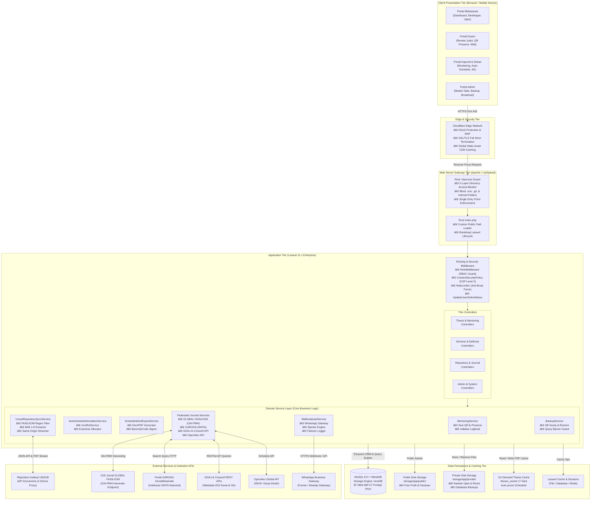
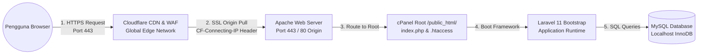
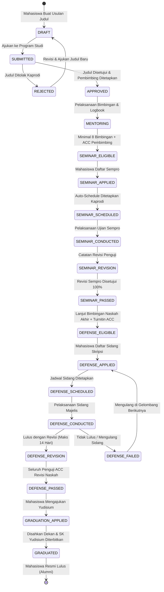
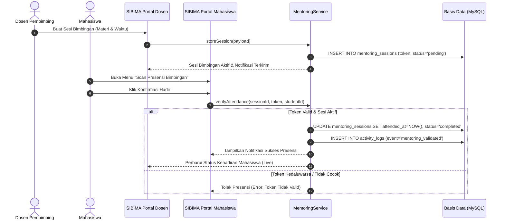
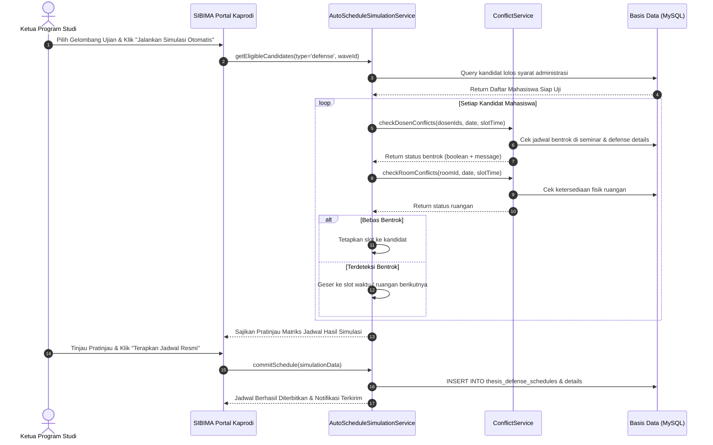
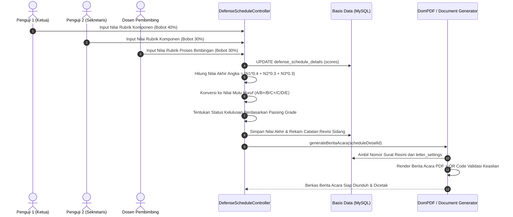
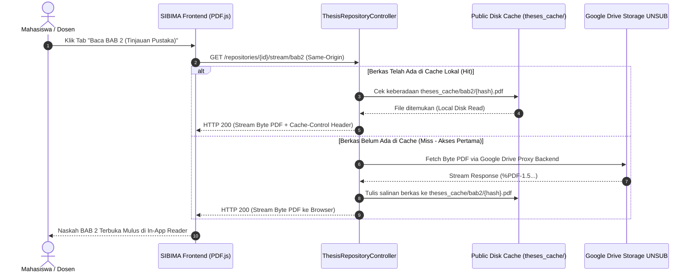
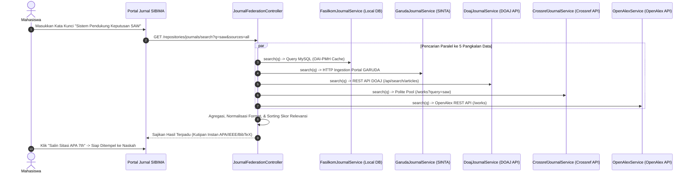
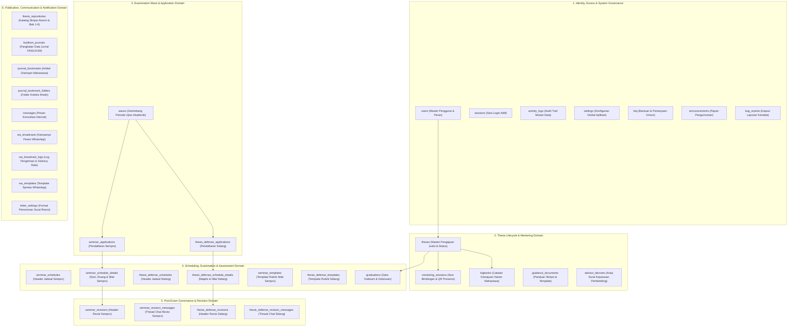
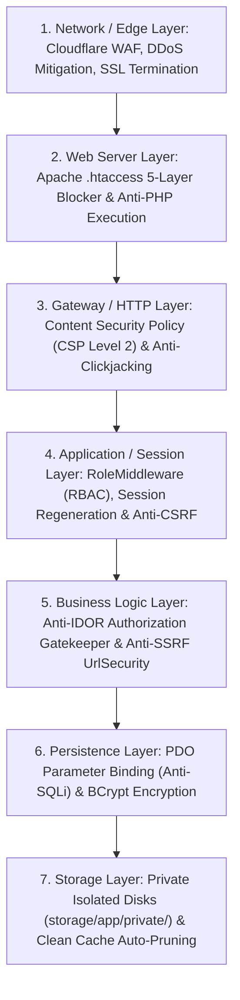

# DOKUMEN ARSITEKTUR SISTEM INFORMASI BIMBINGAN TUGAS AKHIR (SIBIMA)
## FAKULTAS ILMU KOMPUTER — UNIVERSITAS SUBANG (FASILKOM UNSUB)

| Metadata Dokumen | Deskripsi Spesifikasi |
| :--- | :--- |
| **Nama Sistem** | SIBIMA (Sistem Informasi Bimbingan Tugas Akhir Mahasiswa) |
| **Institusi** | Program Studi Sistem Informasi & Informatika, Fakultas Ilmu Komputer, Universitas Subang |
| **Versi Dokumen** | 3.0 (Enterprise Architecture, Cloudflare Hybrid & Federated Library) |
| **Standar Acuan** | IEEE 1471 / ISO/IEC/IEEE 42010 (*Software Architecture Description*) |
| **Basis Framework** | Laravel 11.x (PHP 8.2+) • Tailwind CSS v3.4 • Alpine.js • Vite |
| **Basis Data** | MySQL 8.0+ / MariaDB 10.4+ (Engine: InnoDB, 35 Tabel, 57 Foreign Keys) |
| **Klasifikasi Dokumen** | Dokumen Teknis Rekayasa Perangkat Lunak (*Software Architecture Document - SAD*) |
| **Tanggal Pembaruan** | 29 Oktober 2026 |
| **Status Dokumen** | Disetujui & Diterapkan Penuh (*Production Live*) |

---

## 1. PENDAHULUAN & RUANG LINGKUP SISTEM

### 1.1 Konteks Bisnis & Latar Belakang Akademik
Sistem Informasi Bimbingan Mahasiswa (**SIBIMA**) adalah platform sentral tata kelola siklus hidup akademik Tugas Akhir dan Skripsi pada Fakultas Ilmu Komputer (FASILKOM) Universitas Subang. SIBIMA mengotomatisasi rantai proses administrasi dan akademik secara menyeluruh—mulai dari pengajuan judul, alokasi dosen pembimbing, sesi bimbingan terverifikasi digital ber-QR Code tanda tangan resmi, logbook kemajuan berkas bab, pendaftaran ujian seminar proposal, pelaksanaan seminar, pencatatan revisi bertingkat, pendaftaran sidang skripsi, pelaksanaan sidang dewan penguji, penuntasan revisi sidang, yudisium kelulusan, penomoran Berita Acara resmi, penerbitan Surat Keputusan (SK) Dekan, hingga katalog repositori digital karya ilmiah alumni dan federasi pencarian jurnal internasional.

Sebelum implementasi SIBIMA, proses tugas akhir menghadapi sejumlah kendala klasik perguruan tinggi:
1. **Pencatatan Manual yang Terfragmentasi**: Buku bimbingan kertas rentan hilang, rusak, atau dipalsukan parafnya.
2. **Keterbatasan Visibilitas Progres Mahasiswa**: Ketua Program Studi dan Dekan kesulitan memantau masa studi mahasiswa dan mendeteksi mahasiswa pasif sebelum masa studinya kritis (*drop out*).
3. **Konflik Jadwal Dewan Penguji**: Penjadwalan seminar proposal dan sidang skripsi sering mengalami bentrok ruangan dan jadwal dosen penguji yang menguji di waktu yang sama.
4. **Isolasi Repositori Karya Ilmiah**: Mahasiswa kesulitan mencari referensi skripsi terdahulu karena naskah tersimpan terpisah pada arsip fisik perpustakaan atau repositori institusi yang sulit ditelusuri per bab.

SIBIMA hadir sebagai solusi enterprise terintegrasi yang menghadirkan transparansi, akuntabilitas, efisiensi operasional, dan kepatuhan penuh terhadap standar mutu perguruan tinggi.

### 1.2 Tujuan Arsitektur Sistem
Arsitektur SIBIMA dirancang untuk mencapai sasaran rekayasa berikut:
1. **Integritas & Akurasi Data Transaksional**: Menjamin seluruh tahapan akademik terlindungi oleh integritas referensial basis data ketat (3NF, ACID Compliance) tanpa anomali data.
2. **Keandalan & Skalabilitas Tinggi**: Menjamin sistem beroperasi stabil di lingkungan *Shared Hosting* berbiaya efisien maupun *VPS Dedicated*, diperkuat oleh jaringan *Edge CDN* Cloudflare untuk menahan beban lonjakan akses pada masa pendaftaran ujian.
3. **Otomatisasi Penjadwalan & Konflik Nol**: Mengurangi beban kerja staf akademik melalui algoritma simulasi penjadwalan cerdas (*AutoSchedule Simulation Engine*) yang mendeteksi tabrakan waktu dosen dan ruangan secara *real-time*.
4. **Keamanan & Pertahanan Berlapis (*Defense-in-Depth*)**: Mengamankan berkas privat naskah mahasiswa dari akses ilegal (*Anti-IDOR*), mencegah injeksi web (*Anti-SQLi*, *Anti-XSS*, *Anti-CSRF*, *CSP Level 2*), dan memproteksi endpoint eksternal dari eksploitasi *SSRF*.
5. **Aksesibilitas & Pengalaman Pengguna Enterprise**: Menyajikan antarmuka *Clean Enterprise SaaS* yang responsif, mendukung *Light & Dark Mode* dengan kontras WCAG AA, serta dilengkapi penampil naskah digital langsung (*In-App PDF Reader*) berbasis *same-origin streaming*.

### 1.3 Ruang Lingkup Sistem & Profil Pemangku Kepentingan (*Stakeholders*)
SIBIMA melayani 6 peran pemangku kepentingan (*roles*) dengan wewenang yang terisolasi melalui mekanisme *Role-Based Access Control* (RBAC):

| Aktor / Peran | Deskripsi Tanggung Jawab & Hak Akses Utama |
| :--- | :--- |
| **Mahasiswa** | Mengajukan judul tugas akhir, mengisi logbook harian, membuat janji bimbingan, melakukan konfirmasi kehadiran bimbingan digital, mendaftar Seminar Proposal & Sidang Skripsi, mengunggah revisi naskah, mengajukan yudisium, serta menelusuri katalog pustaka dan jurnal. |
| **Dosen Pembimbing** | Menyetujui/menolak pengajuan judul, mengelola jadwal bimbingan tatap muka/online, memvalidasi kehadiran dan menyelesaikan sesi bimbingan, memberikan paraf digital & catatan perbaikan bab, menyetujui kelayakan pendaftaran ujian, serta memvalidasi revisi akhir naskah. |
| **Dewan Penguji** | Mengakses berkas naskah ujian mahasiswa yang ditugaskan, mengisi lembar rubrik penilaian objektif per komponen, memberikan catatan revisi pada form berita acara, dan memvalidasi penuntasan revisi pasca-sidang. |
| **Ketua Program Studi (Kaprodi)** | Memvalidasi dan mendisposisikan usulan judul & pembimbing, memantau matriks beban bimbingan dosen, menjalankan simulasi auto-scheduling jadwal ujian, memvalidasi hasil kelulusan sidang, serta memantau analitik KPI masa studi mahasiswa. |
| **Dekan / Pimpinan Fakultas** | Memantau dasbor eksekutif perkembangan akademik fakultas, menandatangani Surat Keputusan (SK) Dosen Pembimbing dan SK Dewan Penguji, serta mengesahkan kelulusan yudisium mahasiswa. |
| **Superadmin / Staf Tata Usaha** | Mengelola master data (pengguna, gelombang pendaftaran, template surat, ruang sidang), memelihara cadangan sistem (*backup/restore*), mengawasi *activity logs*, menyiarkan pengumuman/WhatsApp broadcast massal, dan menjalankan sinkronisasi repositori. |

### 1.4 Prinsip-Prinsip Arsitektur Perangkat Lunak
Pengembangan SIBIMA berpedoman pada prinsip-prinsip rekayasa modern:
* **Separation of Concerns (SoC)**: Pemisahan tegas antara logika presentasi (Blade), logika perutean HTTP (Controller), logika bisnis domain (Service Layer), pemodelan entitas (Eloquent ORM), dan infrastruktur basis data (Migrations).
* **Thin Controller, Rich Service Layer**: Controller hanya bertanggung jawab atas validasi request dan format response, sedangkan seluruh kalkulasi bisnis, orkestrasi transaksi, dan integrasi pihak ketiga diisolasi ke dalam *Dedicated Service Classes*.
* **Defense-in-Depth**: Keamanan diterapkan di setiap lapisan—mulai dari konfigurasi web server (`.htaccess`), perisai reverse proxy (Cloudflare), middleware framework (Auth, Role, CSP, Rate Limiter), sanitasi model (Eloquent Parameter Binding), hingga isolasi penyimpanan fisik file (`storage/app/private`).
* **Zero-Downtime Deployment**: Pembaruan sistem dan skema basis data di server produksi dapat dilakukan tanpa mematikan layanan melalui *webhook* `/clear-cache?pull=1` berkeamanan tinggi.
* **Resilient Graceful Degradation**: Kegagalan pada layanan pihak ketiga (misalnya WhatsApp Gateway down atau API Repositori luar lambat) ditangani secara anggun dengan mekanisme *Circuit Breaker*, *Failover Logging*, dan *Fallback Direct Stream*.

---

## 2. ARSITEKTUR TINGKAT TINGGI (HIGH-LEVEL ARCHITECTURE)

### 2.1 Gambaran Arsitektur Sistem Menyeluruh
Diagram kontainer tingkat tinggi berikut menggambarkan arsitektur sistem SIBIMA secara terintegrasi:



### 2.2 Pola Arsitektur: Modern Monolith MVC dengan Service Layer
SIBIMA mengadopsi pola **Modern Modular Monolith**. Pola ini dipilih karena memberikan efisiensi operasional tertinggi pada skala perguruan tinggi:
1. **Kecepatan Deployment & Pemeliharaan Mudah**: Seluruh modul berada dalam satu kesatuan kode terpadu yang dapat diuji secara menyeluruh (*monolithic testability*) tanpa kompleksitas jaringan *microservices* (*network latency*, *distributed tracing*, *eventual consistency*).
2. **Keterkaitan Data Kuat (*Strong Consistency*)**: Siklus tugas akhir menuntut konsistensi transaksi data ACID yang ketat (misalnya, mahasiswa tidak boleh dijadwalkan sidang sebelum revisi seminar proposal disetujui 100% oleh pembimbing).
3. **Pemisahan Domain yang Tegas (*Service Layer Isolation*)**: Meskipun monolitik, logika bisnis tidak bercampur di Controller atau Model, melainkan didelegasikan ke *Domain Services*. Jika di masa depan salah satu komponen (seperti WhatsApp Broadcast atau Penjadwalan AI) perlu dipisahkan menjadi *microservice*, pemisahannya dapat dilakukan secara instan tanpa merombak arsitektur utama.

### 2.3 Dekomposisi 7 Lapisan Sistem (*Layered Architecture*)

| No | Lapisan (*Layer*) | Komponen Teknis | Tanggung Jawab Utama |
| :---: | :--- | :--- | :--- |
| **1** | **Client / Presentation Layer** | Blade Templates, Tailwind CSS v3.4, Alpine.js, Inter Fonts, PDF.js, Chart.js | Merender antarmuka pengguna responsif, menangani interaksi lokal (modal, dropdown, filter instan, pratinjau naskah PDF), dan memvalidasi form sisi klien. |
| **2** | **Edge & Network Security Layer** | Cloudflare Edge Network (WAF, DNS, SSL/TLS, DDoS Guard) | Menyaring trafik berbahaya, terminasi SSL HTTPS global, menyajikan aset statis (*CSS, JS, Fonts*) dari cache CDN tepi, dan meneruskan IP pengunjung asli via header `CF-Connecting-IP`. |
| **3** | **Gateway & Web Server Layer** | Apache / LiteSpeed, `.htaccess`, root `index.php` | Menyaring akses berkas sensitif, mencegah eksekusi PHP pada subfolder, merutekan seluruh HTTP request ke front-controller Laravel `index.php`, dan mengonfigurasi public path lingkungan shared hosting. |
| **4** | **Routing & Security Middleware Layer** | Laravel Routing, `RoleMiddleware`, `ContentSecurityPolicy`, `UpdateUserOnlineStatus`, `ThrottleRequests` | Memverifikasi sesi otentikasi, memvalidasi hak akses peran (RBAC), menerapkan proteksi CSP Level 2, mencegah serangan *brute force*, dan mencatat status online pengguna secara *real-time*. |
| **5** | **Application & Domain Service Layer** | Thin Controllers, Domain Services (`MentoringService`, `AutoScheduleSimulationService`, dll.), Form Requests, Policies | Menjalankan logika bisnis inti perguruan tinggi, orkestrasi alur data, validasi aturan akademik, kalkulasi nilai ujian, simulasi bentrok jadwal, dan pembuatan dokumen resmi. |
| **6** | **Data Persistence & Cache Layer** | MySQL 8.0+ / MariaDB 10.4+ (InnoDB Engine), File/Redis Cache, Local Disk Storages | Menyimpan seluruh data relasional dengan integritas kunci asing ketat, mengelola cache naskah PDF sementara (7 hari), dan mengisolasi berkas naskah rahasia di penyimpanan privat. |
| **7** | **External Integration Layer** | Guzzle HTTP Client, OAI-PMH XML Parser, REST API DOAJ/Crossref/OpenAlex, WhatsApp Webhook | Mengintegrasikan repositori skripsi eksternal, memanen metadata karya ilmiah global, dan mengirimkan notifikasi instan ke gawai pengguna. |

---

## 3. ARSITEKTUR INFRASTRUKTUR, JARINGAN & DEPLOYMENT

### 3.1 Lingkungan Hosting Hybrid
SIBIMA dirancang khusus agar dapat beroperasi secara optimal pada arsitektur **Hybrid Shared Hosting / VPS** di balik jaringan **Cloudflare Edge Proxy**. Arsitektur ini memberikan rasio efisiensi biaya terhadap performa terbaik bagi institusi akademik:



### 3.2 Alur Routing Web Server Khusus Shared Hosting
Pada lingkungan shared hosting standar (cPanel / DirectAdmin), dokumen root domain seringkali diarahkan langsung ke direktori utama repositori (`public_html/`) bukan ke subfolder `public/`. SIBIMA mengatasi batasan ini secara elegan melalui konfigurasi root `index.php` dan pengerasan `.htaccess`:

1. **Bootstrap Jalur Publik Dinamis ([`index.php`](file:///c:/Users/Bagus%20Ali%20Akbar/Herd/sibima/index.php))**:
   ```php
   // Daftarkan autoload dan inisialisasi aplikasi
   require __DIR__.'/vendor/autoload.php';
   $app = require_once __DIR__.'/bootstrap/app.php';

   // Tetapkan root proyek saat ini sebagai public path aktif
   $app->usePublicPath(__DIR__);
   $app->handleRequest(Request::capture());
   ```
2. **Pengerasan Akses 5-Lapisan ([`.htaccess`](file:///c:/Users/Bagus%20Ali%20Akbar/Herd/sibima/.htaccess))**:
   * **Lapisan 1**: Memblokir seluruh berkas dan folder tersembunyi yang diawali tanda titik (`.env`, `.git`, `.agents`, dll.) dengan kode status HTTP `403 Forbidden`.
   * **Lapisan 2**: Memblokir akses langsung browser ke folder internal Laravel (`app`, `bootstrap`, `config`, `database`, `docs`, `resources`, `routes`, `vendor`), sekaligus mengizinkan akses publik hanya ke `storage/app/public/`.
   * **Lapisan 3**: Melarang pengunduhan langsung berkas konfigurasi proyek (`artisan`, `composer.json`, `package.json`, `vite.config.js`).
   * **Lapisan 4**: Memblokir berkas dengan ekstensi rahasia (`.env`, `.sql`, `.sqlite`, `.gz`, `.log`, `.bak`, `.yml`).
   * **Lapisan 5**: Melarang eksekusi file PHP manapun di seluruh subfolder (hanya root `index.php` yang diizinkan dieksekusi oleh web server).

### 3.3 Konfigurasi SSL & Trusted Proxies Cloudflare
Karena server origin SIBIMA berada di balik Cloudflare Reverse Proxy, alamat IP asal yang terbaca oleh web server Apache secara default adalah alamat IP node Cloudflare, bukan alamat IP mahasiswa/dosen. Jika tidak dikonfigurasi, hal ini dapat merusak fitur *Audit Trail*, *Rate Limiter*, dan *Session Security*.

SIBIMA menyelesaikan masalah ini pada [`bootstrap/app.php`](file:///c:/Users/Bagus%20Ali%20Akbar/Herd/sibima/bootstrap/app.php):
```php
$trustedProxies = env('TRUSTED_PROXIES', '*');
$middleware->trustProxies(
    at: $trustedProxies === '*'
        ? '*'
        : array_values(array_filter(array_map('trim', explode(',', (string) $trustedProxies))))
);
```
Dengan konfigurasi ini, Laravel secara otomatis:
* Mempercayai header `CF-Connecting-IP` dan `X-Forwarded-For` untuk merekam alamat IP nyata pengguna pada tabel `activity_logs`.
* Mendeteksi header `X-Forwarded-Proto: https` sehingga URL yang dihasilkan oleh helper `url()`, `route()`, dan `asset()` selalu berprotokol `https://` secara konsisten tanpa menimbulkan masalah *Mixed Content*.

### 3.4 Mekanisme Zero-Downtime Cache Clearing & Live Auto-Pull Hook
Untuk memfasilitasi pembaruan kode secara instan langsung dari repositori GitHub (`main` branch) ke server produksi tanpa perlu membuka sesi SSH terminal cPanel secara manual, SIBIMA menyediakan endpoint pemeliharaan berkeamanan tinggi pada rute `/clear-cache`:

* **Otentikasi Berlapis**: Hanya dapat diakses oleh pengguna dengan role `admin` yang sedang login, ATAU melalui pemanggilan webhook eksternal dengan query parameter `?key={DEPLOY_SECRET_KEY}` yang diverifikasi menggunakan perbandingan hash kebal waktu (*timing-attack safe*) `hash_equals()`.
* **Eksekusi Penarikan Kode Otomatis (`?pull=1`)**:
  Jika parameter `pull=1` disertakan, server origin secara otomatis mengeksekusi perintah `git pull origin main` di latar belakang.
* **Orkestrasi Pembersihan & Optimasi**:
  Setelah kode ditarik, endpoint secara otomatis mengeksekusi rantai perintah Artisan:
  ```bash
  php artisan view:clear
  php artisan route:clear
  php artisan config:clear
  php artisan cache:clear
  php artisan migrate --force
  ```
* **Proteksi Rate Limiting**: Rute ini dilindungi middleware `throttle:5,1` (maksimal 5 request per menit) untuk mencegah serangan *Denial of Service (DoS)* terhadap sumber daya komputasi server.

---

## 4. ARSITEKTUR MODUL & SUBSISTEM APLIKASI

SIBIMA terdiri dari 10 subsistem aplikasi modular yang saling berinteraksi:

### 4.1 Sub-sistem Otentikasi, Profil & RBAC
* **Implementasi**: [`app/Http/Middleware/RoleMiddleware.php`](file:///c:/Users/Bagus%20Ali%20Akbar/Herd/sibima/app/Http/Middleware/RoleMiddleware.php), [`app/Models/User.php`](file:///c:/Users/Bagus%20Ali%20Akbar/Herd/sibima/app/Models/User.php).
* **Fitur Utama**:
  * Otentikasi berbasis sesi aman dengan proteksi regenerasi Session ID pada setiap kali login.
  * Hierarki wewenang berbasis peran (`mahasiswa`, `dosen`, `kaprodi`, `dekan`, `admin`).
  * Pelacakan status keaktifan pengguna secara waktu nyata (*real-time presence*) melalui middleware [`UpdateUserOnlineStatus.php`](file:///c:/Users/Bagus%20Ali%20Akbar/Herd/sibima/app/Http/Middleware/UpdateUserOnlineStatus.php) yang memperbarui kolom `last_seen_at` setiap 2 menit.
  * Manajemen profil mandiri, penggantian kata sandi dengan verifikasi enkripsi `bcrypt`, dan unggah foto profil tersanitasi.

### 4.2 Sub-sistem Pengajuan Judul & Bimbingan Tugas Akhir
* **Implementasi**: [`app/Services/MentoringService.php`](file:///c:/Users/Bagus%20Ali%20Akbar/Herd/sibima/app/Services/MentoringService.php), [`app/Services/ThesisService.php`](file:///c:/Users/Bagus%20Ali%20Akbar/Herd/sibima/app/Services/ThesisService.php), [`app/Models/Thesis.php`](file:///c:/Users/Bagus%20Ali%20Akbar/Herd/sibima/app/Models/Thesis.php), [`app/Models/MentoringSession.php`](file:///c:/Users/Bagus%20Ali%20Akbar/Herd/sibima/app/Models/MentoringSession.php).
* **Fitur Utama**:
  * **Pengajuan Judul Fleksibel**: Mahasiswa dapat mengajukan hingga 3 alternatif judul tugas akhir disertai rumusan masalah dan berkas proposal awal.
  * **Verifikasi Kuota & Disposisi Pembimbing**: Kaprodi mengevaluasi beban aktif dosen pembimbing (maksimal kuota per dosen) sebelum menyetujui dan menetapkan Pembimbing Utama (Pembimbing 1) dan Pembimbing Pendamping (Pembimbing 2).
  * **Sesi Bimbingan Berbasis QR-Code**:
    1. Dosen membuat sesi bimbingan (mandiri atau kelompok).
    2. Sistem menghasilkan token acak 32 karakter bertanda tangan kriptografis yang ditampilkan sebagai QR Code di layar gawai dosen.
    3. Mahasiswa melakukan konfirmasi kehadiran (Hadir/Izin), lalu dosen memvalidasi pelaksanaan bimbingan dan menandai status sesi Selesai (Completed).
    4. Sistem mencatat koordinat waktu presensi, memastikan kehadiran fisik/tatap muka tanpa manipulasi tanda tangan.
  * **Logbook Kemajuan Harian**: Mahasiswa mencatat aktivitas penelitian harian, kendala yang dihadapi, dan progres penulisan bab (BAB I s/d BAB VI).
  * **Pencetakan Kartu Bimbingan Digital**: Menghasilkan lembar kartu bimbingan resmi berformat PDF lengkap dengan paraf digital dan riwayat tanggal bimbingan yang telah disetujui.

### 4.3 Sub-sistem Manajemen Seminar Proposal (Sempro)
* **Implementasi**: [`app/Models/SeminarApplication.php`](file:///c:/Users/Bagus%20Ali%20Akbar/Herd/sibima/app/Models/SeminarApplication.php), [`app/Models/SeminarSchedule.php`](file:///c:/Users/Bagus%20Ali%20Akbar/Herd/sibima/app/Models/SeminarSchedule.php), [`app/Models/SeminarRevision.php`](file:///c:/Users/Bagus%20Ali%20Akbar/Herd/sibima/app/Models/SeminarRevision.php).
* **Fitur Utama**:
  * Pendaftaran seminar proposal mahasiswa yang divalidasi syarat kelayakannya (minimal 8 sesi bimbingan tervalidasi dan persetujuan kedua dosen pembimbing).
  * Pengelompokan pendaftaran ke dalam gelombang akademik aktif (`waves`).
  * Penjadwalan sidang proposal dan pembentukan susunan dewan penguji (Penguji 1, Penguji 2, dan Pembimbing).
  * Formulir penilaian online dengan kalkulasi bobot otomatis: Nilai Angka (0–100) dan konversi Nilai Huruf mutu (A, B+, B, C+, C, D, E).
  * Pencatatan Berita Acara Seminar Proposal otomatis dengan nomor surat terstandar.
  * Siklus revisi proposal dua arah (*bidirectional messaging thread*) dengan tenggat waktu maksimal penyelesaian (14 hari kerja).

### 4.4 Sub-sistem Manajemen Sidang Skripsi (Sidang Akhir)
* **Implementasi**: [`app/Models/ThesisDefenseApplication.php`](file:///c:/Users/Bagus%20Ali%20Akbar/Herd/sibima/app/Models/ThesisDefenseApplication.php), [`app/Models/ThesisDefenseSchedule.php`](file:///c:/Users/Bagus%20Ali%20Akbar/Herd/sibima/app/Models/ThesisDefenseSchedule.php), [`app/Models/ThesisDefenseRevision.php`](file:///c:/Users/Bagus%20Ali%20Akbar/Herd/sibima/app/Models/ThesisDefenseRevision.php), [`app/Models/Graduation.php`](file:///c:/Users/Bagus%20Ali%20Akbar/Herd/sibima/app/Models/Graduation.php).
* **Fitur Utama**:
  * Pendaftaran sidang skripsi dengan verifikasi kelulusan seminar proposal, surat bebas plagiarisme (Turnitin < 25%), transkrip nilai, dan naskah skripsi lengkap.
  * Penugasan majelis sidang dewan penguji (Ketua Sidang, Sekretaris Sidang, Penguji Utama, dan Penguji Pendamping).
  * Penilaian sidang skripsi komprehensif (penguasaan materi, metode penelitian, implementasi perangkat lunak, dan penulisan naskah).
  * Penetapan status kelulusan: *Lulus Murni*, *Lulus dengan Revisi*, atau *Tidak Lulus / Mengulang Sidang*.
  * Pelacakan revisi pasca-sidang hingga 100% tuntas disetujui seluruh penguji sebelum mahasiswa berhak mengajukan yudisium kelulusan.

### 4.5 Sub-sistem Auto-Schedule & Conflict Detection Engine
* **Implementasi**: [`app/Services/AutoScheduleSimulationService.php`](file:///c:/Users/Bagus%20Ali%20Akbar/Herd/sibima/app/Services/AutoScheduleSimulationService.php), [`app/Services/ConflictService.php`](file:///c:/Users/Bagus%20Ali%20Akbar/Herd/sibima/app/Services/ConflictService.php).
* **Fitur Utama**:
  * **Simulasi Alokasi Cerdas**: Kaprodi dapat menjalankan simulasi pembagian jadwal ujian secara otomatis dalam hitungan detik untuk puluhan kandidat mahasiswa sekaligus.
  * **Deteksi Bentrok Multi-Dimensi (*Conflict Engine*)**:
    1. *Bentrok Dosen*: Memeriksa apakah dosen yang dialokasikan sedang menguji di ruangan lain, menjadi pembimbing di sesi yang bersamaan, atau memiliki batas beban maksimal sidang per hari.
    2. *Bentrok Ruangan*: Memastikan satu ruangan fisik sidang hanya dialokasikan untuk satu sesi ujian pada slot waktu yang sama.
    3. *Bentrok Mahasiswa*: Menghindari penjadwalan ganda pada mahasiswa yang sama.
  * **Visualisasi & Preview Tabrakan**: Jika ditemukan potensi bentrok, sistem menampilkan lencana peringatan (*warning badge*) merah/amber beserta rincian nama kegiatan yang bertabrakan, sebelum jadwal disimpan secara permanen ke basis data.

### 4.6 Sub-sistem Notifikasi & Komunikasi Multi-Saluran
* **Implementasi**: [`app/Services/WhatsAppService.php`](file:///c:/Users/Bagus%20Ali%20Akbar/Herd/sibima/app/Services/WhatsAppService.php), [`app/Services/WaBroadcastService.php`](file:///c:/Users/Bagus%20Ali%20Akbar/Herd/sibima/app/Services/WaBroadcastService.php), [`app/Services/ChatService.php`](file:///c:/Users/Bagus%20Ali%20Akbar/Herd/sibima/app/Services/ChatService.php).
* **Fitur Utama**:
  * **In-App Direct Consultation Chat**: Komunikasi pesan teks langsung antara mahasiswa dan dosen pembimbing di dalam aplikasi terkait revisi bab naskah.
  * **WhatsApp Gateway Notification Engine**:
    * Pengiriman pesan pengingat jadwal ujian (H-1 dan H-0) ke nomor WhatsApp mahasiswa dan dosen penguji.
    * Notifikasi status: persetujuan judul, penerbitan jadwal sidang, dan pengingat batas waktu revisi.
    * **Spintax Engine**: Mengacak variasi kata dalam pesan broadcast massal untuk mencegah nomor gateway terdeteksi sebagai spam oleh algoritma WhatsApp.
    * **Filter Audiens Tertarget**: Admin/Kaprodi dapat menyiarkan pesan ke segmen khusus, seperti: *Mahasiswa Belum Seminar*, *Mahasiswa Bimbingan Pasif (>30 hari tidak bimbingan)*, dan *Mahasiswa Masa Studi Kritis*.

### 4.7 Sub-sistem Ekspor Dokumen & Pelaporan Dinamis
* **Implementasi**: [`app/Services/ScheduleWordExportService.php`](file:///c:/Users/Bagus%20Ali%20Akbar/Herd/sibima/app/Services/ScheduleWordExportService.php), DomPDF Integration.
* **Fitur Utama**:
  * **Ekspor Microsoft Word (`.docx`) Resmi**:
    * Menghasilkan dokumen rekapitulasi jadwal seminar dan sidang lengkap dengan kop surat FASILKOM UNSUB, format tabel baku, serta tanda tangan digital Kaprodi.
    * Memanfaatkan library `PhpOffice\PhpWord` dan `BaconQrCode` untuk menanamkan kode QR validasi keaslian dokumen pada berkas DOCX.
  * **Penerbitan Surat Keputusan (SK) Dekan & Berita Acara PDF**:
    * Mengompilasi Berita Acara Ujian, Lembar Pengesahan Naskah, SK Pembimbing, dan SK Penguji secara otomatis dengan penomoran surat dinamis dari tabel `letter_settings`.
    * Memasukkan stempel digital dan QR-Code verifikasi integritas berkas.

### 4.8 Sub-sistem Katalog Pustaka Skripsi Digital & On-Demand PDF Streaming
* **Implementasi**: [`app/Services/UnsubRepositorySyncService.php`](file:///c:/Users/Bagus%20Ali%20Akbar/Herd/sibima/app/Services/UnsubRepositorySyncService.php), [`app/Console/Commands/CleanThesisCacheCommand.php`](file:///c:/Users/Bagus%20Ali%20Akbar/Herd/sibima/app/Console/Commands/CleanThesisCacheCommand.php), [`app/Http/Controllers/ThesisRepositoryController.php`](file:///c:/Users/Bagus%20Ali%20Akbar/Herd/sibima/app/Http/Controllers/ThesisRepositoryController.php).
* **Fitur Utama**:
  * **Sinkronisasi Multi-Sumber Cerdas**: Mengumpulkan data skripsi alumni dari Web FASILKOM UNSUB (judul, mahasiswa, pembimbing) dan Repositori Institusi UNSUB (abstrak dan tautan Google Drive PDF BAB 1–6).
  * **Whitelist Regex FASILKOM**: Menyaring secara ketat ribuan karya ilmiah dari seluruh universitas agar hanya skripsi Program Studi Sistem Informasi dan Informatika yang dimasukkan ke basis data SIBIMA.
  * **Ekstraksi Bab Otomatis**: Mendeteksi pola nama berkas PDF bab yang bervariasi (`BAB 1.pdf`, `bab_i.pdf`, `bab-01-revisi.pdf`, `BAB VI.pdf`) dan memetakannya ke kolom `file_path` s/d `file_path_bab6`.
  * **On-Demand Streaming & Public Disk Cache (7 Hari)**: Naskah PDF diambil secara *real-time* ke server UNSUB saat pertama kali dibuka, disimpan di cache lokal `theses_cache/` selama 7 hari untuk akses instan berikutnya, dan dibersihkan secara otomatis setiap minggu oleh cron job Artisan `repositories:clean-cache --days=7`.
  * **In-App Multi-Chapter PDF Reader**: Membaca naskah per bab secara terisolasi menggunakan mesin PDF.js dengan dukungan zoom, rotasi, layar penuh (*fullscreen*), serta bypass pembatasan CORS browser.

### 4.9 Sub-sistem Federasi Pencarian Jurnal Ilmiah Multi-Sumber
* **Implementasi**: [`app/Services/FasilkomJournalService.php`](file:///c:/Users/Bagus%20Ali%20Akbar/Herd/sibima/app/Services/FasilkomJournalService.php), [`app/Services/GarudaJournalService.php`](file:///c:/Users/Bagus%20Ali%20Akbar/Herd/sibima/app/Services/GarudaJournalService.php), [`app/Services/DoajJournalService.php`](file:///c:/Users/Bagus%20Ali%20Akbar/Herd/sibima/app/Services/DoajJournalService.php), [`app/Services/CrossrefJournalService.php`](file:///c:/Users/Bagus%20Ali%20Akbar/Herd/sibima/app/Services/CrossrefJournalService.php), [`app/Services/OpenAlexService.php`](file:///c:/Users/Bagus%20Ali%20Akbar/Herd/sibima/app/Services/OpenAlexService.php).
* **Fitur Utama**:
  * Menghubungkan mahasiswa tingkat akhir dengan 5 pangkalan data jurnal ilmiah terkemuka dalam satu portal pencarian tunggal:
    1. **Jurnal GLOBAL FASILKOM UNSUB**: Dipanen melalui protokol OAI-PMH Harvester (`oai_dc`) dan disimpan di basis data lokal.
    2. **GARUDA (Garba Rujukan Digital)**: Portal publikasi ilmiah terakreditasi SINTA Kemdiktisaintek Republik Indonesia.
    3. **DOAJ (Directory of Open Access Journals)**: Indeks global jurnal *peer-reviewed* akses terbuka murni.
    4. **Crossref REST API**: Registri DOI resmi dunia dengan metrik jumlah sitasi naskah (*cited-by count*).
    5. **OpenAlex Global**: Pangkalan data bibliografi ilmiah terlengkap di dunia (250+ juta karya) dengan rekonstruksi abstrak *inverted-index*.
  * **Generator Sitasi Otomatis 1-Klik**: Menghasilkan kutipan sitasi instan dalam format **APA 7th Edition**, **IEEE**, dan **BibTeX** untuk memudahkan penyusunan Daftar Pustaka skripsi.
  * **Manajemen Bookmark & Folder**: Mahasiswa dapat menyimpan artikel rujukan ke dalam folder pustaka pribadi di SIBIMA.

### 4.10 Sub-sistem Pemeliharaan, Backup & Audit Trail
* **Implementasi**: [`app/Services/BackupService.php`](file:///c:/Users/Bagus%20Ali%20Akbar/Herd/sibima/app/Services/BackupService.php), [`app/Models/ActivityLog.php`](file:///c:/Users/Bagus%20Ali%20Akbar/Herd/sibima/app/Models/ActivityLog.php), [`app/Models/BugReport.php`](file:///c:/Users/Bagus%20Ali%20Akbar/Herd/sibima/app/Models/BugReport.php).
* **Fitur Utama**:
  * **Pencadangan Basis Data & Berkas Sistem**: Menghasilkan berkas arsip dump SQL terkompresi `.sql.gz` dan cadangan file ke direktori privat `storage/app/private/backups`.
  * **Query Barrier Guardrail**: Mengamankan proses restorasi basis data dari injeksi kueri perusak atau kegagalan transaksi tak terduga.
  * **Audit Log Komprehensif**: Mencatat seluruh aktivitas mutasi data penting (login, persetujuan judul, pengubahan nilai, penjadwalan ujian) lengkap dengan alamat IP, user agent, dan timestamp.
  * **Widget Kapsul Pelaporan Kendala (*Bug & Feature Request*)**: Memungkinkan mahasiswa dan dosen mengirimkan umpan balik langsung beserta tangkapan layar untuk penanganan cepat oleh tim pengembang.

---

## 5. ARSITEKTUR ALUR DATA & SEQUENCE DIAGRAM

### 5.1 State Machine Siklus Hidup Tugas Akhir Mahasiswa
Siklus hidup tugas akhir mahasiswa dari awal pengajuan hingga yudisium kelulusan dimodelkan sebagai mesin status (*state machine*) berikut:



### 5.2 Alur Sesi Bimbingan & Validasi Presensi QR Code
Proses pembuktian kehadiran sesi bimbingan menggunakan QR Code dinamis:



### 5.3 Alur Simulasi Penjadwalan Otomatis & Deteksi Bentrok
Proses simulasi jadwal ujian bebas tabrakan oleh Kaprodi:



### 5.4 Alur Penilaian Ujian & Penerbitan Berita Acara Otomatis
Alur pelaksanaan sidang komprehensif hingga penerbitan Berita Acara:



### 5.5 Alur Sinkronisasi & On-Demand Streaming Repositori PDF
Alur pengiriman berkas naskah per bab tanpa membebani disk penyimpanan lokal:



### 5.6 Alur Federasi Pencarian Multi-Jurnal Ilmiah
Alur pencarian paralel federasi jurnal bereputasi:



---

## 6. ARSITEKTUR BASIS DATA & INTEGRITAS DATA

### 6.1 Ringkasan Skema Basis Data
Basis data SIBIMA dibangun di atas mesin **MySQL 8.0+ / MariaDB 10.4+** dengan storage engine **InnoDB**. Seluruh skema telah dinormalisasi hingga **Third Normal Form (3NF)** guna meniadakan anomali penyisipan (*insert*), pembaharuan (*update*), maupun penghapusan (*delete*).

* **Total Entitas Tabel**: **35 Tabel Operasional**
* **Total Foreign Key Aktif**: **57 Kunci Asing Terdaftar**
* **Karakter Set (Charset)**: `utf8mb4`
* **Collation**: `utf8mb4_unicode_ci` (dukungan penuh teks multibahasa dan simbol matematika)

### 6.2 Klasterisasi 6 Domain Data SIBIMA



### 6.3 Strategi Pengindeksan & Optimasi Kueri (Anti-N+1 Query)
SIBIMA menerapkan strategi optimasi kueri tingkat tinggi:
1. **Pengindeksan Kunci Asing & Komposit**: Seluruh kolom *Foreign Key* dan kolom yang sering dicari dalam klausul `WHERE` (seperti `status`, `wave_id`, `date`, `attended_at`) memiliki indeks B-Tree khusus.
2. **Eager Loading Terstruktur**: Menghilangkan masalah *N+1 Query Problem* pada seluruh pemanggilan relasi Eloquent di Controller:
   ```php
   // Contoh optimasi eager loading pada daftar tugas akhir
   $theses = Thesis::with([
       'student:id,name,identifier,email,avatar',
       'supervisor1:id,name,identifier',
       'supervisor2:id,name,identifier',
       'wave:id,title,is_active',
       'seminarScheduleDetail.schedule',
       'thesisDefenseScheduleDetail.schedule'
   ])->paginate(15);
   ```
3. **Paginasi Cerdas**: Semua daftar data dalam tabel menggunakan *chunked pagination* (`paginate(15)`) untuk menjaga konsumsi memori PHP tetap di bawah 32 MB per request.

### 6.4 Mekanisme Backup Database & Query Barrier Guardrail
Modul cadangan SIBIMA diimplementasikan pada [`app/Services/BackupService.php`](file:///c:/Users/Bagus%20Ali%20Akbar/Herd/sibima/app/Services/BackupService.php):
* **Pencadangan Atomik**: Menjalankan *native mysqldump* dengan parameter `--single-transaction --quick --lock-tables=false` agar proses backup tidak mengunci tabel operasional yang sedang digunakan oleh mahasiswa/dosen.
* **Kompresi Gzip**: Berkas dump langsung dikompresi ke `.sql.gz` untuk menghemat hingga 85% kapasitas penyimpanan server.
* **Query Barrier Guardrail pada Restorasi**: Sebelum berkas cadangan dipulihkan ke basis data, sistem memeriksa integritas skrip, menonaktifkan sementara `FOREIGN_KEY_CHECKS=0`, menjalankan pemulihan di dalam transaksi aman, dan mengaktifkan kembali `FOREIGN_KEY_CHECKS=1` setelah seluruh tabel berhasil divalidasi.

---

## 7. ARSITEKTUR KEAMANAN SISTEM (SYSTEM SECURITY ARCHITECTURE)

### 7.1 Model Pertahanan Berlapis (*Defense-in-Depth*)
Keamanan SIBIMA tidak bergantung pada satu pintu pertahanan, melainkan dirancang berlapis:



### 7.2 Proteksi Autentikasi, Brute Force & Session Hijacking
* **Hash Kata Sandi Modern**: Menggunakan algoritma `bcrypt` dengan faktor kerja (*work factor*) 12 yang tahan terhadap serangan *rainbow tables* dan *GPU-accelerated cracking*.
* **Rate Limiting Ketat**: Endpoint login dibatasi maksimal 5 percobaan gagal per menit (`throttle:5,1`). Jika terlampaui, IP diblokir sementara selama 60 detik.
* **Session Fixation Prevention**: Sesi ID diperbarui secara instan pada setiap pergantian status login (`$request->session()->regenerate()`).
* **Proteksi Cookie**: Cookie sesi Laravel dikonfigurasi dengan flag `HttpOnly`, `SameSite=Lax`, dan `Secure` (otomatis aktif di bawah koneksi HTTPS Cloudflare).

### 7.3 Proteksi Data & Akses Berkas Privat (*Anti-IDOR*)
Seluruh berkas naskah seminar, berkas sidang skripsi, dan lampiran revisi disimpan di direktori privat non-publik:
`storage/app/private/`

Akses terhadap berkas ini **TIDAK PERNAH** dapat diakses langsung melalui URL publik browser. Berkas hanya dapat diunduh atau dipratinjau melalui *streaming gatekeeper* yang memverifikasi kepemilikan naskah (*Insecure Direct Object Reference / Anti-IDOR*):
```php
public function downloadNaskah(ThesisDefenseApplication $application)
{
    $user = Auth::user();
    
    // Verifikasi Otorisasi Ketat
    $isOwner = $user->id === $application->thesis->student_id;
    $isPembimbing = in_array($user->id, [$application->thesis->supervisor1_id, $application->thesis->supervisor2_id]);
    $isPenguji = $application->scheduleDetail && in_array($user->id, [
        $application->scheduleDetail->examiner1_id, 
        $application->scheduleDetail->examiner2_id
    ]);
    $isPimpinan = in_array($user->role, ['admin', 'kaprodi', 'dekan']);

    if (!$isOwner && !$isPembimbing && !$isPenguji && !$isPimpinan) {
        abort(403, 'Akses Ditolak: Anda tidak memiliki wewenang untuk membaca naskah ini.');
    }

    return Storage::disk('private')->download($application->file_path);
}
```

### 7.4 Keamanan Input & Anti-Injeksi
* **Anti-SQL Injection**: 100% kueri basis data menggunakan Eloquent ORM atau Query Builder Laravel yang secara inheren mengimplementasikan *Prepared Statements* via PHP Data Objects (PDO). Tidak ada penyusunan kueri SQL melalui konkatenasi string mentah (*raw string concatenation*).
* **Anti-Cross-Site Scripting (Anti-XSS)**: Seluruh output data teks yang dirender pada antarmuka Blade menggunakan kurung kurawal ganda `{{ $var }}` yang secara otomatis memanggil fungsi `htmlspecialchars()` dengan flag `ENT_QUOTES | ENT_SUBSTITUTE | ENT_HTML401` dan encoding `UTF-8`.
* **Anti-CSRF**: Setiap formulir HTML HTTP POST/PUT/DELETE wajib menyertakan token `@csrf` yang divalidasi oleh middleware `VerifyCsrfToken`. Request via AJAX/Fetch API wajib menyertakan header `X-CSRF-TOKEN`.

### 7.5 Anti-SSRF pada Integrasi HTTP Eksternal
Untuk mencegah eksploitasi *Server-Side Request Forgery* (SSRF) saat modul sinkronisasi repositori dan federasi jurnal memanggil URL pihak ketiga, SIBIMA menerapkan validasi keamanan URL:
* Memeriksa skema protokol (hanya mengizinkan `http://` dan `https://`).
* Memfilter alamat IP target menggunakan fungsi filter jaringan: memblokir akses ke alamat loopback (`127.0.0.1`, `localhost`), alamat IP privat RFC1918 (`10.0.0.0/8`, `172.16.0.0/12`, `192.168.0.0/16`), serta endpoint metadata cloud (`169.254.169.254`).

### 7.6 Content Security Policy (CSP Level 2)
SIBIMA mengaktifkan middleware [`ContentSecurityPolicy.php`](file:///c:/Users/Bagus%20Ali%20Akbar/Herd/sibima/app/Http/Middleware/ContentSecurityPolicy.php) yang menyertakan header HTTP keamanan tingkat lanjut:
* `Content-Security-Policy`: Membatasi sumber skrip, frame, dan koneksi hanya ke domain tepercaya (Bunny Fonts, Cloudflare CDN, Google Drive UNSUB Proxy).
* `X-Frame-Options: SAMEORIGIN`: Mencegah serangan *Clickjacking*.
* `X-Content-Type-Options: nosniff`: Mencegah serangan *MIME Sniffing*.
* `Referrer-Policy: strict-origin-when-cross-origin`: Melindungi data sensitif URL referer.

---

## 8. ARSITEKTUR ANTARMUKA PENGGUNA (FRONTEND & DESIGN SYSTEM)

### 8.1 Clean Enterprise SaaS Architecture
Antarmuka pengguna SIBIMA dibangun dengan mengadopsi standar desain **Clean Enterprise SaaS** (mengacu pada standar kelas dunia seperti *Linear* dan *TailwindUI*). Prinsip visual utamanya:
* **Fungsionalitas Tinggi & Kejelasan Data**: Tata letak berorientasi pada kerapian tabel data, hirarki tipografi yang tegas, serta navigasi yang minim friksi.
* **Bebas AI Slop**: Menghindari gradien warna-warni acak (seperti ungu ke pink), bayangan berlebihan, efek neon, atau animasi lambat yang menurunkan produktivitas kerja staf akademik.
* **Ikonografi Monokromatik Murni**: Seluruh ikon menggunakan SVG murni (Heroicons / Lucide SVG), dan melarang keras penggunaan emoji berwarna sebagai ikon antarmuka fungsional.

### 8.2 Sistem Tipografi Terstandarisasi: Inter Enterprise
Berdasarkan keputusan desain resmi SIBIMA, seluruh sistem menggunakan keluarga huruf **Inter** sebagai standar tipografi tunggal:
* **Distribusi CDN Cepat**: Dimuat melalui CDN Bunny Fonts dengan bobot lengkap (300 Light, 400 Regular, 500 Medium, 600 SemiBold, 700 Bold, dan 800 ExtraBold) dengan mode `display=swap`.
* **Sub-Pixel Antialiasing**: Dikonfigurasi global pada CSS:
  ```css
  @layer base {
      html, body {
          font-family: 'Inter', -apple-system, BlinkMacSystemFont, 'Segoe UI', Roboto, sans-serif;
          -webkit-font-smoothing: antialiased;
          -moz-osx-font-smoothing: grayscale;
      }
      table, .tabular-nums {
          font-variant-numeric: tabular-nums;
      }
  }
  ```
* **Tabular Numbers Alignment (`font-variant-numeric: tabular-nums`)**: Menjamin digit angka pada kolom **NPM**, **NIDN**, tanggal ujian, dan angka nilai akademik selalu sejajar secara vertikal, menciptakan kerapian visual pada tabel data akademik yang padat.

### 8.3 Sistem Token Warna Semantik (Light & Dark Mode)
SIBIMA menerapkan sistem token warna semantik yang memenuhi standar aksesibilitas **WCAG 2.1 Level AA (Rasio Kontras Minimal 4.5:1)** di kedua mode tampilan:

| Peran Token | Token Tailwind (Light Mode) | Token Tailwind (Dark Mode) | Kegunaan Fungsional |
| :--- | :--- | :--- | :--- |
| **Brand Primary** | `bg-orange-600 hover:bg-orange-700` | `dark:bg-orange-600 dark:hover:bg-orange-500` | Tombol aksi utama, tautan aktif, fokus input |
| **Page Surface** | `bg-slate-50 text-slate-800` | `dark:bg-slate-900 dark:text-slate-100` | Latar belakang seluruh halaman |
| **Card / Modal Surface** | `bg-white border-slate-200` | `dark:bg-slate-900 border-slate-800` | Kontainer kartu data, modal popup, dropdown |
| **Muted Text** | `text-slate-500` | `dark:text-slate-400` | Teks sekunder, label pembantu, deskripsi kolom |
| **Success / Approved** | `bg-emerald-50 text-emerald-800 border-emerald-200` | `dark:bg-emerald-950/40 dark:text-emerald-300 dark:border-emerald-800/60` | Lencana status: Lulus, Disetujui, Selesai |
| **Warning / Pending** | `bg-amber-50 text-amber-800 border-amber-200` | `dark:bg-amber-950/40 dark:text-amber-300 dark:border-amber-800/60` | Lencana status: Menunggu ACC, Revisi, Simulasi |
| **Info / Sent** | `bg-blue-50 text-blue-800 border-blue-200` | `dark:bg-blue-950/40 dark:text-blue-300 dark:border-blue-800/60` | Lencana status: Terkirim, Dosen Penguji, Ekspor Word |
| **Danger / Rejected** | `bg-rose-50 text-rose-800 border-rose-200` | `dark:bg-rose-950/40 dark:text-rose-300 dark:border-rose-800/60` | Lencana status: Ditolak, Mengulang, Ekspor PDF |

### 8.4 Pola Tata Letak 2-Tier Header & Toolbar Enterprise
Pada halaman manajemen data yang kompleks (seperti jadwal seminar/sidang dan repositori), SIBIMA menerapkan pola toolbar 2-tier:
* **Tier 1 (Atas)**: Kiri menyajikan Judul Halaman dan deskripsi singkat; Kanan memuat tombol aksi utama halaman (misal: *+ Tambah Manual*, *Jalankan Simulasi Otomatis*).
* **Tier 2 (Bawah, dibatasi border pemisah halus)**: Kiri memuat deretan filter dropdown dan kotak pencarian dengan tinggi seragam `h-10` (40px) dan sudut membulat `rounded-xl`; Kanan memuat tombol aksi ekspor kolektif (*Cetak Berita Acara*, *Ekspor Word*, *Ekspor PDF*).

---

## 9. MATRIKS STACK TEKNOLOGI & REFERENSI BERKAS TEKNIS

### 9.1 Inventaris Stack Teknologi Lengkap

| Komponen Arsitektur | Teknologi / Pustaka | Versi | Peran & Justifikasi Pemilihan |
| :--- | :--- | :--- | :--- |
| **Backend Framework** | **Laravel** | `11.x` | Kerangka kerja PHP modern dengan ekosistem enterprise, Eloquent ORM, migrasi, dan keamanan bawaan. |
| **Bahasa Pemrograman** | **PHP** | `8.2+` | Menawarkan performa tinggi dengan fitur *Readonly Classes*, *Intersection Types*, dan *JIT Compiler*. |
| **Database Engine** | **MySQL / MariaDB** | `8.0+ / 10.4+` | RDBMS dengan engine InnoDB untuk integritas relasional ACID dan row-level locking. |
| **CSS Framework** | **Tailwind CSS** | `3.4.x` | Pendekatan *utility-first* untuk styling modular, efisien, dan purifikasi kelas otomatis. |
| **Frontend Framework** | **Alpine.js** | `3.14.x` | Reaktivitas sisi klien yang ringan (*lightweight*) untuk modal, dropdown, dan tab navigasi tanpa overhead SPA. |
| **Build Tool / Bundler** | **Vite** | `5.x` | Kompilasi aset ultra-cepat dengan Hot Module Replacement (HMR) saat pengujian lokal. |
| **Typography System** | **Inter** (Bunny Fonts) | `300–800` | Font sans-serif resmi berkarakter enterprise, tajam, dan mendukung angka tabular. |
| **Word Document Engine**| **PhpOffice/PhpWord** | `1.3.x` | Pustaka pembangun berkas Microsoft Word (`.docx`) dinamis dengan styling tabel dan penanaman gambar. |
| **QR Code Generator** | **BaconQrCode** | `3.0.x` | Generator kode QR murni PHP untuk validasi presensi dan tanda tangan digital. |
| **PDF Document Engine** | **barryvdh/laravel-dompdf** | `3.1.x` | Konversi template Blade HTML ke berkas PDF untuk penerbitan SK Dekan dan Berita Acara. |
| **In-App PDF Viewer** | **PDF.js (Mozilla)** | `3.x` | Penampil PDF di dalam browser dengan dukungan same-origin streaming dan multi-bab. |
| **Data Visualization** | **Chart.js** | `4.x` | Grafik interaktif pada dasbor analitik masa studi dan statistik topik penelitian. |
| **Edge CDN & WAF** | **Cloudflare** | Global | Reverse proxy, terminasi SSL HTTPS, WAF anti-DDoS, dan caching aset statis tepi. |

### 9.2 Matriks Pemetaan Modul ke Berkas Kode Sumber

| Modul / Domain | Lokasi Berkas Controller | Lokasi Berkas Service Utama | Lokasi Berkas Model & View |
| :--- | :--- | :--- | :--- |
| **Otentikasi & Profil** | `app/Http/Controllers/Auth/` | `app/Services/UserService.php` | `app/Models/User.php`<br/>`resources/views/auth/` |
| **Tugas Akhir & Judul** | `app/Http/Controllers/ThesisController.php` | `app/Services/ThesisService.php`<br/>`ThesisAnalyticsService.php` | `app/Models/Thesis.php`<br/>`resources/views/theses/` |
| **Bimbingan & Logbook** | `app/Http/Controllers/MentoringSessionController.php`<br/>`LogbookController.php` | `app/Services/MentoringService.php` | `app/Models/MentoringSession.php`<br/>`app/Models/Logbook.php`<br/>`resources/views/mentorings/` |
| **Seminar Proposal** | `app/Http/Controllers/SeminarApplicationController.php`<br/>`SeminarScheduleController.php` | `app/Services/AutoScheduleSimulationService.php`<br/>`ConflictService.php` | `app/Models/SeminarApplication.php`<br/>`app/Models/SeminarSchedule.php`<br/>`resources/views/seminars/` |
| **Sidang Skripsi** | `app/Http/Controllers/ThesisDefenseApplicationController.php`<br/>`ThesisDefenseScheduleController.php` | `app/Services/AutoScheduleSimulationService.php`<br/>`ExaminerService.php` | `app/Models/ThesisDefenseApplication.php`<br/>`app/Models/ThesisDefenseSchedule.php`<br/>`resources/views/defenses/` |
| **Revisi Dua Arah** | `app/Http/Controllers/SeminarRevisionController.php`<br/>`ThesisDefenseRevisionController.php` | `app/Services/RevisionService.php` | `app/Models/SeminarRevision.php`<br/>`app/Models/ThesisDefenseRevision.php`<br/>`resources/views/revisions/` |
| **Ekspor Word & PDF** | `app/Http/Controllers/ScheduleExportController.php`<br/>`AdvisorDecreeController.php` | `app/Services/ScheduleWordExportService.php` | `app/Models/LetterSetting.php`<br/>`app/Models/AdvisorDecree.php`<br/>`resources/views/exports/` |
| **Katalog Pustaka Skripsi**| `app/Http/Controllers/ThesisRepositoryController.php` | `app/Services/UnsubRepositorySyncService.php`<br/>`BookRepositoryService.php` | `app/Models/ThesisRepository.php`<br/>`resources/views/repositories/` |
| **Federasi Jurnal Ilmiah** | `app/Http/Controllers/ThesisRepositoryController.php` | `FasilkomJournalService.php`<br/>`GarudaJournalService.php`<br/>`DoajJournalService.php`<br/>`CrossrefJournalService.php`<br/>`OpenAlexService.php` | `app/Models/FasilkomJournal.php`<br/>`app/Models/JournalBookmark.php`<br/>`resources/views/repositories/journals.blade.php` |
| **WhatsApp & Notifikasi** | `app/Http/Controllers/WaBroadcastController.php` | `app/Services/WhatsAppService.php`<br/>`WaBroadcastService.php` | `app/Models/WaBroadcast.php`<br/>`app/Models/WaBroadcastLog.php`<br/>`resources/views/broadcasts/` |
| **Backup, Log & Pemeliharaan** | `app/Http/Controllers/BackupController.php`<br/>`BugReportController.php` | `app/Services/BackupService.php`<br/>`DashboardService.php` | `app/Models/ActivityLog.php`<br/>`app/Models/BugReport.php`<br/>`resources/views/backups/` |

---

## 10. PENUTUP & KEPATUHAN ARSITEKTURAL

Dokumen Arsitektur Sistem SIBIMA Versi 3.0 ini menjadi acuan tunggal dan pedoman baku (*single source of truth*) dalam pengembangan, pemeliharaan, audit keamanan, dan integrasi fitur lanjutan pada sistem informasi akademik Fakultas Ilmu Komputer Universitas Subang.

Setiap perubahan kode, penambahan modul, maupun pembaruan skema basis data di masa mendatang wajib mematuhi:
1. **Prinsip Clean Enterprise SaaS**: Menggunakan font resmi Inter, token warna semantik SIBIMA, rasio kontras WCAG AA, dan ikon monokromatik SVG murni.
2. **Integritas Referensial Ketat**: Deklarasi Foreign Key pada engine InnoDB dan penghindaran *N+1 Query Problem* via eager loading terstruktur.
3. **Pertahanan Berlapis (*Defense-in-Depth*)**: Perlindungan ketat file privat naskah mahasiswa (*Anti-IDOR*), sanitasi input (*Anti-SQLi*, *Anti-XSS*, *Anti-CSRF*), dan Content Security Policy.
4. **Otomatisasi Deployment**: Penyelarasan otomatis melalui Git commit konvensional dan pipeline sinkronisasi server tanpa henti layanan (*zero-downtime*).

---
*Dokumen ini disahkan oleh Tim Pengembang Sistem Informasi & Pimpinan Fakultas Ilmu Komputer Universitas Subang.*