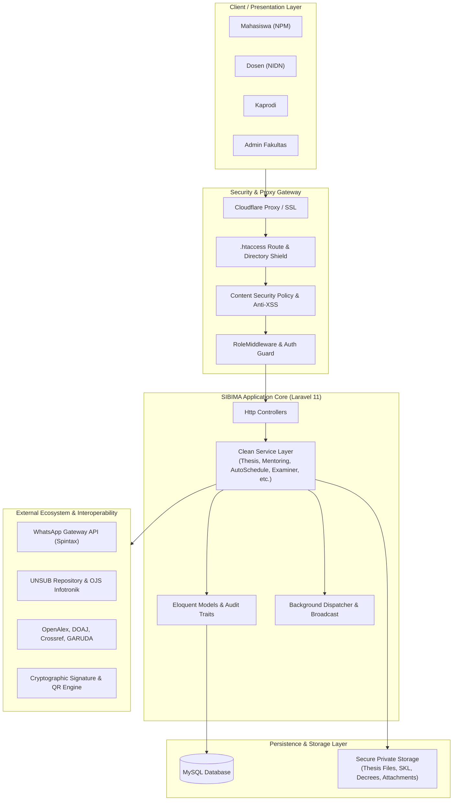
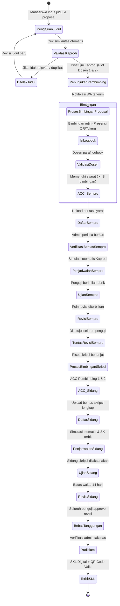
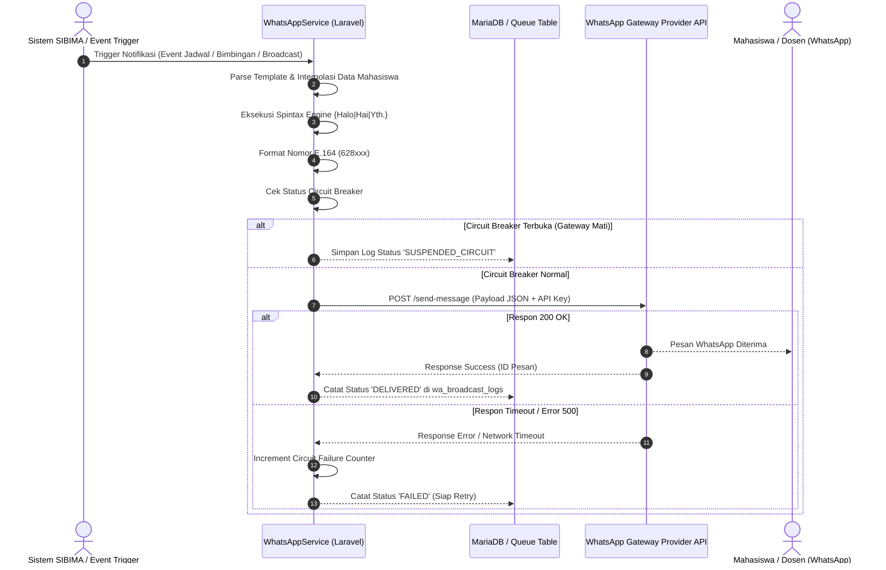

# DOKUMEN SPESIFIKASI KEBUTUHAN SISTEM (SRS)
## SISTEM INFORMASI BIMBINGAN TUGAS AKHIR & MANAJEMEN AKADEMIK (SIBIMA)
### FAKULTAS ILMU KOMPUTER — UNIVERSITAS SUBANG (FASILKOM UNSUB)

---

## 1. PENDAHULUAN & RUANG LINGKUP

### 1.1 Tujuan Dokumen
Dokumen Spesifikasi Kebutuhan Sistem (*Software Requirements Specification* - SRS) ini disusun untuk mendokumentasikan seluruh kebutuhan fungsional (*Functional Requirements*) dan non-fungsional (*Non-Functional Requirements*) dari platform **SIBIMA (Sistem Informasi Bimbingan Tugas Akhir & Manajemen Akademik)**. Dokumen ini menjadi acuan formal bagi tim pengembang (*software engineers*), arsitek sistem, penguji mutu perangkat lunak (*QA*), pimpinan program studi (Kaprodi), dan administrator fakultas.

### 1.2 Identifikasi Produk
- **Nama Produk**: SIBIMA (Sistem Informasi Bimbingan Tugas Akhir & Manajemen Akademik)
- **Instansi Pemilik**: Fakultas Ilmu Komputer, Universitas Subang (FASILKOM UNSUB)
- **Platform**: Web Application (Desktop & Mobile Responsive)
- **Stack Teknologi Utama**:
  - **Backend**: PHP 8.2+, Laravel 11.x, Eloquent ORM
  - **Database**: MySQL / MariaDB (Relational Enterprise Schema)
  - **Frontend**: Blade Templating Engine, Tailwind CSS v3/v4, Alpine.js, Vite 7.x
  - **Integrasi Eksternal**: WhatsApp Gateway API (Spintax Engine), OpenAlex, DOAJ, Crossref, GARUDA Kemdikbud, Google Books, FASILKOM OJS (Infotronik), E-Prints UNSUB Repository
  - **Keamanan & Infrastruktur**: Cloudflare Reverse Proxy, OPcache, CSP Level 2, Digital Cryptographic Token Verification, Strict RBAC

### 1.3 Definisi, Akronim, dan Singkatan
| Istilah / Akronim | Penjelasan Lengkap |
| :--- | :--- |
| **SIBIMA** | Sistem Informasi Bimbingan Tugas Akhir & Manajemen Akademik FASILKOM UNSUB. |
| **NPM** | Nomor Pokok Mahasiswa; identitas unik mahasiswa sebagai kredensial login default. |
| **NIDN / NIDK** | Nomor Induk Dosen Nasional / Khusus; identitas unik dosen di pangkalan data Dikti. |
| **Kaprodi** | Ketua Program Studi (Teknik Informatika / Sistem Informasi) yang berwenang atas tata kelola akademik tugas akhir. |
| **Logbook** | Catatan rekam jejak bimbingan berkala mahasiswa yang wajib divalidasi oleh dosen pembimbing. |
| **Sempro** | Seminar Proposal Tugas Akhir / Skripsi; evaluasi kelayakan rancangan penelitian mahasiswa. |
| **Sidang Skripsi** | Ujian akhir pertahanan skripsi (*thesis defense*) di hadapan dewan penguji. |
| **Berita Acara** | Dokumen resmi hasil penilaian dewan penguji seminar/sidang yang berkekuatan hukum akademik. |
| **SKL** | Surat Keterangan Lulus; dokumen resmi digital yang diterbitkan setelah mahasiswa bebas tanggungan dan yudisium. |
| **SK Pembimbing** | Surat Keputusan Dekan mengenai penunjukan dosen pembimbing tugas akhir mahasiswa. |
| **Surat Tugas** | Dokumen penugasan resmi bagi dosen untuk membimbing atau menguji mahasiswa. |
| **Spintax** | Format variasi teks dinamis `{Halo|Hai|Selamat Pagi}` untuk mencegah pencekalan spam pada WhatsApp Gateway. |
| **RBAC** | *Role-Based Access Control*; mekanisme pembatasan hak akses berbasis peran pengguna. |
| **IDOR** | *Insecure Direct Object Reference*; kerentanan akses data langsung tanpa verifikasi otorisasi kepemilikan. |
| **SSRF** | *Server-Side Request Forgery*; kerentanan manipulasi server untuk mengakses jaringan internal/privat. |

---

## 2. DESKRIPSI UMUM SISTEM & MODEL PENGGUNA

### 2.1 Arsitektur Sistem SIBIMA
SIBIMA dibangun dengan arsitektur *Monolithic Clean Enterprise Service-Oriented*, memisahkan *Routing & Controller* dari logika bisnis inti melalui lapisan *Service Layer* (`app/Services/`) dan *Repository Layer*. Sistem dilengkapi dengan modul keamanan berlapis (Anti-SSRF, CSP, Query Barrier, Tokenized Verification, Audit Logging) serta otomasi penuh pada build aset dan *live production deployment*.

### 2.2 Klasifikasi Peran Pengguna (*User Roles*)
| Peran (*Role*) | Kewenangan & Ruang Lingkup Operasional |
| :--- | :--- |
| **Admin (`admin`)** | Akses penuh (*super-administrative*): manajemen akun seluruh pengguna, konfigurasi kop/format surat dinas, backup & restore database, audit aktivitas sistem, siaran WhatsApp massal bertarget (*broadcast*), pemantauan log keamanan, dan penanganan tiket kendala/fitur (*bug reports*). |
| **Kaprodi (`kaprodi`)** | Tata kelola kurikulum tugas akhir: validasi judul & topik proposal, penunjukan dosen pembimbing 1 & 2, pembukaan gelombang (*wave*) seminar/sidang, simulasi & penetapan jadwal otomatis (*auto-scheduling*), penetapan SK dosen penguji, serta monitoring komprehensif mahasiswa kritis. |
| **Dosen (`dosen`)** | Pembimbingan dan pengujian: penjadwalan bimbingan mandiri/kelompok, presensi bimbingan *real-time* via QR/Token, verifikasi logbook harian, pemberian status ACC seminar/sidang, penginputan rubrik nilai ujian, peninjauan pesan revisi dua arah, tanda tangan digital SK, dan pencetakan Berita Acara. |
| **Mahasiswa (`mahasiswa`)** | Pelaksana tugas akhir: pengajuan judul skripsi (disertai uji similaritas otomatis), pencatatan bimbingan harian (*logbook*), pendaftaran seminar proposal & sidang skripsi (unggah syarat berkas), interaksi revisi pasca-sidang dengan penguji, penjelajahan repositori jurnal/buku digital, pengajuan bebas tanggungan/yudisium, dan unduh SKL digital tervalidasi. |

---

## 3. SPESIFIKASI KEBUTUHAN FUNGSIONAL (*FUNCTIONAL REQUIREMENTS*)

Kebutuhan fungsional mendefinisikan layanan, fungsi spesifik, alur masukan, logika bisnis, dan luaran yang dihasilkan oleh SIBIMA. Seluruh kebutuhan fungsional dikelompokkan ke dalam 12 modul operasional sebagaimana dirangkum pada Tabel 3.0.

### Tabel 3.0: Rekapitulasi Modul Kebutuhan Fungsional SIBIMA
| No | Modul Sistem | Kode FR | Jumlah FR | Aktor Utama |
| :---: | :--- | :---: | :---: | :--- |
| 1 | Autentikasi, Profil & Keamanan Sesi | `FR-AUTH-01` s/d `FR-AUTH-03` | 3 | Seluruh Pengguna (Admin, Kaprodi, Dosen, Mahasiswa) |
| 2 | Pengajuan Judul & Manajemen Tugas Akhir | `FR-THES-01` s/d `FR-THES-04` | 4 | Mahasiswa, Kaprodi, Admin |
| 3 | Bimbingan & Logbook Digital | `FR-MENT-01` s/d `FR-MENT-04` | 4 | Mahasiswa, Dosen Pembimbing |
| 4 | Pendaftaran Seminar Proposal & Sidang Skripsi | `FR-APPL-01` s/d `FR-APPL-03` | 3 | Mahasiswa, Admin, Kaprodi |
| 5 | Penjadwalan & Simulasi Algoritma Otomatis | `FR-SCHD-01` s/d `FR-SCHD-03` | 3 | Kaprodi, Admin, Dosen Penguji |
| 6 | Ruang Ujian, Rubrik Penilaian & Berita Acara | `FR-EXAM-01` s/d `FR-EXAM-03` | 3 | Dosen Penguji, Kaprodi |
| 7 | Manajemen Revisi Ujian Dua Arah | `FR-REVS-01` s/d `FR-REVS-03` | 3 | Mahasiswa, Dosen Penguji |
| 8 | Repositori Digital & Sitasi Jurnal Ilmiah | `FR-REPO-01` s/d `FR-REPO-03` | 3 | Mahasiswa, Dosen, Kaprodi |
| 9 | Yudisium, Bebas Tanggungan & SKL Digital | `FR-GRAD-01` s/d `FR-GRAD-03` | 3 | Mahasiswa, Admin, Kaprodi |
| 10 | Komunikasi, Chat & WhatsApp Gateway | `FR-COMM-01` s/d `FR-COMM-04` | 4 | Seluruh Pengguna |
| 11 | Monitoring Progres & Analitik Akademik | `FR-MONI-01` s/d `FR-MONI-02` | 2 | Kaprodi, Admin |
| 12 | Administrasi Sistem, Audit & Lapor Kendala/Fitur | `FR-SYST-01` s/d `FR-SYST-05` | 5 | Admin, Seluruh Pengguna |
| **TOTAL** | **12 Modul Fungsional Utama** | — | **39 FR** | — |

---

### 3.1 Tabel Spesifikasi Kebutuhan: Autentikasi, Profil & Keamanan Sesi (`FR-AUTH`)

| Kode FR | Nama Fitur / Kebutuhan | Aktor | Masukan & Prasyarat (*Input / Pre-condition*) | Logika Bisnis & Alur Pemrosesan | Luaran & Kondisi Akhir (*Output / Post-condition*) |
| :--- | :--- | :--- | :--- | :--- | :--- |
| **FR-AUTH-01** | Autentikasi Multi-Identifier & Deteksi Password Standar | Seluruh Pengguna | **Input**: Identifier (NPM/NIDN/Email) dan kata sandi. **Prasyarat**: Akun pengguna telah terdaftar dan berstatus aktif (`is_active = 1`). | 1. Sistem memverifikasi kecocokan kredensial via hash `bcrypt`. 2. Memeriksa status akun; jika `is_active = 0`, akses ditolak. 3. Mencegah brute force via throttle (maks. 5 percobaan/menit). 4. Mendeteksi jika password masih bernilai standar (identik NPM/NIDN), sistem menampilkan peringatan wajib ganti kata sandi. 5. Memvalidasi password baru agar tidak sama dengan NPM/NIDN. | Pengguna berhasil masuk ke dashboard sesuai hak akses (*role*), atau menampilkan pesan galat validasi. |
| **FR-AUTH-02** | Manajemen Sesi & Pencabutan Otorisasi (*Session Revocation*) | Seluruh Pengguna, Admin | **Input**: Permintaan login baru, pergantian password, atau aksi penonaktifan akun oleh Admin. | 1. Sistem mencatat waktu login terakhir (`last_login_at`), IP address, dan user agent ke database. 2. Menandai status online pada cache (`user-is-online-{id}`) selama 5 menit per request. 3. Saat terjadi reset password atau akun dinonaktifkan, sistem mencabut seluruh token sesi aktif di perangkat lain (*session termination*). | Sesi aktif di perangkat lama seketika hangus; pengguna diarahkan kembali ke halaman login. |
| **FR-AUTH-03** | Tanda Tangan Digital & Verifikasi Spesimen | Dosen, Pejabat Fakultas | **Input**: Goresan kanvas tanda tangan digital (*signature pad*) atau berkas gambar tanda tangan (PNG transparan). **Prasyarat**: Pengguna berstatus Dosen/Pejabat. | 1. Sistem menyimpan spesimen tanda tangan di storage privat terenkripsi. 2. Mengenerate token kriptografis unik (`signature_token`). 3. Menghubungkan spesimen dengan endpoint publik `/verify-signature/{token}` untuk keperluan pembuktian keabsahan SK/Berita Acara. | Tanda tangan tersimpan di profil dan siap dibubuhkan otomatis pada dokumen dinas serta QR Code verifikasi. |

---

### 3.2 Tabel Spesifikasi Kebutuhan: Pengajuan Judul & Manajemen Tugas Akhir (`FR-THES`)

| Kode FR | Nama Fitur / Kebutuhan | Aktor | Masukan & Prasyarat (*Input / Pre-condition*) | Logika Bisnis & Alur Pemrosesan | Luaran & Kondisi Akhir (*Output / Post-condition*) |
| :--- | :--- | :--- | :--- | :--- | :--- |
| **FR-THES-01** | Pengajuan Judul Skripsi & Uji Similaritas Otomatis | Mahasiswa | **Input**: Judul usulan, abstrak, latar belakang, bidang kajian/konsentrasi, dan draft berkas proposal (PDF). **Prasyarat**: Mahasiswa belum memiliki skripsi berstatus aktif/disetujui. | 1. Sistem menjalankan algoritma perbandingan kemiripan teks (*similarity check*) terhadap seluruh data skripsi aktif dan repositori alumni UNSUB. 2. Jika similaritas $> 70\%$, sistem memunculkan daftar judul serupa sebagai peringatan duplikasi. 3. Memvalidasi format berkas proposal (maksimal 10 MB, format PDF). | Record data skripsi tersimpan di tabel `theses` dengan status `submitted` menunggu telaah Kaprodi. |
| **FR-THES-02** | Validasi Judul & Penunjukan Pembimbing Berbasis Kuota | Kaprodi | **Input**: Pilihan status persetujuan (`approved` / `rejected`), catatan perbaikan, penunjukan Pembimbing 1 dan Pembimbing 2. **Prasyarat**: Usulan skripsi berstatus `submitted`. | 1. Kaprodi menelaah kelayakan topik penelitian. 2. Sistem memvalidasi kuota aktif dosen pembimbing (`theses_count < max_quota`) untuk mencegah *overload* beban dosen. 3. Menyimpan relasi pembimbing ke dalam basis data. 4. Memicu notifikasi in-app dan pesan WhatsApp ke Mahasiswa serta Dosen Pembimbing terkait. | Status skripsi berubah menjadi `approved`; penunjukan dosen pembimbing 1 & 2 resmi tercatat. |
| **FR-THES-03** | Papan Kanban Progres Skripsi Mahasiswa | Mahasiswa, Dosen, Kaprodi | **Input**: Permintaan data visual progres skripsi berdasarkan filter angkatan, prodi, atau status. | 1. Sistem mengelompokkan data skripsi ke dalam kolom tahapan visual: *Pengajuan Judul* $\rightarrow$ *Bimbingan Proposal* $\rightarrow$ *Seminar Proposal* $\rightarrow$ *Bimbingan Skripsi* $\rightarrow$ *Sidang Skripsi* $\rightarrow$ *Revisi* $\rightarrow$ *Selesai*. 2. Menyajikan kartu interaktif berisi nama mahasiswa, NPM, pembimbing, dan durasi pengerjaan. | Tampilan papan Kanban interaktif yang mempermudah monitoring progres tugas akhir secara visual. |
| **FR-THES-04** | Migrasi & Impor Massal Data Skripsi Excel | Admin, Kaprodi | **Input**: Berkas Microsoft Excel (`.xlsx`) berisi riwayat data skripsi berjalan. **Prasyarat**: Format kolom sesuai template resmi. | 1. Sistem membaca file Excel secara chunked per baris. 2. Mencocokkan NPM mahasiswa dan NIDN dosen pembimbing ke tabel `users`. 3. Mencegah duplikasi data tugas akhir mahasiswa. 4. Mencatat log audit migrasi data (`clean-audit`). | Data skripsi lama berhasil diimpor ke sistem tanpa perlu penginputan manual satu per satu. |

---

### 3.3 Tabel Spesifikasi Kebutuhan: Bimbingan & Logbook Digital (`FR-MENT`)

| Kode FR | Nama Fitur / Kebutuhan | Aktor | Masukan & Prasyarat (*Input / Pre-condition*) | Logika Bisnis & Alur Pemrosesan | Luaran & Kondisi Akhir (*Output / Post-condition*) |
| :--- | :--- | :--- | :--- | :--- | :--- |
| **FR-MENT-01** | Penjadwalan Sesi Bimbingan (Mandiri & Kelompok) | Dosen Pembimbing | **Input**: Tanggal, jam mulai & selesai, ruang/lokasi (tatap muka/online), kapasitas kuota, dan topik bimbingan. | 1. Sistem memeriksa ketiadaan bentrok waktu pada agenda dosen. 2. Menyimpan sesi bimbingan ke tabel `mentoring_sessions`. 3. Otomatis menampilkan jadwal pada Kalender Akademik SIBIMA (`/calendar`). 4. Mengirimkan notifikasi undangan ke dashboard mahasiswa bimbingan. | Sesi bimbingan resmi terbuka dan dapat dipilih/dikonfirmasi oleh mahasiswa bimbingan. |
| **FR-MENT-02** | Presensi Bimbingan Real-time (Token / QR Code) | Dosen, Mahasiswa | **Input**: Token acak alfanumerik (6 karakter) atau pemindaian QR Code yang digenerate dosen pada ruang sesi bimbingan. | 1. Dosen membuka sesi absensi langsung (*live attendance*). 2. Mahasiswa memasukkan token atau memindai QR Code di lokasinya. 3. Sistem mencocokkan token, batas masa kedaluwarsa waktu (15 menit), serta status relasi bimbingan mahasiswa terhadap dosen tersebut. | Mahasiswa berstatus `hadir` pada sesi bimbingan; terekam ke dalam riwayat presensi resmi. |
| **FR-MENT-03** | Pencatatan & Validasi Paraf Logbook Harian | Mahasiswa, Dosen Pembimbing | **Input**: Tanggal bimbingan, bab penelitian yang dibahas, uraian hasil konsultasi, dan unggahan draf perbaikan dokumen. | 1. Mahasiswa menginput catatan logbook pasca-sesi bimbingan. 2. Dosen pembimbing meninjau catatan dan berkas draf. 3. Dosen memberikan verifikasi: `approved` (disertai paraf digital otomatis) atau `needs_revision` (dengan catatan perbaikan). | Logbook tervalidasi secara resmi dan bertambah ke dalam akumulasi syarat kelayakan ujian. |
| **FR-MENT-04** | Rekapitulasi & Ekspor Buku Bimbingan PDF | Mahasiswa, Dosen Pembimbing | **Input**: Permintaan unduh berkas rekapitulasi kartu bimbingan skripsi mahasiswa tertentu. | 1. Sistem mengompilasi seluruh logbook yang telah berstatus `approved`. 2. Mengurutkan berdasarkan tanggal kronologis bimbingan. 3. Menyematkan paraf digital dosen, stempel fakultas, dan QR Code validasi ke layout PDF resmi FASILKOM UNSUB. | Dokumen PDF Kartu Bimbingan Skripsi resmi siap cetak sebagai prasyarat pendaftaran ujian. |

---

### 3.4 Tabel Spesifikasi Kebutuhan: Pendaftaran Seminar Proposal & Sidang Skripsi (`FR-APPL`)

| Kode FR | Nama Fitur / Kebutuhan | Aktor | Masukan & Prasyarat (*Input / Pre-condition*) | Logika Bisnis & Alur Pemrosesan | Luaran & Kondisi Akhir (*Output / Post-condition*) |
| :--- | :--- | :--- | :--- | :--- | :--- |
| **FR-APPL-01** | Validasi Kelayakan Berkas Prasyarat (*Eligibility Check*) | Mahasiswa | **Input**: Formulir pendaftaran gelombang seminar/sidang, unggahan berkas syarat (KRS, bukti pembayaran ujian, sertifikat TOEFL, kartu bimbingan, draft laporan). **Prasyarat**: Gelombang ujian terbuka (`is_active = 1`). | 1. Sistem memeriksa jumlah logbook bimbingan tervalidasi ($\ge 8$ sesi). 2. Memeriksa status persetujuan ujian: **Wajib ACC Pembimbing 1 dan Pembimbing 2**. 3. Jika syarat belum terpenuhi, formulir terkunci (*disabled*) dengan rincian kendala. 4. Memvalidasi tipe dan ukuran seluruh berkas unggahan (maks. 5 MB/file, PDF/ZIP). | Berkas pendaftaran tersimpan dengan status `pending_verification` menunggu review Admin. |
| **FR-APPL-02** | Verifikasi Berkas & Paket Unduhan ZIP Massal | Admin, Kaprodi | **Input**: Keputusan validasi berkas (`valid` / `invalid`), catatan perbaikan jika berkas ditolak. **Prasyarat**: Permohonan berstatus `pending_verification`. | 1. Admin/Kaprodi memeriksa kelengkapan setiap dokumen persyaratan. 2. Jika terdapat berkas cacat, status diubah ke `invalid` dan memicu notifikasi WA ke mahasiswa. 3. Menyediakan fitur `downloadZip` yang mengemas seluruh lampiran berkas mahasiswa pendaftar ke satu arsip ZIP instan. | Berkas berstatus `verified` dan mahasiswa masuk ke dalam daftar siap dijadwalkan ujian. |
| **FR-APPL-03** | Pendaftaran Khusus oleh Admin (*Bypass Register*) | Admin, Kaprodi | **Input**: Pemilihan data mahasiswa, pemilihan gelombang ujian, dan pengunggahan berkas manual. **Prasyarat**: Otorisasi role Admin / Kaprodi. | 1. Mengizinkan staf administrator mendaftarkan mahasiswa secara langsung pada situasi khusus (dispensasi dekanat / perbaikan data). 2. Mengabaikan pembatasan kuota gelombang reguler. 3. Mencatat jejak audit `adminRegister` ke tabel `activity_logs`. | Mahasiswa langsung terdaftar pada gelombang ujian terkait dengan status terverifikasi. |

---

### 3.5 Tabel Spesifikasi Kebutuhan: Penjadwalan & Simulasi Algoritma Otomatis (`FR-SCHD`)

| Kode FR | Nama Fitur / Kebutuhan | Aktor | Masukan & Prasyarat (*Input / Pre-condition*) | Logika Bisnis & Alur Pemrosesan | Luaran & Kondisi Akhir (*Output / Post-condition*) |
| :--- | :--- | :--- | :--- | :--- | :--- |
| **FR-SCHD-01** | Mesin Simulasi Penjadwalan Otomatis Bebas Konflik | Kaprodi, Admin | **Input**: Pilihan gelombang ujian aktif, daftar ruangan ujian tersedia, rentang tanggal pelaksanaan, dan batas sesi per hari. | 1. Mengambil data mahasiswa yang berstatus `verified`. 2. Menjalankan *AutoScheduleSimulationService*: alokasi slot waktu dan ruangan. 3. Menerapkan aturan integritas dewan penguji:    - *Aturan 1*: Tidak boleh ada bentrok ruangan pada jam yang sama.    - *Aturan 2*: Dosen tidak boleh dijadwalkan menguji di 2 tempat pada waktu yang sama.    - *Aturan 3*: Dosen Pembimbing mahasiswa dilarang menjadi Ketua Dewan Penguji untuk mahasiswa bimbingannya sendiri.    - *Aturan 4*: Distribusi beban menguji merata antar dosen prodi. | Draf jadwal simulasi lengkap dengan rincian mahasiswa, ruangan, slot jam, ketua penguji, dan anggota penguji. |
| **FR-SCHD-02** | Penyesuaian Manual & Penetapan Jadwal Resmi (*Apply Schedule*) | Kaprodi | **Input**: Modifikasi manual penguji/ruangan jika diperlukan, lalu penekanan aksi `Apply Schedule`. **Prasyarat**: Hasil simulasi tidak memiliki indikator konflik bentrok. | 1. Kaprodi meninjau draf hasil simulasi. 2. Memvalidasi ketiadaan konflik dosen secara *real-time* via `ScheduleConflictController`. 3. Menyimpan detail jadwal resmi ke tabel `seminar_schedules` / `thesis_defense_schedules`. 4. Memicu notifikasi in-app dan pesan WhatsApp serentak kepada seluruh mahasiswa dan dewan penguji yang ditugaskan. | Jadwal resmi terkunci dan langsung tampil pada dashboard masing-masing dosen penguji dan mahasiswa. |
| **FR-SCHD-03** | Ekspor Batch Jadwal & Undangan (PDF & Word DOCX) | Admin, Kaprodi | **Input**: Permintaan ekspor jadwal gelombang tertentu dalam format PDF atau Microsoft Word (`.docx`). | 1. Sistem mengambil data jadwal ujian terstruktur (sesi, jam, ruang, mahasiswa, dewan penguji). 2. Menyusun dokumen tabel jadwal rapi sesuai format standar administrasi akademik FASILKOM. 3. Mengintegrasikan template surat tugas dewan penguji (`ScheduleWordExportService`). | File dokumen `.pdf` dan `.docx` siap cetak dan dibagikan ke dewan penguji dan ruang ujian. |

---

### 3.6 Tabel Spesifikasi Kebutuhan: Ruang Ujian, Rubrik Penilaian & Berita Acara (`FR-EXAM`)

| Kode FR | Nama Fitur / Kebutuhan | Aktor | Masukan & Prasyarat (*Input / Pre-condition*) | Logika Bisnis & Alur Pemrosesan | Luaran & Kondisi Akhir (*Output / Post-condition*) |
| :--- | :--- | :--- | :--- | :--- | :--- |
| **FR-EXAM-01** | Antarmuka Ujian Dosen Penguji (*Examiner Dashboard*) | Dosen Penguji | **Input**: Klik menu `Seminar Examiner` atau `Defense Examiner`. **Prasyarat**: Dosen terdaftar sebagai penguji pada jadwal mahasiswa yang bersangkutan. | 1. Sistem menyaring daftar mahasiswa yang diuji oleh dosen yang sedang login. 2. Menampilkan informasi identitas mahasiswa, judul skripsi, nama pembimbing, jam sidang, dan ruang. 3. Menyediakan akses cepat unduh berkas laporan naskah skripsi mahasiswa. | Layar antarmuka khusus dewan penguji untuk memproses penilaian dan revisi ujian. |
| **FR-EXAM-02** | Penilaian Berbasis Rubrik Multi-Kriteria Otomatis | Dosen Penguji | **Input**: Nilai angka (skala 0 - 100) pada masing-masing komponen rubrik penilaian resmi: teori/konsep, metodologi, implementasi/program, tata tulis naskah. | 1. Sistem menghitung nilai terbobot masing-masing penguji. 2. Mengalkulasi nilai rata-rata gabungan seluruh dewan penguji. 3. Mengonversi nilai numerik ke nilai mutu huruf: A ($\ge 80$), B+ ($75 - 79.9$), B ($70 - 74.9$), C ($60 - 69.9$), D, E. 4. Menentukan rekomendasi status kelulusan: *Lulus Murni*, *Lulus dengan Revisi*, atau *Tidak Lulus (Mengulang)*. | Nilai ujian tersimpan permanen di database dan terkunci dari manipulasi data tidak sah. |
| **FR-EXAM-03** | Penerbitan & Tanda Tangan Digital Berita Acara Ujian | Dosen Penguji, Kaprodi | **Input**: Aksi `exportBeritaAcara` atau `approve-direct`. **Prasyarat**: Seluruh dewan penguji telah menginputkan nilai rubrik secara lengkap. | 1. Sistem mengompilasi Berita Acara Ujian resmi. 2. Menyematkan rekapitulasi nilai masing-masing penguji, nilai akhir gabungan, nilai huruf, dan status kelulusan. 3. Menyisipkan tanda tangan digital dewan penguji beserta QR Code validasi ke `/verify/document/{token}`. | Dokumen resmi Berita Acara Ujian (PDF) bertanda tangan digital siap cetak dan diarsipkan prodi. |

---

### 3.7 Tabel Spesifikasi Kebutuhan: Manajemen Revisi Ujian Dua Arah (`FR-REVS`)

| Kode FR | Nama Fitur / Kebutuhan | Aktor | Masukan & Prasyarat (*Input / Pre-condition*) | Logika Bisnis & Alur Pemrosesan | Luaran & Kondisi Akhir (*Output / Post-condition*) |
| :--- | :--- | :--- | :--- | :--- | :--- |
| **FR-REVS-01** | Pencatatan Poin Revisi & Penetapan Deadline | Dosen Penguji | **Input**: Catatan uraian revisi per bab, batas waktu akhir penyelesaian (*deadline*, default 14 hari kalender pasca-sidang), dan lampiran coretan koreksi naskah (opsional). | 1. Dosen mencatatkan poin-poin revisi pada sistem pasca-sidang. 2. Sistem membuat record tiket revisi (`seminar_revisions` / `thesis_defense_revisions`). 3. Menetapkan status revisi awal: `pending` (menunggu perbaikan mahasiswa). 4. Mengirimkan notifikasi WhatsApp rincian revisi ke nomor ponsel mahasiswa. | Mahasiswa menerima daftar kewajiban revisi resmi beserta batas waktu pengerjaan. |
| **FR-REVS-02** | Komunikasi & Pengunggahan Bukti Revisi Mahasiswa | Mahasiswa | **Input**: Berkas naskah skripsi yang telah direvisi (PDF berpenanda warna), deskripsi tanggapan per poin revisi, dan pesan balasan konsultasi. | 1. Mahasiswa mengunggah dokumen perbaikan pada thread penguji yang dituju. 2. Menyusun deskripsi kronologis halaman dan bab yang telah disesuaikan. 3. Sistem mencatat percakapan dua arah di `revision_messages`. 4. Memberi notifikasi kepada dosen penguji bahwa mahasiswa telah mengunggah revisi baru. | Berkas perbaikan diterima oleh dosen penguji untuk ditelaah ulang. |
| **FR-REVS-03** | Persetujuan Revisi (*Approval State Machine*) & Lembar Pengesahan | Dosen Penguji, Mahasiswa | **Input**: Keputusan penguji (`approved` / `unapproved` / `approve-direct`). **Prasyarat**: Penguji telah memeriksa perbaikan naskah mahasiswa. | 1. Dosen penguji menyetujui hasil revisi jika perbaikan telah sesuai. 2. Sistem memperbarui status revisi penguji tersebut menjadi `approved`. 3. Memeriksa status seluruh dewan penguji; jika **seluruh penguji telah menyetujui**, maka status revisi tugas akhir dinyatakan **Selesai / Tuntas Penuh**. 4. Mengaktifkan tombol cetak Lembar Pengesahan Revisi tervalidasi bagi mahasiswa. | Terbitnya Lembar Bebas Revisi resmi ber-QR Code untuk syarat pendaftaran Yudisium. |

---

### 3.8 Tabel Spesifikasi Kebutuhan: Repositori Digital & Sitasi Jurnal Ilmiah (`FR-REPO`)

| Kode FR | Nama Fitur / Kebutuhan | Aktor | Masukan & Prasyarat (*Input / Pre-condition*) | Logika Bisnis & Alur Pemrosesan | Luaran & Kondisi Akhir (*Output / Post-condition*) |
| :--- | :--- | :--- | :--- | :--- | :--- |
| **FR-REPO-01** | Repositori Skripsi Alumni (*Protected Stream* Bab 1-6) | Seluruh Pengguna | **Input**: Kata kunci pencarian judul, nama alumni, tahun kelulusan, program studi, atau nama dosen pembimbing. | 1. Sistem mencari data pada koleksi skripsi alumni yang telah lulus yudisium. 2. Menyajikan abstrak, metadata, dan opsi baca bab per bab (`bab1` s/d `bab6`). 3. Dokumen dialirkan melalui *Protected PDF Stream* dari storage privat, memblokir pengunduhan mentah ilegal dari luar aplikasi. | Pengguna dapat membaca karya ilmiah terdahulu sebagai referensi penelitian secara aman. |
| **FR-REPO-02** | Pencarian Jurnal Eksternal Terintegrasi (Multi-API) | Mahasiswa, Dosen, Kaprodi | **Input**: Kata kunci topik riset ilmiah, filter tahun publikasi, dan pemilihan basis data ilmiah (GARUDA, DOAJ, Crossref, OpenAlex, Google Books, Infotronik). | 1. Sistem meneruskan kueri ke masing-masing Service API eksternal secara asinkronus. 2. Memvalidasi URL respon dari risiko SSRF melalui helper `UrlSecurity`. 3. Melakukan agregasi metadata: judul artikel, penulis, nama jurnal, volume, tahun, abstrak, dan link PDF *Open Access*. | Daftar artikel jurnal ilmiah bereputasi nasional dan internasional tersaji langsung di sistem SIBIMA. |
| **FR-REPO-03** | Manajemen Folder Bookmark & Ekspor Sitasi Standar | Mahasiswa, Dosen | **Input**: Artikel jurnal pilihan yang di-bookmark, pemilihan folder kategori riset, catatan anotasi pribadi, dan opsi format sitasi (APA / IEEE / BibTeX). | 1. Menyimpan artikel pilihan ke tabel `journal_bookmarks`. 2. Mengelompokkan bookmark ke dalam folder referensi yang dibuat pengguna. 3. Mengenerate teks sitasi terstandarisasi secara otomatis berdasarkan format sitasi internasional (APA 7th Edition, IEEE, atau BibTeX). | File ekspor sitasi akademik siap disalin atau diimpor ke Mendeley / Zotero. |

---

### 3.9 Tabel Spesifikasi Kebutuhan: Yudisium, Bebas Tanggungan & SKL Digital (`FR-GRAD`)

| Kode FR | Nama Fitur / Kebutuhan | Aktor | Masukan & Prasyarat (*Input / Pre-condition*) | Logika Bisnis & Alur Pemrosesan | Luaran & Kondisi Akhir (*Output / Post-condition*) |
| :--- | :--- | :--- | :--- | :--- | :--- |
| **FR-GRAD-01** | Pengajuan Bebas Tanggungan Akademik & Perpustakaan | Mahasiswa | **Input**: Bukti penyerahan hardcopy skripsi, bukti unggah program/aplikasi, bukti sumbangan buku perpustakaan, dan pasfoto ijazah. **Prasyarat**: Telah tuntas seluruh revisi sidang skripsi. | 1. Sistem memverifikasi status kelulusan sidang dan kelengkapan persetujuan revisi dari seluruh dewan penguji. 2. Mahasiswa mengunggah seluruh dokumen bukti bebas tanggungan. 3. Menyimpan permohonan ke tabel `graduations` dengan status `pending`. | Pengajuan yudisium tercatat dan masuk ke antrean verifikasi bagian tata usaha fakultas. |
| **FR-GRAD-02** | Verifikasi Yudisium oleh Admin / Kaprodi | Admin, Kaprodi | **Input**: Konfirmasi verifikasi bebas tanggungan (`verified` / `rejected`), nomor SK Yudisium, dan tanggal penetapan kelulusan. | 1. Admin memeriksa kesesuaian fisik dan administratif dokumen bebas tanggungan. 2. Kaprodi mengesahkan penetapan kelulusan yudisium. 3. Sistem mencatat tanggal resmi kelulusan sarjana dan predikat kelulusan (Pujian / Sangat Memuaskan / Memuaskan). | Status mahasiswa berubah menjadi `Lulus Yudisium`; hak akses dialihkan ke status alumni. |
| **FR-GRAD-03** | Penerbitan SKL Digital Berstempel QR Code Validasi Publik | Mahasiswa, Admin | **Input**: Aksi unduh SKL digital (`download-skl`). **Prasyarat**: Mahasiswa telah berstatus `verified` pada modul yudisium. | 1. Sistem mengompilasi naskah resmi Surat Keterangan Lulus (SKL) berformat PDF. 2. Menyisipkan kop surat FASILKOM, nomor surat dinas otomatis, data diri lulusan, IPK akhir, dan gelar sarjana (S.Kom). 3. Menyematkan stempel resmi digital dan tanda tangan Dekan. 4. Membubuhkan QR Code verifikasi publik yang mengarah ke URL `/verify/skl/{token}`. | File PDF SKL Digital berkekuatan hukum resmi yang dapat diverifikasi keasliannya oleh instansi luar. |

---

### 3.10 Tabel Spesifikasi Kebutuhan: Komunikasi, Chat & WhatsApp Gateway (`FR-COMM`)

| Kode FR | Nama Fitur / Kebutuhan | Aktor | Masukan & Prasyarat (*Input / Pre-condition*) | Logika Bisnis & Alur Pemrosesan | Luaran & Kondisi Akhir (*Output / Post-condition*) |
| :--- | :--- | :--- | :--- | :--- | :--- |
| **FR-COMM-01** | Chat Internal Antar-Pengguna Terotorisasi (`canChatWith`) | Seluruh Pengguna | **Input**: ID pengguna penerima pesan dan teks pesan chat. | 1. Sistem memanggil `ChatService::canChatWith($sender, $recipient)`. 2. Memvalidasi hierarki hubungan:    - Mahasiswa hanya boleh chat dengan Dosen Pembimbing, Dosen Penguji jadwal aktif, dan Admin.    - Dosen boleh chat dengan mahasiswa bimbingan/uji, sesama dosen, dan Admin. 3. Mencegah IDOR pada jalur obrolan. 4. Menyimpan pesan di tabel `messages` dan memperbarui counter unread secara asinkronus. | Pesan obrolan terkirim dan diterima secara *real-time* oleh pihak yang berwenang. |
| **FR-COMM-02** | Gateway Notifikasi WhatsApp Otomatis | Sistem SIBIMA (Otomatis) | **Input**: Pemicu peristiwa akademik sistem (plot pembimbing, rilis jadwal, revisi masuk, pengingat deadline, ucapan ulang tahun). | 1. Sistem memetakan peristiwa ke template pesan di `wa_templates`. 2. Mengambil nomor telepon tujuan dan mengonversinya ke format standar internasional E.164 (`628xxx`). 3. Mengisi variabel dinamis nama mahasiswa, judul, tanggal, dan nama dosen. 4. Meneruskan pesan ke vendor gateway WhatsApp via HTTP POST API. | Notifikasi WhatsApp terkirim langsung ke aplikasi WhatsApp di ponsel pengguna. |
| **FR-COMM-03** | Mesin Spintax Dinamis & Circuit Breaker WhatsApp | Sistem SIBIMA (Otomatis), Admin | **Input**: Format teks Spintax `{Yth. Bapak/Ibu|Kepada Yth. Dosen}` dan batas ambang kegagalan gateway (*failure threshold*). | 1. Sistem mengevaluasi ekspresi Spintax secara acak guna memvariasikan kalimat pesan dan mencegah pencekalan nomor oleh WhatsApp anti-spam. 2. Memeriksa status *Circuit Breaker*: jika vendor gateway mengembalikan error beruntun $> 5$ kali, sirkuit terbuka (*Open*) dan antrean dihentikan sementara guna mengamankan server. 3. Admin dapat menekan tombol `resetCircuit` untuk mengaktifkan kembali sirkuit pasca-perbaikan vendor. | Pesan terkirim dengan variasi kalimat natural dan sistem terlindung dari *crash* akibat gateway eksternal mati. |
| **FR-COMM-04** | Siaran Pesan WhatsApp Massal Bertarget (*Targeted WA Broadcast*) | Admin, Kaprodi | **Input**: Judul siaran, teks pesan, filter target (berdasarkan angkatan, program studi, status tugas akhir, atau role pengguna), dan nomor uji coba (*test number*). | 1. Sistem menampilkan pratinjau daftar pengguna penerima target (`previewTargets`). 2. Menyediakan opsi kirim pesan uji coba ke nomor Admin terlebih dahulu (`testSend`). 3. Menjalankan pengiriman massal secara bertahap (*batched/chunked dispatch*) untuk menghindari pemblokiran nomor. 4. Merekam log status pengiriman per penerima (`sent` / `failed`) di `wa_broadcast_logs`. | Pesan siaran resmi fakultas tersampaikan secara merata ke ponsel seluruh target audiens yang dipilih. |

---

### 3.11 Tabel Spesifikasi Kebutuhan: Monitoring Progres & Analitik Akademik (`FR-MONI`)

| Kode FR | Nama Fitur / Kebutuhan | Aktor | Masukan & Prasyarat (*Input / Pre-condition*) | Logika Bisnis & Alur Pemrosesan | Luaran & Kondisi Akhir (*Output / Post-condition*) |
| :--- | :--- | :--- | :--- | :--- | :--- |
| **FR-MONI-01** | Deteksi & Peringatan Mahasiswa Kritis (*Critical Students Alert*) | Kaprodi, Admin | **Input**: Kriteria batas dorman (misal: $> 30$ hari tidak bimbingan, $> 14$ hari belum merampungkan revisi, atau mendekati semester akhir). | 1. Sistem memindai seluruh skripsi berjalan dan membandingkan tanggal aktivitas terakhir terhadap tanggal saat ini. 2. Memberikan label status `CRITICAL` berkedip pada mahasiswa yang macet bimbingan/revisi. 3. Menyediakan tombol aksi cepat *Remind* yang otomatis mengirimkan teguran via WhatsApp ke mahasiswa dan dosen pembimbingnya. | Mahasiswa bermasalah terdeteksi dini dan dapat segera ditindaklanjuti sebelum melampaui masa studi. |
| **FR-MONI-02** | Dasbor Analitik & Grafik Statistik Penyelesaian Skripsi | Kaprodi, Admin | **Input**: Filter rentang tahun akademik, pemilihan program studi (Teknik Informatika / Sistem Informasi). | 1. Mengagregasi data skripsi: tren bidang minat riset terpopuler (AI, Web, IoT, Networking, Mobile, Sistem Informasi). 2. Menghitung rata-rata lama penyelesaian skripsi (bulan). 3. Mengalkulasi rasio kelulusan tepat waktu vs terlambat. 4. Menyajikan grafik batang dan diagram lingkaran interaktif. 5. Menyediakan fitur ekspor laporan analitik ke PDF dan Excel. | Informasi analitik strategis siap pakai untuk bahan evaluasi rapat dekanat dan akreditasi BAN-PT/LAM INFOKOM. |

---

### 3.12 Tabel Spesifikasi Kebutuhan: Administrasi Sistem, Audit & Lapor Kendala/Fitur (`FR-SYST`)

| Kode FR | Nama Fitur / Kebutuhan | Aktor | Masukan & Prasyarat (*Input / Pre-condition*) | Logika Bisnis & Alur Pemrosesan | Luaran & Kondisi Akhir (*Output / Post-condition*) |
| :--- | :--- | :--- | :--- | :--- | :--- |
| **FR-SYST-01** | Pengaturan Kop Surat, Nomor Dinas & Pejabat Fakultas | Admin | **Input**: Konfigurasi template kop surat dinas, format penomoran surat otomatis (variabel `{nomor}/{kode_prodi}/{bulan_romawi}/{tahun}`), data pejabat penandatangan (Dekan, Kaprodi, Kasubag TU), dan unggahan stempel dinas. | 1. Menyimpan konfigurasi ke tabel `letter_settings` dan `settings`. 2. Menjadikan konfigurasi ini sebagai acuan otomatis (*dynamic binding*) saat modul surat menyurat mencetak SK Pembimbing, SK Penguji, Berita Acara, dan SKL Digital. | Seluruh dokumen administrasi resmi yang digenerate sistem selalu konsisten dengan format dinas terkini. |
| **FR-SYST-02** | Cadangan & Pemulihan Basis Data (*Database Backup & Restore*) | Admin | **Input**: Aksi buat cadangan (*create backup*), unduh berkas `.sql`, atau unggah berkas SQL cadangan untuk dipulihkan (*restore*). **Prasyarat**: Hanya akun dengan role `admin`. | 1. *Backup*: Sistem mengekstrak struktur dan data MySQL ke file SQL terkompresi. 2. *Restore*: Melalui `BackupService`, sistem memindai file SQL dan memblokir seluruh kueri berbahaya (`INTO OUTFILE`, `LOAD_FILE`, `GRANT`, `DROP USER`). 3. Menjaga akun admin yang sedang login agar tidak terhapus/terkunci selama proses pemulihan. | Salinan database tersimpan aman; pemulihan sistem darurat dapat dilakukan cepat tanpa merusak integritas server. |
| **FR-SYST-03** | Pencatatan Jejak Audit Sistem & Riwayat Aktivitas Login | Admin | **Input**: Seluruh aktivitas mutasi data (*create, update, delete*) dan event login di sistem. | 1. Trait `Auditable` pada model Eloquent merekam perubahan atribut (*old values* vs *new values*). 2. `ActivityLogController` mencatat riwayat login sukses maupun gagal, alamat IP klien, perangkat peramban (*user agent*), dan timestamp. 3. Menyediakan tabel pemantauan jejak audit yang dapat difilter dan diekspor ke Excel. | Rekam jejak seluruh aktivitas pengguna terdokumentasi rapi untuk transparansi dan investigasi forensik keamanan. |
| **FR-SYST-04** | Widget Mengambang Lapor Bug & Usulan Fitur Baru | Seluruh Pengguna, Admin | **Input**: Mode laporan (Tab *Lapor Kendala / Bug* atau Tab *Usulan Fitur Baru*), judul, kategori, tingkat urgensi, halaman URL, uraian deskripsi, contoh langkah/alur ide, dan unggahan bukti tangkapan layar/mockup (maks. 5 MB). | 1. Jika mode Bug: menghasilkan nomor tiket **`BUG-YYYYMMDD-XXXX`** bertema peringatan amber. 2. Jika mode Fitur: menghasilkan nomor tiket **`REQ-YYYYMMDD-XXXX`** bertema ide indigo. 3. Menyimpan laporan ke tabel `bug_reports`. 4. Mengirimkan notifikasi ke panel admin. 5. Pengguna dapat melacak respons dan status penanganan tiketnya pada menu *Status Laporan Saya*. | Tiket kendala/fitur tercatat resmi; Admin dapat memperbarui status pengerjaan dan memberikan catatan solusi balik. |
| **FR-SYST-05** | Sinkronisasi Server Produksi & Pembersihan Cache (`/clear-cache`) | Admin, Deployment Secret Key | **Input**: URL endpoint `/clear-cache?pull=1&migrate=1` dengan autentikasi sesi admin atau parameter `key={DEPLOY_SECRET_KEY}`. | 1. Memeriksa otentikasi admin atau kecocokan hash `hash_equals(DEPLOY_SECRET_KEY, $key)`. 2. Membersihkan cache aplikasi (`optimize:clear`, `view:clear`, `route:clear`, `config:clear`). 3. Mereset OPcache PHP hosting (`opcache_reset`). 4. Jika parameter `pull=1`, mengeksekusi `git pull origin main` untuk sinkronisasi kode server live. 5. Menyinkronkan manifest aset Vite dan mengompilasi ulang view Blade fresh (`view:cache`). | Server produksi tersinkronisasi sempurna dengan versi Git terbaru dan seluruh cache lama dibersihkan secara instan. |

---

## 4. SPESIFIKASI KEBUTUHAN NON-FUNGSIONAL (*NON-FUNCTIONAL REQUIREMENTS*)

Sistem SIBIMA dirancang untuk memenuhi standar mutu perangkat lunak internasional (ISO/IEC 25010) dengan klasifikasi kebutuhan non-fungsional sebagai berikut:

### 4.1 Kebutuhan Kinerja & Skalabilitas (*Performance & Scalability*)

| Kode NFR | Parameter | Spesifikasi & Standar yang Diterapkan |
| :--- | :--- | :--- |
| **NFR-PERF-01** | **Waktu Respons Halaman** | Waktu pemuatan halaman (*Page Load Time*) maksimal $\le 2.0$ detik pada koneksi internet standar (4G / WiFi Kampus) untuk 95% permintaan GET. |
| **NFR-PERF-02** | **Waktu Eksekusi API / JSON** | Permintaan AJAX/JSON (misal presensi, cek judul, filter tabel) merespons dalam waktu $\le 500$ milidetik. |
| **NFR-PERF-03** | **Optimasi Bundling Aset** | Seluruh skrip JS dan stylesheet Tailwind CSS dikompilasi ke mode produksi menggunakan Vite 7 dengan kompresi Gzip/Brotli, memangkas ukuran payload CSS/JS hingga $< 200$ KB. |
| **NFR-PERF-04** | **Efisiensi Kueri Basis Data** | Dilarang keras memicu *N+1 Query Problem*. Seluruh pemanggilan relasi wajib menerapkan *Eager Loading* (`with(['user', 'pembimbing', 'details'])`). Kueri tabel berkapasitas besar menggunakan paginasi (`paginate(15)`). |
| **NFR-PERF-05** | **Manajemen Cache Aplikasi** | Pemanfaatan Laravel Cache dan OPcache pada shared hosting / VPS untuk mereduksi beban I/O server hingga 40%. |
| **NFR-PERF-06** | **Dukungan Konkurensi** | Sistem mampu melayani sedikitnya **250 pengguna aktif bersamaan** (*concurrent users*) saat periode puncak (pendaftaran seminar/sidang dan pengisian revisi) tanpa terjadi *timeout* atau degradasi basis data. |

---

### 4.2 Kebutuhan Keamanan & Integritas Data (*Security & Protection*)

| Kode NFR | Parameter | Spesifikasi & Standar yang Diterapkan |
| :--- | :--- | :--- |
| **NFR-SECU-01** | **Enkripsi Data Kredensial** | Seluruh kata sandi pengguna wajib di-hash menggunakan algoritma **Bcrypt** dengan *work factor* standar Laravel. Token sesi dan tanda tangan digital dienkripsi. |
| **NFR-SECU-02** | **Proteksi Akses Jalur Publik (.htaccess)** | Konfigurasi file `.htaccess` tingkat root, `storage/`, dan `database/` secara ketat memblokir akses HTTP langsung terhadap berkas sensitif: `.env`, `.sqlite`, `.sql`, `.log`, `.git`, dan folder internal Laravel. |
| **NFR-SECU-03** | **Proteksi Anti-SSRF (Server-Side Request Forgery)** | Seluruh permintaan HTTP keluar yang dipicu pengguna (misal sinkronisasi jurnal / scraping E-Prints) wajib divalidasi oleh helper `UrlSecurity`, menolak akses ke IP privat (`10.0.0.0/8`, `192.168.0.0/16`, `172.16.0.0/12`), loopback (`127.0.0.1`), link-local (`169.254.169.254`), dan metadata cloud (AWS/GCP/DigitalOcean). |
| **NFR-SECU-04** | **Content Security Policy (CSP Level 2)** | Middleware `ContentSecurityPolicy` menyuntikkan header keamanan HTTP ketat: `Content-Security-Policy`, `X-Content-Type-Options: nosniff`, `X-Frame-Options: SAMEORIGIN`, dan `Referrer-Policy: strict-origin-when-cross-origin` guna mencegah serangan XSS (*Cross-Site Scripting*) dan Clickjacking. |
| **NFR-SECU-05** | **Pencegahan Injeksi SQL & Command Injection** | Seluruh interaksi database memanfaatkan Eloquent ORM atau *Prepared Statements*. Modul pemulihan database (`BackupService`) memfilter kata kunci destruktif. Penggunaan fungsi eksekusi shell server (`shell_exec`, `exec`) ditiadakan pada modul fungsional umum dan hanya dibatasi pada rute `/clear-cache` dengan otentikasi kunci rahasia (*Deploy Secret Key*). |
| **NFR-SECU-06** | **Pemberian Akses Berkas Privat (*Private Download Route*)** | Seluruh dokumen lampiran skripsi, SKL, dan berkas persyaratan tersimpan di disk privat (`storage/app/private/` atau non-publik). Pengunduhan berkas wajib melewati rute `/download-private-file` dengan validasi kepemilikan dan peran pengguna (Mencegah IDOR). |
| **NFR-SECU-07** | **Integritas Dokumen Digital & Anti-Pemalsuan** | Setiap dokumen legal yang diterbitkan (SKL, SK Pembimbing, Berita Acara) memuat **QR Code bertanda tangan kriptografis** (`verify-signature/{token}`) yang mengarah ke portal publik verifikasi keaslian dokumen FASILKOM UNSUB. |

---

### 4.3 Kebutuhan Keandalan & Ketersediaan (*Reliability & Availability*)

| Kode NFR | Parameter | Spesifikasi & Standar yang Diterapkan |
| :--- | :--- | :--- |
| **NFR-RELI-01** | **Ketersediaan Layanan (Uptime)** | Ketersediaan sistem ditargetkan mencapai minimal **99.5% uptime** dalam kurun waktu 1 tahun akademik (di luar jadwal pemeliharaan terencana). |
| **NFR-RELI-02** | **Toleransi Kesalahan Gateway WhatsApp** | Jika vendor/gateway WhatsApp eksternal mengalami gangguan jaringan (*downtime*), sistem SIBIMA **tidak boleh mengalami *crash* atau *blank page***. Kesalahan ditangkap oleh blok *try-catch*, status kegagalan dicatat pada `wa_broadcast_logs`, dan sistem mengaktifkan proteksi *Circuit Breaker*. |
| **NFR-RELI-03** | **Integritas Transaksi Basis Data (ACID)** | Setiap proses multi-tabel (misal pendaftaran sidang, pembatalan jadwal, restore database) wajib dibungkus dalam blok `DB::transaction()` untuk menjamin tidak ada data yatim (*orphan data*) saat terjadi kegagalan sistem di tengah proses. |
| **NFR-RELI-04** | **Pemulihan Bencana (*Disaster Recovery*)** | Fitur pencadangan database mandiri memungkinkan pemulihan data operasional secara utuh dalam waktu kurang dari 15 menit pasca-insiden kegagalan server hosting. |

---

### 4.4 Kebutuhan Kemudahan Penggunaan (*Usability & Design System*)

| Kode NFR | Parameter | Spesifikasi & Standar yang Diterapkan |
| :--- | :--- | :--- |
| **NFR-USAB-01** | **Design System Clean Enterprise SaaS** | Mengadopsi standar antarmuka **SIBIMA UI/UX Pro Max** berbasis Linear / TailwindUI: tata letak terstruktur, palet warna semantik (*Orange brand action*, *Emerald approved*, *Amber pending*, *Blue info*, *Rose danger*), dan bebas dari gradien acak (*no AI slop*). |
| **NFR-USAB-02** | **Aksesibilitas Kontras Warna (WCAG AA)** | Seluruh elemen teks, tombol, dan form input wajib memenuhi rasio kontras warna minimal **4.5:1 (WCAG AA)**, baik pada **Light Mode** maupun **Dark Mode**. |
| **NFR-USAB-03** | **Responsivitas Perangkat Seluler (Mobile Friendly)** | Antarmuka menyesuaikan secara mulus (*fully responsive*) pada resolusi layar ponsel ($\ge 360$ px), tablet, hingga layar monitor desktop ($1920 \times 1080$ px). Komponen kapsul mengambang otomatis mengecil (*collapsed mini pill*) pada layar ponsel. |
| **NFR-USAB-04** | **Standar Ikonografi Monokromatik** | Seluruh ikon antarmuka wajib menggunakan ikon berbasis vektor SVG (Heroicons / Lucide SVG). Dilarang keras menggunakan emoji teks sebagai ikon kontrol utama antarmuka. |
| **NFR-USAB-05** | **Umpan Balik Pengguna (*Visual Feedback*)** | Setiap aksi asinkronus (simpan draf, validasi, submit formulir) wajib menampilkan indikator pemuatan (*loading spinner*) dan pesan status toast/alert yang informatif dalam Bahasa Indonesia formal. |

---

### 4.5 Kebutuhan Pemeliharaan & Skalabilitas Kode (*Maintainability*)

| Kode NFR | Parameter | Spesifikasi & Standar yang Diterapkan |
| :--- | :--- | :--- |
| **NFR-MAIN-01** | **Kepatuhan Standar Penulisan Kode** | Kode backend mematuhi standar **PSR-12** (*PHP Coding Style Standard*), memanfaatkan deklarasi tipe data yang ketat (*strict types*), dan terdokumentasi dengan baik (*DocBlocks*). |
| **NFR-MAIN-02** | **Pemisahan Logika Bisnis (*Clean Architecture*)** | Controller hanya bertindak sebagai pengatur lalu lintas HTTP (*thin controller*). Seluruh perhitungan komputasi, algoritma simulasi jadwal, manipulasi dokumen, dan integrasi WhatsApp dialokasikan pada Service Classes terpisah di `app/Services/`. |
| **NFR-MAIN-03** | **Otomatisasi Deployment & Versioning** | Proyek terhubung ke repositori Git (`origin git@github.com:bagusaliakbar/SIBIMA.git`). Setiap pembaruan kode mematuhi alur otomatisasi kompilasi aset (`npm run build`), pembersihan view cache (`php artisan view:clear`), dan Conventional Commits. |

---

### 4.6 Kebutuhan Kompatibilitas & Lingkungan Server (*Compatibility & Environment*)

| Kode NFR | Parameter | Spesifikasi & Standar yang Diterapkan |
| :--- | :--- | :--- |
| **NFR-COMP-01** | **Kompatibilitas Server Produksi** | Sistem dirancang kompatibel berjalan pada lingkungan **Shared Hosting cPanel** maupun **Virtual Private Server (VPS)** Linux (Ubuntu/Debian) yang menggunakan routing root `.htaccess` di balik reverse proxy Cloudflare. |
| **NFR-COMP-02** | **Kompatibilitas Peramban Web (*Cross-Browser*)** | Sistem berfungsi secara konsisten dan tanpa distorsi tampilan pada peramban web modern: Google Chrome, Mozilla Firefox, Microsoft Edge, Apple Safari, dan browser mobile berbasis Chromium (Android/iOS). |
| **NFR-COMP-03** | **Kompatibilitas Format Dokumen Ekspor** | Dokumen hasil ekspor berformat standar industri: PDF (standar Adobe Acrobat Reader) dan Word DOCX (kompatibel penuh dengan Microsoft Word 2013+ dan LibreOffice Writer). |

---

## 5. MATRIKS KETERLACAKAN KEBUTUHAN (*REQUIREMENTS TRACEABILITY MATRIX - RTM*)

Tabel berikut memetakan keterkaitan antara Peran Pengguna, Kode Kebutuhan Fungsional (FR), Kode Kebutuhan Non-Fungsional (NFR), dan Modul Implementasi di dalam kode program:

| Modul Utama | Kode FR | Aktor Terkait | Pemetaan Kode NFR Terkait | File Model / Controller / Service Utama |
| :--- | :--- | :--- | :--- | :--- |
| **Autentikasi & Akun** | `FR-AUTH-01..03` | Semua Pengguna | `NFR-SECU-01`, `NFR-SECU-04` | `User.php`, `AuthController`, `ProfileController` |
| **Pengajuan Judul Skripsi** | `FR-THES-01..04` | Mahasiswa, Kaprodi, Admin | `NFR-PERF-02`, `NFR-SECU-06` | `Thesis.php`, `ThesisController`, `ThesisService` |
| **Bimbingan & Logbook** | `FR-MENT-01..04` | Mahasiswa, Dosen | `NFR-PERF-01`, `NFR-USAB-03` | `MentoringSession.php`, `Logbook.php`, `MentoringService` |
| **Pendaftaran Seminar & Sidang** | `FR-APPL-01..03` | Mahasiswa, Kaprodi, Admin | `NFR-SECU-06`, `NFR-RELI-03` | `SeminarApplication.php`, `ThesisDefenseApplication.php`, `ApplicationService` |
| **Simulasi & Jadwal Otomatis** | `FR-SCHD-01..03` | Kaprodi, Admin, Dosen | `NFR-PERF-02`, `NFR-COMP-03` | `SeminarSchedule.php`, `AutoScheduleSimulationService`, `ScheduleWordExportService` |
| **Pengujian & Berita Acara** | `FR-EXAM-01..03` | Dosen Penguji, Kaprodi | `NFR-SECU-07`, `NFR-COMP-03` | `SeminarExaminerController`, `ThesisDefenseExaminerController`, `ExaminerService` |
| **Revisi Pasca-Ujian** | `FR-REVS-01..03` | Mahasiswa, Dosen Penguji | `NFR-USAB-05`, `NFR-RELI-03` | `SeminarRevision.php`, `ThesisDefenseRevision.php`, `RevisionService` |
| **Repositori & Sitasi Jurnal** | `FR-REPO-01..03` | Mahasiswa, Dosen, Kaprodi | `NFR-SECU-03`, `NFR-PERF-04` | `ThesisRepository.php`, `ThesisRepositoryController`, `GarudaJournalService`, `DoajJournalService` |
| **Yudisium & SKL Digital** | `FR-GRAD-01..03` | Mahasiswa, Kaprodi, Admin | `NFR-SECU-07`, `NFR-COMP-03` | `Graduation.php`, `GraduationController` |
| **Komunikasi & WhatsApp Gateway** | `FR-COMM-01..04` | Semua Pengguna | `NFR-RELI-02`, `NFR-PERF-06` | `ChatController`, `ChatService`, `WhatsAppService`, `WaBroadcastService` |
| **Monitoring & Mahasiswa Kritis** | `FR-MONI-01..02` | Kaprodi, Admin | `NFR-PERF-01`, `NFR-USAB-01` | `MonitoringController`, `MonitoringService`, `ThesisAnalyticsService` |
| **Administrasi, Backup & Lapor Bug** | `FR-SYST-01..05` | Semua Pengguna (Bug), Admin | `NFR-SECU-02`, `NFR-SECU-05` | `BackupController`, `BackupService`, `BugReportController`, `bug-report-widget.blade.php` |

---

## 6. DIAGRAM ALUR PROSES UTAMA SISTEM

### 6.1 Siklus Hidup Tugas Akhir Mahasiswa di SIBIMA

### 6.2 Alur Gateway WhatsApp dengan Spintax & Failover

---

## 7. KESIMPULAN

Dokumen Spesifikasi Kebutuhan Sistem SIBIMA ini menyajikan rincian teknis lengkap atas **12 Modul Fungsional Utama** dan **6 Kategori Kebutuhan Non-Fungsional Mutu Perangkat Lunak**. Spesifikasi ini merefleksikan seluruh logika bisnis, arsitektur keamanan, integrasi eksternal, dan antarmuka enterprise yang telah diimplementasikan secara nyata di dalam repositori SIBIMA FASILKOM Universitas Subang. Dokumen ini menjadi standar baku dalam pengujian, audit kelaikan sistem, serta pengembangan modul lanjutan di masa mendatang.
