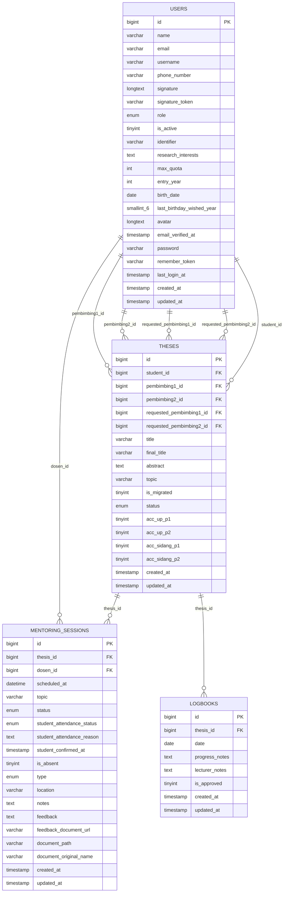
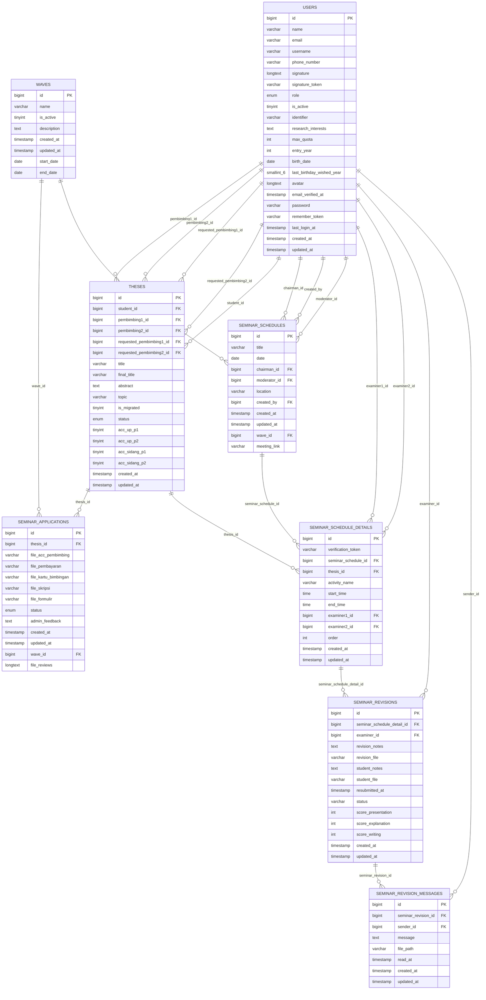
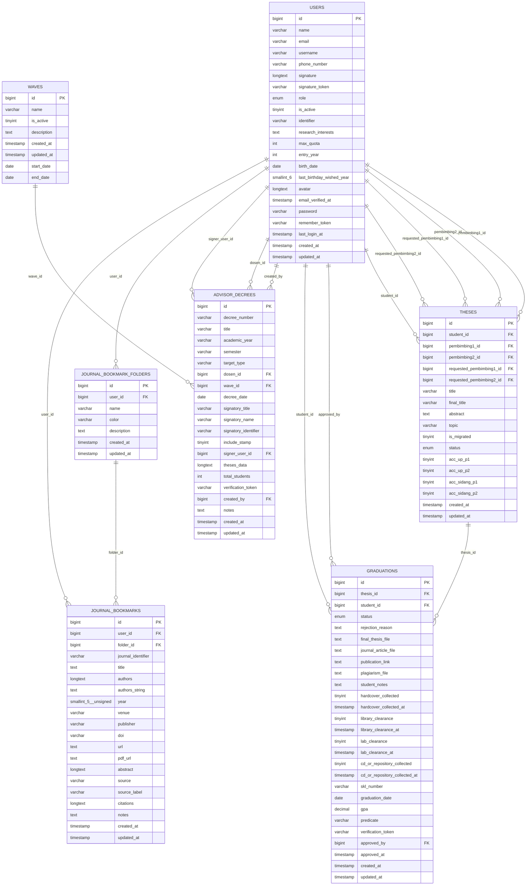
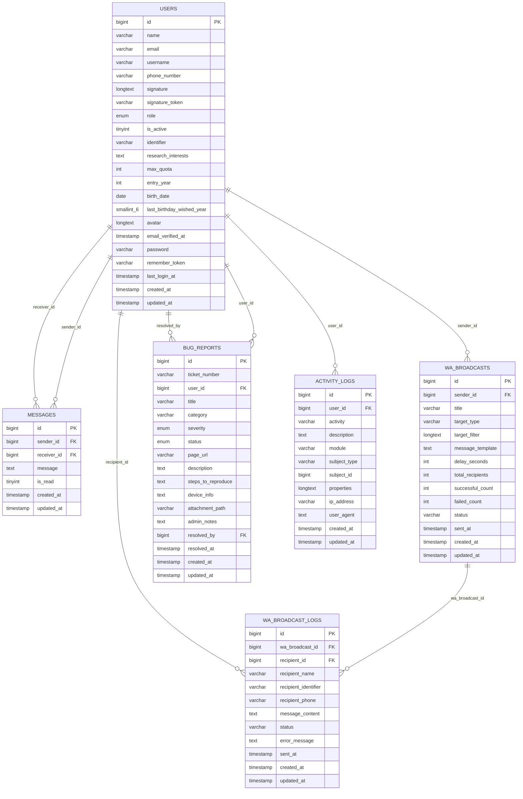

# DOKUMEN RANCANGAN BASIS DATA SISTEM INFORMASI BIMBINGAN TUGAS AKHIR (SIBIMA)
## FAKULTAS ILMU KOMPUTER — UNIVERSITAS SUBANG

| Metadata Dokumen | Deskripsi Spesifikasi |
| :--- | :--- |
| **Nama Sistem** | SIBIMA (Sistem Informasi Bimbingan Tugas Akhir Mahasiswa) |
| **Institusi** | Program Studi Sistem Informasi & Informatika, Fakultas Ilmu Komputer, Universitas Subang |
| **Versi Dokumen** | 2.1 (Pembaruan Skema Relasi Fisik Lengkap & ERD Terklaster) |
| **Basis Data Engine** | MySQL 8.0+ / MariaDB 10.4+ (Storage Engine: InnoDB) |
| **Total Entitas Tabel** | **35 Tabel Operasional** |
| **Total Foreign Key Aktif** | **57 Kunci Asing Terdaftar** |
| **Tanggal Penyusunan** | 29 October 2026 |
| **Klasifikasi Dokumen** | Dokumen Teknis Rekayasa Perangkat Lunak (*Software Architecture Document*) |

---

## 1. PENDAHULUAN & PRINSIP PERANCANGAN BASIS DATA

Sistem Informasi Bimbingan Tugas Akhir (SIBIMA) dirancang untuk mengotomatisasi seluruh siklus administrasi dan akademik tugas akhir mahasiswa pada Fakultas Ilmu Komputer Universitas Subang. Siklus tersebut mencakup pengajuan judul, alokasi dosen pembimbing, sesi bimbingan berbasis QR-code, logbook kemajuan harian, pendaftaran ujian seminar proposal, pelaksanaan seminar, pencatatan revisi, pendaftaran sidang skripsi, pelaksanaan sidang dewan penguji, penuntasan revisi sidang, yudisium kelulusan, penomoran Berita Acara resmi, hingga penerbitan Surat Keputusan (SK) Dekan.

Perancangan basis data SIBIMA dibangun di atas fondasi prinsip arsitektur sistem informasi enterprise:
1. **Normalisasi Data Tingkat Ketiga (3NF)**: Menghindari anomali penyisipan (*insertion anomaly*), pembaharuan (*update anomaly*), dan penghapusan (*deletion anomaly*), sekaligus mengeliminasi redundansi data yang tidak perlu.
2. **Integritas Referensial Ketat (*Referential Integrity*)**: Setiap keterhubungan antar-entitas dilindungi oleh deklarasi *Foreign Key* pada engine InnoDB dengan aksi `ON DELETE CASCADE`, `ON DELETE SET NULL`, atau `ON DELETE RESTRICT` sesuai kaidah bisnis akademik.
3. **Penamaan Bersih & Terstandarisasi (*Clean Naming Conventions*)**: Seluruh nama tabel menggunakan format *snake_case* jamak (*plural*), kolom primary key seragam `id` bertipe `BIGINT UNSIGNED`, kolom referensi kunci asing format `{singular_table}_id`, serta kolom rekam audit waktu `created_at` dan `updated_at`.
4. **Keamanan & Ketertelusuran (*Auditability*)**: Pencatatan riwayat login, mutasi data krusial, dan pembaharuan status tersimpan di tabel `activity_logs`, sementara kredensial pengguna terenkripsi menggunakan algoritma *hash* aman `bcrypt`.

### 1.1 Spesifikasi Teknis Basis Data

| Komponen Arsitektur | Standar / Konvensi yang Diterapkan | Justifikasi Teknis Rekayasa |
| :--- | :--- | :--- |
| **RDBMS Engine** | **InnoDB** | Mendukung transaksi ACID, row-level locking, dan foreign key constraints secara penuh. |
| **Karakter Set (Charset)** | **`utf8mb4`** | Mendukung penuh 4-byte UTF-8, emoji, dan karakter khusus simbolis akademik. |
| **Collation** | **`utf8mb4_unicode_ci`** | Pencocokan dan pengurutan teks akurat multi-bahasa serta bersifat *case-insensitive*. |
| **Konvensi Penamaan Tabel** | Format *snake_case* jamak (*plural*) | Contoh: `theses`, `mentoring_sessions`, `activity_logs`. |
| **Konvensi Primary Key (PK)** | Kolom `id` bertipe `BIGINT UNSIGNED` | Menjamin kapasitas ID hingga $1.84 \times 10^{19}$ record dengan auto-increment. |
| **Konvensi Foreign Key (FK)** | Format `{singular_table_name}_id` | Contoh: `student_id`, `thesis_id`, `wave_id` dengan referensi eksplisit ke tabel induk. |
| **Kolom Jejak Waktu (*Timestamps*)** | `created_at` dan `updated_at` bertipe `TIMESTAMP` | Menjamin rekam jejak audit waktu penciptaan dan perubahan data secara otomatis. |

---

## 2. DIAGRAM RELASI ENTITAS (ENTITY-RELATIONSHIP DIAGRAM / ERD)

Sebagaimana standar perancangan visual skema basis data (seperti pada phpMyAdmin Designer, MySQL Workbench, dan DBeaver), bagian ini memaparkan **struktur tabel visual lengkap beserta kolom, tipe data, atribut primary key (`PK`), atribut foreign key (`FK`), dan garis relasi antar-kolom kunci**.

Untuk menjaga keterbacaan yang optimal dan menghindari jalinan garis kusut (*hairball diagram*), diagram ERD dikelompokkan ke dalam 5 klaster fungsional utama:

### 2.1 Klaster 1: Relasi Tugas Akhir & Bimbingan Mahasiswa
Klaster ini menghubungkan mahasiswa (`users`), tugas akhir (`theses`), logbook kegiatan harian (`logbooks`), dan sesi bimbingan bersama dosen pembimbing (`mentoring_sessions`). Garis relasi menghubungkan `users.id` ke `theses.student_id`, `theses.pembimbing1_id`, dan `theses.pembimbing2_id`, serta `theses.id` ke `logbooks.thesis_id` dan `mentoring_sessions.thesis_id`.

### 2.2 Klaster 2: Relasi Seminar Proposal (Pendaftaran, Jadwal, Penilaian & Revisi)
Klaster ini memetakan pendaftaran seminar proposal (`seminar_applications`), gelombang pendaftaran (`waves`), master jadwal seminar (`seminar_schedules`), alokasi dewan penguji (`seminar_schedule_details`), revisi pasca-seminar (`seminar_revisions`), dan thread percakapan revisi (`seminar_revision_messages`).

### 2.3 Klaster 3: Relasi Sidang Skripsi (Pendaftaran, Jadwal, Penilaian & Revisi)
Klaster ini memetakan permohonan ujian akhir sidang (`thesis_defense_applications`), gelombang aktif (`waves`), jadwal sidang (`thesis_defense_schedules`), alokasi dewan penguji sidang (`thesis_defense_schedule_details`), revisi sidang (`thesis_defense_revisions`), dan thread percakapan revisi sidang skripsi (`thesis_defense_revision_messages`).

```mermaid
erDiagram
    WAVES {
        bigint id PK
        varchar name
        tinyint is_active
        text description
        timestamp created_at
        timestamp updated_at
        date start_date
        date end_date
    }
    THESES {
        bigint id PK
        bigint student_id FK
        bigint pembimbing1_id FK
        bigint pembimbing2_id FK
        bigint requested_pembimbing1_id FK
        bigint requested_pembimbing2_id FK
        varchar title
        varchar final_title
        text abstract
        varchar topic
        tinyint is_migrated
        enum status
        tinyint acc_up_p1
        tinyint acc_up_p2
        tinyint acc_sidang_p1
        tinyint acc_sidang_p2
        timestamp created_at
        timestamp updated_at
    }
    THESIS_DEFENSE_APPLICATIONS {
        bigint id PK
        bigint thesis_id FK
        varchar file_formulir
        varchar file_transkrip
        varchar file_acc_pembimbing
        varchar file_logbook
        varchar file_pembayaran
        varchar file_skripsi
        varchar file_ktm
        varchar file_pkkmb_univ
        varchar file_pkkmb_fak
        varchar file_makrab
        varchar file_cisco
        varchar file_workshop
        varchar file_organisasi
        varchar file_toefl
        varchar file_kewirausahaan
        varchar file_tahsin
        varchar file_komputer
        varchar file_perpus_pinjam
        varchar file_perpus_sumbang
        varchar file_ijazah
        varchar status
        text admin_feedback
        timestamp created_at
        timestamp updated_at
        bigint wave_id FK
        longtext file_reviews
    }
    THESIS_DEFENSE_SCHEDULES {
        bigint id PK
        varchar title
        date date
        bigint chairman_id FK
        bigint moderator_id FK
        varchar location
        bigint created_by FK
        timestamp created_at
        timestamp updated_at
        bigint wave_id FK
        varchar meeting_link
    }
    THESIS_DEFENSE_SCHEDULE_DETAILS {
        bigint id PK
        varchar verification_token
        bigint thesis_defense_schedule_id FK
        bigint thesis_id FK
        varchar activity_name
        time start_time
        time end_time
        bigint examiner1_id FK
        bigint examiner2_id FK
        int order
        timestamp created_at
        timestamp updated_at
    }
    THESIS_DEFENSE_REVISIONS {
        bigint id PK
        bigint thesis_defense_schedule_detail_id FK
        bigint examiner_id FK
        text revision_notes
        varchar revision_file
        text student_notes
        varchar student_file
        timestamp resubmitted_at
        varchar status
        int score_presentation
        int score_explanation
        int score_writing
        timestamp created_at
        timestamp updated_at
    }
    THESIS_DEFENSE_REVISION_MESSAGES {
        bigint id PK
        bigint thesis_defense_revision_id FK
        bigint sender_id FK
        text message
        varchar file_path
        timestamp read_at
        timestamp created_at
        timestamp updated_at
    }
    USERS {
        bigint id PK
        varchar name
        varchar email
        varchar username
        varchar phone_number
        longtext signature
        varchar signature_token
        enum role
        tinyint is_active
        varchar identifier
        text research_interests
        int max_quota
        int entry_year
        date birth_date
        smallint_6 last_birthday_wished_year
        longtext avatar
        timestamp email_verified_at
        varchar password
        varchar remember_token
        timestamp last_login_at
        timestamp created_at
        timestamp updated_at
    }
    USERS ||--o{ THESES : "pembimbing1_id"
    USERS ||--o{ THESES : "pembimbing2_id"
    USERS ||--o{ THESES : "requested_pembimbing1_id"
    USERS ||--o{ THESES : "requested_pembimbing2_id"
    USERS ||--o{ THESES : "student_id"
    THESES ||--o{ THESIS_DEFENSE_APPLICATIONS : "thesis_id"
    WAVES ||--o{ THESIS_DEFENSE_APPLICATIONS : "wave_id"
    USERS ||--o{ THESIS_DEFENSE_SCHEDULES : "chairman_id"
    USERS ||--o{ THESIS_DEFENSE_SCHEDULES : "created_by"
    USERS ||--o{ THESIS_DEFENSE_SCHEDULES : "moderator_id"
    WAVES ||--o{ THESIS_DEFENSE_SCHEDULES : "wave_id"
    THESIS_DEFENSE_SCHEDULES ||--o{ THESIS_DEFENSE_SCHEDULE_DETAILS : "thesis_defense_schedule_id"
    USERS ||--o{ THESIS_DEFENSE_SCHEDULE_DETAILS : "examiner1_id"
    USERS ||--o{ THESIS_DEFENSE_SCHEDULE_DETAILS : "examiner2_id"
    THESES ||--o{ THESIS_DEFENSE_SCHEDULE_DETAILS : "thesis_id"
    THESIS_DEFENSE_SCHEDULE_DETAILS ||--o{ THESIS_DEFENSE_REVISIONS : "thesis_defense_schedule_detail_id"
    USERS ||--o{ THESIS_DEFENSE_REVISIONS : "examiner_id"
    THESIS_DEFENSE_REVISIONS ||--o{ THESIS_DEFENSE_REVISION_MESSAGES : "thesis_defense_revision_id"
    USERS ||--o{ THESIS_DEFENSE_REVISION_MESSAGES : "sender_id"
```

### 2.4 Klaster 4: Relasi Kelulusan Yudisium, SK Dosen Pembimbing & Repositori
Klaster ini mengatur kelulusan yudisium (`graduations`), penerbitan SK dosen pembimbing (`advisor_decrees`), pengaturan format nomor surat resmi (`letter_settings`), repositori skripsi alumni (`thesis_repositories`), dan koleksi referensi jurnal (`journal_bookmarks`, `journal_bookmark_folders`).

### 2.5 Klaster 5: Relasi Komunikasi, Gateway WhatsApp, Log Audit & Bug Report
Klaster ini mengelola perpesanan internal (`messages`), siaran massal WhatsApp (`wa_broadcasts`, `wa_broadcast_logs`), template pesan notifikasi (`wa_templates`), log audit keamanan pengguna (`activity_logs`), dan tiket pelaporan kendala/usulan fitur baru (`bug_reports`).

### 2.6 Matriks Rinci Relasi Antar-Tabel (*Relational Cardinality Matrix*)
Tabel berikut menyajikan seluruh hubungan referensial kunci asing aktif pada basis data SIBIMA beserta kardinalitas dan aturan perlindungan integritas datanya:

| No | Tabel Sumber (*Child*) | Kolom Foreign Key (FK) | Tabel Rujukan (*Parent*) | Kolom Primary Key (PK) | Kardinalitas | Aturan `ON DELETE` | Makna & Aturan Relasi Bisnis |
| :---: | :--- | :--- | :--- | :--- | :---: | :--- | :--- |
| 1 | `activity_logs` | `user_id` | `users` | `id` | N : 1 | `SET NULL` | Pengguna yang memicu aksi mutasi data atau event login sistem. |
| 2 | `advisor_decrees` | `created_by` | `users` | `id` | N : 1 | `CASCADE` | Menghubungkan entitas advisor_decrees (created_by) dengan entitas rujukan users (id). |
| 3 | `advisor_decrees` | `dosen_id` | `users` | `id` | N : 1 | `SET NULL` | Dosen penerima Surat Keputusan penetapan bimbingan. |
| 4 | `advisor_decrees` | `signer_user_id` | `users` | `id` | N : 1 | `SET NULL` | Menghubungkan entitas advisor_decrees (signer_user_id) dengan entitas rujukan users (id). |
| 5 | `advisor_decrees` | `wave_id` | `waves` | `id` | N : 1 | `SET NULL` | Menghubungkan entitas advisor_decrees (wave_id) dengan entitas rujukan waves (id). |
| 6 | `announcements` | `user_id` | `users` | `id` | N : 1 | `CASCADE` | Menghubungkan entitas announcements (user_id) dengan entitas rujukan users (id). |
| 7 | `bug_reports` | `resolved_by` | `users` | `id` | N : 1 | `SET NULL` | Admin/Teknisi yang menangani dan menuntaskan tiket laporan. |
| 8 | `bug_reports` | `user_id` | `users` | `id` | N : 1 | `CASCADE` | Pengguna pelapor kendala teknis atau pengusul fitur baru. |
| 9 | `faqs` | `created_by` | `users` | `id` | N : 1 | `SET NULL` | Menghubungkan entitas faqs (created_by) dengan entitas rujukan users (id). |
| 10 | `graduations` | `approved_by` | `users` | `id` | N : 1 | `SET NULL` | Menghubungkan entitas graduations (approved_by) dengan entitas rujukan users (id). |
| 11 | `graduations` | `student_id` | `users` | `id` | N : 1 | `CASCADE` | Mahasiswa calon wisudawan/lulusan yudisium. |
| 12 | `graduations` | `thesis_id` | `theses` | `id` | 1 : 1 | `CASCADE` | Skripsi yang telah disahkan seluruh penguji untuk yudisium. |
| 13 | `guidance_documents` | `uploaded_by` | `users` | `id` | N : 1 | `SET NULL` | Menghubungkan entitas guidance_documents (uploaded_by) dengan entitas rujukan users (id). |
| 14 | `journal_bookmarks` | `folder_id` | `journal_bookmark_folders` | `id` | N : 1 | `SET NULL` | Pengelompokan artikel jurnal ke folder riset spesifik. |
| 15 | `journal_bookmarks` | `user_id` | `users` | `id` | N : 1 | `CASCADE` | Pengguna pemilik bookmark referensi jurnal riset. |
| 16 | `journal_bookmark_folders` | `user_id` | `users` | `id` | N : 1 | `CASCADE` | Pengguna pembuat folder koleksi referensi jurnal. |
| 17 | `logbooks` | `thesis_id` | `theses` | `id` | N : 1 | `CASCADE` | Rekaman catatan harian progres pengerjaan skripsi mahasiswa. |
| 18 | `mentoring_sessions` | `dosen_id` | `users` | `id` | N : 1 | `CASCADE` | Dosen pembimbing yang membuka dan mengesahkan sesi bimbingan. |
| 19 | `mentoring_sessions` | `thesis_id` | `theses` | `id` | N : 1 | `CASCADE` | Sesi bimbingan tatap muka yang terhubung ke tugas akhir. |
| 20 | `messages` | `receiver_id` | `users` | `id` | N : 1 | `CASCADE` | Pengguna penerima pesan obrolan internal platform. |
| 21 | `messages` | `sender_id` | `users` | `id` | N : 1 | `CASCADE` | Pengguna pengirim pesan obrolan internal platform. |
| 22 | `seminar_applications` | `thesis_id` | `theses` | `id` | N : 1 | `CASCADE` | Skripsi yang diajukan untuk menempuh ujian Seminar Proposal. |
| 23 | `seminar_applications` | `wave_id` | `waves` | `id` | N : 1 | `SET NULL` | Gelombang periode pendaftaran seminar proposal aktif. |
| 24 | `seminar_revisions` | `examiner_id` | `users` | `id` | N : 1 | `CASCADE` | Dosen penguji seminar yang memberikan catatan revisi. |
| 25 | `seminar_revisions` | `seminar_schedule_detail_id` | `seminar_schedule_details` | `id` | N : 1 | `CASCADE` | Kewajiban perbaikan yang diterbitkan dewan penguji seminar. |
| 26 | `seminar_revision_messages` | `seminar_revision_id` | `seminar_revisions` | `id` | N : 1 | `CASCADE` | Thread percakapan konsultasi perbaikan revisi seminar. |
| 27 | `seminar_revision_messages` | `sender_id` | `users` | `id` | N : 1 | `RESTRICT` | Menghubungkan entitas seminar_revision_messages (sender_id) dengan entitas rujukan users (id). |
| 28 | `seminar_schedules` | `chairman_id` | `users` | `id` | N : 1 | `CASCADE` | Menghubungkan entitas seminar_schedules (chairman_id) dengan entitas rujukan users (id). |
| 29 | `seminar_schedules` | `created_by` | `users` | `id` | N : 1 | `CASCADE` | Menghubungkan entitas seminar_schedules (created_by) dengan entitas rujukan users (id). |
| 30 | `seminar_schedules` | `moderator_id` | `users` | `id` | N : 1 | `CASCADE` | Menghubungkan entitas seminar_schedules (moderator_id) dengan entitas rujukan users (id). |
| 31 | `seminar_schedules` | `wave_id` | `waves` | `id` | N : 1 | `SET NULL` | Master sesi pelaksanaan ujian seminar proposal per gelombang. |
| 32 | `seminar_schedule_details` | `examiner1_id` | `users` | `id` | N : 1 | `CASCADE` | Menghubungkan entitas seminar_schedule_details (examiner1_id) dengan entitas rujukan users (id). |
| 33 | `seminar_schedule_details` | `examiner2_id` | `users` | `id` | N : 1 | `CASCADE` | Menghubungkan entitas seminar_schedule_details (examiner2_id) dengan entitas rujukan users (id). |
| 34 | `seminar_schedule_details` | `seminar_schedule_id` | `seminar_schedules` | `id` | N : 1 | `CASCADE` | Induk sesi ruangan dan tanggal seminar proposal. |
| 35 | `seminar_schedule_details` | `thesis_id` | `theses` | `id` | 1 : 1 | `CASCADE` | Alokasi mahasiswa peserta yang dijadwalkan seminar. |
| 36 | `theses` | `pembimbing1_id` | `users` | `id` | N : 1 | `SET NULL` | Penugasan dosen sebagai Dosen Pembimbing Utama. |
| 37 | `theses` | `pembimbing2_id` | `users` | `id` | N : 1 | `SET NULL` | Penugasan dosen sebagai Dosen Pembimbing Pendamping. |
| 38 | `theses` | `requested_pembimbing1_id` | `users` | `id` | N : 1 | `SET NULL` | Menghubungkan entitas theses (requested_pembimbing1_id) dengan entitas rujukan users (id). |
| 39 | `theses` | `requested_pembimbing2_id` | `users` | `id` | N : 1 | `SET NULL` | Menghubungkan entitas theses (requested_pembimbing2_id) dengan entitas rujukan users (id). |
| 40 | `theses` | `student_id` | `users` | `id` | N : 1 | `CASCADE` | Menghubungkan tugas akhir dengan mahasiswa penyusun. |
| 41 | `thesis_defense_applications` | `thesis_id` | `theses` | `id` | N : 1 | `CASCADE` | Skripsi yang diajukan untuk menempuh Sidang Skripsi. |
| 42 | `thesis_defense_applications` | `wave_id` | `waves` | `id` | N : 1 | `SET NULL` | Gelombang periode pendaftaran sidang skripsi aktif. |
| 43 | `thesis_defense_revisions` | `thesis_defense_schedule_detail_id` | `thesis_defense_schedule_details` | `id` | N : 1 | `CASCADE` | Koreksi naskah skripsi yang wajib diselesaikan pasca-sidang. |
| 44 | `thesis_defense_revisions` | `examiner_id` | `users` | `id` | N : 1 | `CASCADE` | Dosen penguji sidang yang memvalidasi perbaikan skripsi. |
| 45 | `thesis_defense_revision_messages` | `thesis_defense_revision_id` | `thesis_defense_revisions` | `id` | N : 1 | `CASCADE` | Thread percakapan perbaikan revisi sidang skripsi. |
| 46 | `thesis_defense_revision_messages` | `sender_id` | `users` | `id` | N : 1 | `RESTRICT` | Menghubungkan entitas thesis_defense_revision_messages (sender_id) dengan entitas rujukan users (id). |
| 47 | `thesis_defense_schedules` | `chairman_id` | `users` | `id` | N : 1 | `CASCADE` | Menghubungkan entitas thesis_defense_schedules (chairman_id) dengan entitas rujukan users (id). |
| 48 | `thesis_defense_schedules` | `created_by` | `users` | `id` | N : 1 | `CASCADE` | Menghubungkan entitas thesis_defense_schedules (created_by) dengan entitas rujukan users (id). |
| 49 | `thesis_defense_schedules` | `moderator_id` | `users` | `id` | N : 1 | `CASCADE` | Menghubungkan entitas thesis_defense_schedules (moderator_id) dengan entitas rujukan users (id). |
| 50 | `thesis_defense_schedules` | `wave_id` | `waves` | `id` | N : 1 | `SET NULL` | Master sesi pelaksanaan sidang skripsi per gelombang. |
| 51 | `thesis_defense_schedule_details` | `thesis_defense_schedule_id` | `thesis_defense_schedules` | `id` | N : 1 | `CASCADE` | Induk sesi ruangan dan tanggal sidang skripsi. |
| 52 | `thesis_defense_schedule_details` | `examiner1_id` | `users` | `id` | N : 1 | `CASCADE` | Menghubungkan entitas thesis_defense_schedule_details (examiner1_id) dengan entitas rujukan users (id). |
| 53 | `thesis_defense_schedule_details` | `examiner2_id` | `users` | `id` | N : 1 | `CASCADE` | Menghubungkan entitas thesis_defense_schedule_details (examiner2_id) dengan entitas rujukan users (id). |
| 54 | `thesis_defense_schedule_details` | `thesis_id` | `theses` | `id` | 1 : 1 | `CASCADE` | Alokasi mahasiswa peserta yang dijadwalkan sidang akhir. |
| 55 | `wa_broadcasts` | `sender_id` | `users` | `id` | N : 1 | `CASCADE` | Staf Admin/Kaprodi pembuat siaran pengumuman massal WA. |
| 56 | `wa_broadcast_logs` | `recipient_id` | `users` | `id` | N : 1 | `SET NULL` | Pengguna penerima target pengiriman pesan siaran. |
| 57 | `wa_broadcast_logs` | `wa_broadcast_id` | `wa_broadcasts` | `id` | N : 1 | `CASCADE` | Induk kampanye siaran pesan WhatsApp massal. |

---

## 3. SPESIFIKASI RINCI STRUKTUR TABEL BASIS DATA (35 TABEL LENGKAP)

Bagian ini memaparkan spesifikasi fisik seluruh **35 tabel operasional SIBIMA**. Setiap tabel dilengkapi dengan **Nama Tabel**, **Primary Key**, **Foreign Key**, **Deskripsi**, serta tabel rincian seluruh kolom yang mencakup No, Nama Kolom, Tipe Data, Nullable, Nilai Default, Kunci (*Key*), dan Keterangan & Aturan Bisnis:

### 3.1 Tabel Log Audit Aktivitas Sistem (`activity_logs`)

> **Nama Tabel**: `activity_logs`  
> **Primary Key**: `id`  
> **Foreign Key**: `user_id` $\rightarrow$ merujuk ke `users.id`  
> **Deskripsi**: Mencatat rekam jejak audit (*security audit trail*) seluruh mutasi data penting, event login/logout, alamat IP pengguna, dan user-agent peramban untuk keperluan keamanan dan forensik.

| No | Nama Kolom | Tipe Data | Nullable | Nilai Default | Kunci (*Key*) | Keterangan & Aturan Bisnis |
| :---: | :--- | :--- | :---: | :---: | :---: | :--- |
| 1 | `id` | `bigint(20) unsigned` | NOT NULL | *None* | PRI (auto_increment) | Identitas unik rekaman data (*Surrogate Primary Key*). |
| 2 | `user_id` | `bigint(20) unsigned` | NULL | `NULL` | MUL | Kunci asing merujuk ke tabel users. |
| 3 | `activity` | `varchar(255)` | NOT NULL | *None* | - | Menyimpan atribut data activity pada sistem SIBIMA. |
| 4 | `description` | `text` | NULL | `NULL` | - | Menyimpan atribut data description pada sistem SIBIMA. |
| 5 | `module` | `varchar(255)` | NULL | `NULL` | - | Menyimpan atribut data module pada sistem SIBIMA. |
| 6 | `subject_type` | `varchar(255)` | NULL | `NULL` | MUL | Menyimpan atribut data subject type pada sistem SIBIMA. |
| 7 | `subject_id` | `bigint(20) unsigned` | NULL | `NULL` | - | Menyimpan atribut data subject id pada sistem SIBIMA. |
| 8 | `properties` | `longtext` | NULL | `NULL` | - | Menyimpan atribut data properties pada sistem SIBIMA. |
| 9 | `ip_address` | `varchar(45)` | NULL | `NULL` | - | Menyimpan atribut data ip address pada sistem SIBIMA. |
| 10 | `user_agent` | `text` | NULL | `NULL` | - | Menyimpan atribut data user agent pada sistem SIBIMA. |
| 11 | `created_at` | `timestamp` | NULL | `NULL` | - | Waktu rekaman pertama kali dibuat di sistem. |
| 12 | `updated_at` | `timestamp` | NULL | `NULL` | - | Waktu rekaman terakhir kali diperbarui. |

---

### 3.2 Tabel Surat Keputusan (SK) Dosen Pembimbing (`advisor_decrees`)

> **Nama Tabel**: `advisor_decrees`  
> **Primary Key**: `id`  
> **Foreign Key**: `created_by` $\rightarrow$ merujuk ke `users.id` `dosen_id` $\rightarrow$ merujuk ke `users.id` `signer_user_id` $\rightarrow$ merujuk ke `users.id` `wave_id` $\rightarrow$ merujuk ke `waves.id`  
> **Deskripsi**: Merekam penerbitan Surat Keputusan resmi dari pimpinan fakultas mengenai penetapan dosen pembimbing skripsi mahasiswa untuk periode semester tertentu.

| No | Nama Kolom | Tipe Data | Nullable | Nilai Default | Kunci (*Key*) | Keterangan & Aturan Bisnis |
| :---: | :--- | :--- | :---: | :---: | :---: | :--- |
| 1 | `id` | `bigint(20) unsigned` | NOT NULL | *None* | PRI (auto_increment) | Identitas unik rekaman data (*Surrogate Primary Key*). |
| 2 | `decree_number` | `varchar(255)` | NOT NULL | *None* | MUL | Nomor surat keputusan resmi yang diterbitkan fakultas. |
| 3 | `title` | `varchar(255)` | NOT NULL | `'Penetapan Dosen Pembimbing Skripsi Mahasiswa'` | - | Menyimpan atribut data title pada sistem SIBIMA. |
| 4 | `academic_year` | `varchar(255)` | NOT NULL | `'2025/2026'` | MUL | Menyimpan atribut data academic year pada sistem SIBIMA. |
| 5 | `semester` | `varchar(255)` | NOT NULL | `'Ganjil'` | - | Menyimpan atribut data semester pada sistem SIBIMA. |
| 6 | `target_type` | `varchar(255)` | NOT NULL | `'collective'` | - | Menyimpan atribut data target type pada sistem SIBIMA. |
| 7 | `dosen_id` | `bigint(20) unsigned` | NULL | `NULL` | MUL | Kunci asing dosen yang ditunjuk dalam surat keputusan. |
| 8 | `wave_id` | `bigint(20) unsigned` | NULL | `NULL` | MUL | Kunci asing gelombang semester penetapan SK pembimbingan. |
| 9 | `decree_date` | `date` | NOT NULL | *None* | - | Rekam penanggalan agenda kegiatan. |
| 10 | `signatory_title` | `varchar(255)` | NOT NULL | `'Dekan Fakultas Ilmu Komputer'` | - | Menyimpan atribut data signatory title pada sistem SIBIMA. |
| 11 | `signatory_name` | `varchar(255)` | NOT NULL | *None* | - | Menyimpan atribut data signatory name pada sistem SIBIMA. |
| 12 | `signatory_identifier` | `varchar(255)` | NULL | `NULL` | - | Menyimpan atribut data signatory identifier pada sistem SIBIMA. |
| 13 | `include_stamp` | `tinyint(1)` | NOT NULL | `1` | - | Menyimpan atribut data include stamp pada sistem SIBIMA. |
| 14 | `signer_user_id` | `bigint(20) unsigned` | NULL | `NULL` | MUL | Kunci asing pejabat penandatangan SK (Dekan/Wadek). |
| 15 | `theses_data` | `longtext` | NOT NULL | *None* | - | Menyimpan atribut data theses data pada sistem SIBIMA. |
| 16 | `total_students` | `int(10) unsigned` | NOT NULL | `0` | - | Menyimpan atribut data total students pada sistem SIBIMA. |
| 17 | `verification_token` | `varchar(64)` | NOT NULL | *None* | UNI | Kode token acak keamanan autentikasi/verifikasi. |
| 18 | `created_by` | `bigint(20) unsigned` | NOT NULL | *None* | MUL | Menyimpan atribut data created by pada sistem SIBIMA. |
| 19 | `notes` | `text` | NULL | `NULL` | - | Menyimpan atribut data notes pada sistem SIBIMA. |
| 20 | `created_at` | `timestamp` | NULL | `NULL` | - | Waktu rekaman pertama kali dibuat di sistem. |
| 21 | `updated_at` | `timestamp` | NULL | `NULL` | - | Waktu rekaman terakhir kali diperbarui. |

---

### 3.3 Tabel Pengumuman & Informasi Program Studi (`announcements`)

> **Nama Tabel**: `announcements`  
> **Primary Key**: `id`  
> **Foreign Key**: `user_id` $\rightarrow$ merujuk ke `users.id`  
> **Deskripsi**: Menyimpan siaran warta dan pengumuman resmi dari Kaprodi/Admin kepada seluruh pengguna sistem, dilengkapi status pin pengumuman penting dan tanggal kedaluwarsa.

| No | Nama Kolom | Tipe Data | Nullable | Nilai Default | Kunci (*Key*) | Keterangan & Aturan Bisnis |
| :---: | :--- | :--- | :---: | :---: | :---: | :--- |
| 1 | `id` | `bigint(20) unsigned` | NOT NULL | *None* | PRI (auto_increment) | Identitas unik rekaman data (*Surrogate Primary Key*). |
| 2 | `title` | `varchar(255)` | NOT NULL | *None* | - | Menyimpan atribut data title pada sistem SIBIMA. |
| 3 | `content` | `text` | NOT NULL | *None* | - | Menyimpan atribut data content pada sistem SIBIMA. |
| 4 | `type` | `enum('info','warning','important')` | NOT NULL | `'info'` | - | Menyimpan atribut data type pada sistem SIBIMA. |
| 5 | `is_active` | `tinyint(1)` | NOT NULL | `1` | - | Bendera status biner (1 = Ya / Aktif, 0 = Tidak / Nonaktif). |
| 6 | `user_id` | `bigint(20) unsigned` | NOT NULL | *None* | MUL | Kunci asing merujuk ke tabel users. |
| 7 | `created_at` | `timestamp` | NULL | `NULL` | - | Waktu rekaman pertama kali dibuat di sistem. |
| 8 | `updated_at` | `timestamp` | NULL | `NULL` | - | Waktu rekaman terakhir kali diperbarui. |

---

### 3.4 Tabel Laporan Kendala Sistem & Usulan Fitur Baru (`bug_reports`)

> **Nama Tabel**: `bug_reports`  
> **Primary Key**: `id`  
> **Foreign Key**: `resolved_by` $\rightarrow$ merujuk ke `users.id` `user_id` $\rightarrow$ merujuk ke `users.id`  
> **Deskripsi**: Menyimpan tiket laporan galat teknis (kode BUG-) serta permohonan fitur baru (kode REQ-) yang diajukan pengguna melalui widget pengaduan sistem terintegrasi.

| No | Nama Kolom | Tipe Data | Nullable | Nilai Default | Kunci (*Key*) | Keterangan & Aturan Bisnis |
| :---: | :--- | :--- | :---: | :---: | :---: | :--- |
| 1 | `id` | `bigint(20) unsigned` | NOT NULL | *None* | PRI (auto_increment) | Identitas unik rekaman data (*Surrogate Primary Key*). |
| 2 | `ticket_number` | `varchar(32)` | NOT NULL | *None* | UNI | Nomor tiket unik pelaporan (format: BUG-xxxx atau REQ-xxxx). |
| 3 | `user_id` | `bigint(20) unsigned` | NOT NULL | *None* | MUL | Kunci asing pengguna pelapor masalah atau pengusul fitur. |
| 4 | `title` | `varchar(255)` | NOT NULL | *None* | - | Judul ringkas ringkasan kendala atau usulan fitur. |
| 5 | `category` | `varchar(50)` | NOT NULL | `'functionality'` | - | Kategori modul: auth, thesis, seminar, defense, etc. |
| 6 | `severity` | `enum('low','medium','high','critical')` | NOT NULL | `'medium'` | MUL | Tingkat urgensi penanganan: low, medium, high, critical. |
| 7 | `status` | `enum('open','in_progress','resolved','rejected')` | NOT NULL | `'open'` | MUL | Status tiket: open, in_progress, resolved, closed. |
| 8 | `page_url` | `varchar(500)` | NULL | `NULL` | - | Alamat URL halaman saat masalah terjadi di peramban. |
| 9 | `description` | `text` | NOT NULL | *None* | - | Menyimpan atribut data description pada sistem SIBIMA. |
| 10 | `steps_to_reproduce` | `text` | NULL | `NULL` | - | Menyimpan atribut data steps to reproduce pada sistem SIBIMA. |
| 11 | `device_info` | `text` | NULL | `NULL` | - | Menyimpan atribut data device info pada sistem SIBIMA. |
| 12 | `attachment_path` | `varchar(255)` | NULL | `NULL` | - | Path penyimpanan berkas digital pada storage sistem. |
| 13 | `admin_notes` | `text` | NULL | `NULL` | - | Menyimpan atribut data admin notes pada sistem SIBIMA. |
| 14 | `resolved_by` | `bigint(20) unsigned` | NULL | `NULL` | MUL | Kunci asing admin/developer yang menangani laporan. |
| 15 | `resolved_at` | `timestamp` | NULL | `NULL` | - | Menyimpan atribut data resolved at pada sistem SIBIMA. |
| 16 | `created_at` | `timestamp` | NULL | `NULL` | MUL | Waktu rekaman pertama kali dibuat di sistem. |
| 17 | `updated_at` | `timestamp` | NULL | `NULL` | - | Waktu rekaman terakhir kali diperbarui. |

---

### 3.5 Tabel Tanya Jawab Umum (FAQ) (`faqs`)

> **Nama Tabel**: `faqs`  
> **Primary Key**: `id`  
> **Foreign Key**: `created_by` $\rightarrow$ merujuk ke `users.id`  
> **Deskripsi**: Menyimpan daftar pertanyaan umum dan solusi teknis terkait proses administrasi skripsi dan penggunaan aplikasi guna mempermudah mahasiswa dan dosen.

| No | Nama Kolom | Tipe Data | Nullable | Nilai Default | Kunci (*Key*) | Keterangan & Aturan Bisnis |
| :---: | :--- | :--- | :---: | :---: | :---: | :--- |
| 1 | `id` | `bigint(20) unsigned` | NOT NULL | *None* | PRI (auto_increment) | Identitas unik rekaman data (*Surrogate Primary Key*). |
| 2 | `question` | `varchar(255)` | NOT NULL | *None* | - | Menyimpan atribut data question pada sistem SIBIMA. |
| 3 | `answer` | `text` | NOT NULL | *None* | - | Menyimpan atribut data answer pada sistem SIBIMA. |
| 4 | `category` | `varchar(255)` | NOT NULL | `'umum'` | - | Menyimpan atribut data category pada sistem SIBIMA. |
| 5 | `target_role` | `varchar(255)` | NOT NULL | `'all'` | - | Menyimpan atribut data target role pada sistem SIBIMA. |
| 6 | `order` | `int(11)` | NOT NULL | `0` | - | Menyimpan atribut data order pada sistem SIBIMA. |
| 7 | `is_active` | `tinyint(1)` | NOT NULL | `1` | - | Bendera status biner (1 = Ya / Aktif, 0 = Tidak / Nonaktif). |
| 8 | `created_by` | `bigint(20) unsigned` | NULL | `NULL` | MUL | Menyimpan atribut data created by pada sistem SIBIMA. |
| 9 | `created_at` | `timestamp` | NULL | `NULL` | - | Waktu rekaman pertama kali dibuat di sistem. |
| 10 | `updated_at` | `timestamp` | NULL | `NULL` | - | Waktu rekaman terakhir kali diperbarui. |

---

### 3.6 Tabel Fasilkom Journals (`fasilkom_journals`)

> **Nama Tabel**: `fasilkom_journals`  
> **Primary Key**: `id`  
> **Foreign Key**: Tidak ada (*None*)  
> **Deskripsi**: Tabel entitas operasional fasilkom journals pada basis data SIBIMA.

| No | Nama Kolom | Tipe Data | Nullable | Nilai Default | Kunci (*Key*) | Keterangan & Aturan Bisnis |
| :---: | :--- | :--- | :---: | :---: | :---: | :--- |
| 1 | `id` | `bigint(20) unsigned` | NOT NULL | *None* | PRI (auto_increment) | Identitas unik rekaman data (*Surrogate Primary Key*). |
| 2 | `identifier` | `varchar(255)` | NOT NULL | *None* | UNI | Menyimpan atribut data identifier pada sistem SIBIMA. |
| 3 | `article_id` | `bigint(20) unsigned` | NULL | `NULL` | MUL | Menyimpan atribut data article id pada sistem SIBIMA. |
| 4 | `title` | `text` | NOT NULL | *None* | - | Menyimpan atribut data title pada sistem SIBIMA. |
| 5 | `authors` | `longtext` | NULL | `NULL` | - | Menyimpan atribut data authors pada sistem SIBIMA. |
| 6 | `authors_string` | `varchar(1000)` | NULL | `NULL` | - | Menyimpan atribut data authors string pada sistem SIBIMA. |
| 7 | `abstract` | `longtext` | NULL | `NULL` | - | Menyimpan atribut data abstract pada sistem SIBIMA. |
| 8 | `subjects` | `longtext` | NULL | `NULL` | - | Menyimpan atribut data subjects pada sistem SIBIMA. |
| 9 | `publication_date` | `varchar(255)` | NULL | `NULL` | - | Rekam penanggalan agenda kegiatan. |
| 10 | `year` | `int(11)` | NULL | `NULL` | MUL | Menyimpan atribut data year pada sistem SIBIMA. |
| 11 | `volume` | `varchar(255)` | NULL | `NULL` | - | Menyimpan atribut data volume pada sistem SIBIMA. |
| 12 | `issue` | `varchar(255)` | NULL | `NULL` | - | Menyimpan atribut data issue pada sistem SIBIMA. |
| 13 | `pages` | `varchar(255)` | NULL | `NULL` | - | Menyimpan atribut data pages pada sistem SIBIMA. |
| 14 | `landing_page_url` | `varchar(255)` | NOT NULL | *None* | - | Menyimpan atribut data landing page url pada sistem SIBIMA. |
| 15 | `pdf_url` | `varchar(255)` | NULL | `NULL` | - | Menyimpan atribut data pdf url pada sistem SIBIMA. |
| 16 | `doi` | `varchar(255)` | NULL | `NULL` | - | Menyimpan atribut data doi pada sistem SIBIMA. |
| 17 | `publisher` | `varchar(255)` | NULL | `NULL` | - | Menyimpan atribut data publisher pada sistem SIBIMA. |
| 18 | `issn` | `varchar(255)` | NULL | `NULL` | - | Menyimpan atribut data issn pada sistem SIBIMA. |
| 19 | `created_at` | `timestamp` | NULL | `NULL` | - | Waktu rekaman pertama kali dibuat di sistem. |
| 20 | `updated_at` | `timestamp` | NULL | `NULL` | - | Waktu rekaman terakhir kali diperbarui. |

---

### 3.7 Tabel Pendaftaran Yudisium & Kelulusan (`graduations`)

> **Nama Tabel**: `graduations`  
> **Primary Key**: `id`  
> **Foreign Key**: `approved_by` $\rightarrow$ merujuk ke `users.id` `student_id` $\rightarrow$ merujuk ke `users.id` `thesis_id` $\rightarrow$ merujuk ke `theses.id`  
> **Deskripsi**: Menyimpan pendaftaran yudisium dan penetapan kelulusan sarjana bagi mahasiswa yang telah menyelesaikan revisi sidang dan melengkapi berkas bebas pustaka serta bebas laboratorium.

| No | Nama Kolom | Tipe Data | Nullable | Nilai Default | Kunci (*Key*) | Keterangan & Aturan Bisnis |
| :---: | :--- | :--- | :---: | :---: | :---: | :--- |
| 1 | `id` | `bigint(20) unsigned` | NOT NULL | *None* | PRI (auto_increment) | Identitas unik rekaman data (*Surrogate Primary Key*). |
| 2 | `thesis_id` | `bigint(20) unsigned` | NOT NULL | *None* | MUL | Kunci asing merujuk ke skripsi yang telah tuntas diuji. |
| 3 | `student_id` | `bigint(20) unsigned` | NOT NULL | *None* | MUL | Kunci asing merujuk ke mahasiswa calon lulusan. |
| 4 | `status` | `enum('pending','approved','rejected')` | NOT NULL | `'pending'` | - | Status permohonan yudisium: submitted, verified, graduated. |
| 5 | `rejection_reason` | `text` | NULL | `NULL` | - | Menyimpan atribut data rejection reason pada sistem SIBIMA. |
| 6 | `final_thesis_file` | `text` | NULL | `NULL` | - | Path penyimpanan berkas digital pada storage sistem. |
| 7 | `journal_article_file` | `text` | NULL | `NULL` | - | Path penyimpanan berkas digital pada storage sistem. |
| 8 | `publication_link` | `text` | NULL | `NULL` | - | Menyimpan atribut data publication link pada sistem SIBIMA. |
| 9 | `plagiarism_file` | `text` | NULL | `NULL` | - | Path penyimpanan berkas digital pada storage sistem. |
| 10 | `student_notes` | `text` | NULL | `NULL` | - | Menyimpan atribut data student notes pada sistem SIBIMA. |
| 11 | `hardcover_collected` | `tinyint(1)` | NOT NULL | `0` | - | Menyimpan atribut data hardcover collected pada sistem SIBIMA. |
| 12 | `hardcover_collected_at` | `timestamp` | NULL | `NULL` | - | Menyimpan atribut data hardcover collected at pada sistem SIBIMA. |
| 13 | `library_clearance` | `tinyint(1)` | NOT NULL | `0` | - | Menyimpan atribut data library clearance pada sistem SIBIMA. |
| 14 | `library_clearance_at` | `timestamp` | NULL | `NULL` | - | Menyimpan atribut data library clearance at pada sistem SIBIMA. |
| 15 | `lab_clearance` | `tinyint(1)` | NOT NULL | `0` | - | Menyimpan atribut data lab clearance pada sistem SIBIMA. |
| 16 | `lab_clearance_at` | `timestamp` | NULL | `NULL` | - | Menyimpan atribut data lab clearance at pada sistem SIBIMA. |
| 17 | `cd_or_repository_collected` | `tinyint(1)` | NOT NULL | `0` | - | Menyimpan atribut data cd or repository collected pada sistem SIBIMA. |
| 18 | `cd_or_repository_collected_at` | `timestamp` | NULL | `NULL` | - | Menyimpan atribut data cd or repository collected at pada sistem SIBIMA. |
| 19 | `skl_number` | `varchar(255)` | NULL | `NULL` | - | Menyimpan atribut data skl number pada sistem SIBIMA. |
| 20 | `graduation_date` | `date` | NULL | `NULL` | - | Tanggal resmi penetapan kelulusan yudisium sarjana. |
| 21 | `gpa` | `decimal(3,2)` | NULL | `NULL` | - | Menyimpan atribut data gpa pada sistem SIBIMA. |
| 22 | `predicate` | `varchar(255)` | NULL | `NULL` | - | Menyimpan atribut data predicate pada sistem SIBIMA. |
| 23 | `verification_token` | `varchar(64)` | NULL | `NULL` | UNI | Kode token acak keamanan autentikasi/verifikasi. |
| 24 | `approved_by` | `bigint(20) unsigned` | NULL | `NULL` | MUL | Kunci asing staf admin/kaprodi yang memvalidasi berkas yudisium. |
| 25 | `approved_at` | `timestamp` | NULL | `NULL` | - | Menyimpan atribut data approved at pada sistem SIBIMA. |
| 26 | `created_at` | `timestamp` | NULL | `NULL` | - | Waktu rekaman pertama kali dibuat di sistem. |
| 27 | `updated_at` | `timestamp` | NULL | `NULL` | - | Waktu rekaman terakhir kali diperbarui. |

---

### 3.8 Tabel Dokumen Panduan & Pedoman Akademik (`guidance_documents`)

> **Nama Tabel**: `guidance_documents`  
> **Primary Key**: `id`  
> **Foreign Key**: `uploaded_by` $\rightarrow$ merujuk ke `users.id`  
> **Deskripsi**: Menyimpan berkas buku pedoman akademik, tata tertib penyusunan skripsi, panduan penulisan ilmiah, dan panduan pengoperasian aplikasi SIBIMA.

| No | Nama Kolom | Tipe Data | Nullable | Nilai Default | Kunci (*Key*) | Keterangan & Aturan Bisnis |
| :---: | :--- | :--- | :---: | :---: | :---: | :--- |
| 1 | `id` | `bigint(20) unsigned` | NOT NULL | *None* | PRI (auto_increment) | Identitas unik rekaman data (*Surrogate Primary Key*). |
| 2 | `title` | `varchar(255)` | NOT NULL | *None* | - | Menyimpan atribut data title pada sistem SIBIMA. |
| 3 | `description` | `text` | NULL | `NULL` | - | Menyimpan atribut data description pada sistem SIBIMA. |
| 4 | `category` | `varchar(255)` | NOT NULL | `'panduan_skripsi'` | - | Menyimpan atribut data category pada sistem SIBIMA. |
| 5 | `file_path` | `varchar(255)` | NOT NULL | *None* | - | Path penyimpanan berkas digital pada storage sistem. |
| 6 | `original_name` | `varchar(255)` | NOT NULL | *None* | - | Menyimpan atribut data original name pada sistem SIBIMA. |
| 7 | `file_size` | `bigint(20) unsigned` | NULL | `NULL` | - | Path penyimpanan berkas digital pada storage sistem. |
| 8 | `file_extension` | `varchar(10)` | NULL | `NULL` | - | Path penyimpanan berkas digital pada storage sistem. |
| 9 | `download_count` | `int(10) unsigned` | NOT NULL | `0` | - | Menyimpan atribut data download count pada sistem SIBIMA. |
| 10 | `is_active` | `tinyint(1)` | NOT NULL | `1` | - | Bendera status biner (1 = Ya / Aktif, 0 = Tidak / Nonaktif). |
| 11 | `uploaded_by` | `bigint(20) unsigned` | NULL | `NULL` | MUL | Menyimpan atribut data uploaded by pada sistem SIBIMA. |
| 12 | `created_at` | `timestamp` | NULL | `NULL` | - | Waktu rekaman pertama kali dibuat di sistem. |
| 13 | `updated_at` | `timestamp` | NULL | `NULL` | - | Waktu rekaman terakhir kali diperbarui. |

---

### 3.9 Tabel Bookmark Artikel Jurnal & Referensi (`journal_bookmarks`)

> **Nama Tabel**: `journal_bookmarks`  
> **Primary Key**: `id`  
> **Foreign Key**: `folder_id` $\rightarrow$ merujuk ke `journal_bookmark_folders.id` `user_id` $\rightarrow$ merujuk ke `users.id`  
> **Deskripsi**: Menyimpan artikel jurnal eksternal, DOI, abstrak, dan tautan publikasi ilmiah yang disimpan pengguna sebagai acuan literatur penyusunan tugas akhir.

| No | Nama Kolom | Tipe Data | Nullable | Nilai Default | Kunci (*Key*) | Keterangan & Aturan Bisnis |
| :---: | :--- | :--- | :---: | :---: | :---: | :--- |
| 1 | `id` | `bigint(20) unsigned` | NOT NULL | *None* | PRI (auto_increment) | Identitas unik rekaman data (*Surrogate Primary Key*). |
| 2 | `user_id` | `bigint(20) unsigned` | NOT NULL | *None* | MUL | Kunci asing pengguna pemilik simpanan bookmark artikel. |
| 3 | `folder_id` | `bigint(20) unsigned` | NULL | `NULL` | MUL | Kunci asing folder kategori koleksi referensi jurnal. |
| 4 | `journal_identifier` | `varchar(255)` | NOT NULL | *None* | - | Menyimpan atribut data journal identifier pada sistem SIBIMA. |
| 5 | `title` | `text` | NOT NULL | *None* | - | Judul publikasi artikel jurnal atau prosiding ilmiah. |
| 6 | `authors` | `longtext` | NULL | `NULL` | - | Menyimpan atribut data authors pada sistem SIBIMA. |
| 7 | `authors_string` | `text` | NULL | `NULL` | - | Menyimpan atribut data authors string pada sistem SIBIMA. |
| 8 | `year` | `smallint(5) unsigned` | NULL | `NULL` | - | Menyimpan atribut data year pada sistem SIBIMA. |
| 9 | `venue` | `varchar(255)` | NULL | `NULL` | - | Menyimpan atribut data venue pada sistem SIBIMA. |
| 10 | `publisher` | `varchar(255)` | NULL | `NULL` | - | Menyimpan atribut data publisher pada sistem SIBIMA. |
| 11 | `doi` | `varchar(255)` | NULL | `NULL` | - | Digital Object Identifier (DOI) resmi artikel jurnal. |
| 12 | `url` | `text` | NULL | `NULL` | - | Tautan URL eksternal sumber artikel jurnal lengkap. |
| 13 | `pdf_url` | `text` | NULL | `NULL` | - | Menyimpan atribut data pdf url pada sistem SIBIMA. |
| 14 | `abstract` | `longtext` | NULL | `NULL` | - | Menyimpan atribut data abstract pada sistem SIBIMA. |
| 15 | `source` | `varchar(50)` | NOT NULL | `'unknown'` | - | Menyimpan atribut data source pada sistem SIBIMA. |
| 16 | `source_label` | `varchar(100)` | NULL | `NULL` | - | Menyimpan atribut data source label pada sistem SIBIMA. |
| 17 | `citations` | `longtext` | NULL | `NULL` | - | Menyimpan atribut data citations pada sistem SIBIMA. |
| 18 | `notes` | `text` | NULL | `NULL` | - | Menyimpan atribut data notes pada sistem SIBIMA. |
| 19 | `created_at` | `timestamp` | NULL | `NULL` | - | Waktu rekaman pertama kali dibuat di sistem. |
| 20 | `updated_at` | `timestamp` | NULL | `NULL` | - | Waktu rekaman terakhir kali diperbarui. |

---

### 3.10 Tabel Folder Koleksi Referensi Jurnal (`journal_bookmark_folders`)

> **Nama Tabel**: `journal_bookmark_folders`  
> **Primary Key**: `id`  
> **Foreign Key**: `user_id` $\rightarrow$ merujuk ke `users.id`  
> **Deskripsi**: Menyediakan wadah pengelompokan (*folder*) bookmark artikel jurnal dan referensi ilmiah mahasiswa/dosen berdasarkan topik atau bab kajian tugas akhir.

| No | Nama Kolom | Tipe Data | Nullable | Nilai Default | Kunci (*Key*) | Keterangan & Aturan Bisnis |
| :---: | :--- | :--- | :---: | :---: | :---: | :--- |
| 1 | `id` | `bigint(20) unsigned` | NOT NULL | *None* | PRI (auto_increment) | Identitas unik rekaman data (*Surrogate Primary Key*). |
| 2 | `user_id` | `bigint(20) unsigned` | NOT NULL | *None* | MUL | Kunci asing merujuk ke tabel users. |
| 3 | `name` | `varchar(255)` | NOT NULL | *None* | - | Menyimpan atribut data name pada sistem SIBIMA. |
| 4 | `color` | `varchar(255)` | NOT NULL | `'orange'` | - | Menyimpan atribut data color pada sistem SIBIMA. |
| 5 | `description` | `text` | NULL | `NULL` | - | Menyimpan atribut data description pada sistem SIBIMA. |
| 6 | `created_at` | `timestamp` | NULL | `NULL` | - | Waktu rekaman pertama kali dibuat di sistem. |
| 7 | `updated_at` | `timestamp` | NULL | `NULL` | - | Waktu rekaman terakhir kali diperbarui. |

---

### 3.11 Tabel Konfigurasi Format Surat Resmi (`letter_settings`)

> **Nama Tabel**: `letter_settings`  
> **Primary Key**: `id`  
> **Foreign Key**: Tidak ada (*None*)  
> **Deskripsi**: Menyimpan format nomor surat dinas, pejabat penandatangan, NIDN pejabat, dan format penomoran otomatis untuk Berita Acara, Undangan Ujian, dan SK Dekan.

| No | Nama Kolom | Tipe Data | Nullable | Nilai Default | Kunci (*Key*) | Keterangan & Aturan Bisnis |
| :---: | :--- | :--- | :---: | :---: | :---: | :--- |
| 1 | `id` | `bigint(20) unsigned` | NOT NULL | *None* | PRI (auto_increment) | Identitas unik rekaman data (*Surrogate Primary Key*). |
| 2 | `type` | `varchar(255)` | NOT NULL | *None* | UNI | Menyimpan atribut data type pada sistem SIBIMA. |
| 3 | `format` | `varchar(255)` | NOT NULL | *None* | - | Menyimpan atribut data format pada sistem SIBIMA. |
| 4 | `last_number` | `int(11)` | NOT NULL | `0` | - | Menyimpan atribut data last number pada sistem SIBIMA. |
| 5 | `title` | `varchar(255)` | NULL | `NULL` | - | Menyimpan atribut data title pada sistem SIBIMA. |
| 6 | `created_at` | `timestamp` | NULL | `NULL` | - | Waktu rekaman pertama kali dibuat di sistem. |
| 7 | `updated_at` | `timestamp` | NULL | `NULL` | - | Waktu rekaman terakhir kali diperbarui. |

---

### 3.12 Tabel Catatan Harian Bimbingan (Logbook) (`logbooks`)

> **Nama Tabel**: `logbooks`  
> **Primary Key**: `id`  
> **Foreign Key**: `thesis_id` $\rightarrow$ merujuk ke `theses.id`  
> **Deskripsi**: Menyimpan rekaman aktivitas kemajuan harian mahasiswa dalam menyusun skripsi. Memuat tanggal bimbingan, bab yang dikerjakan, uraian konsultasi, status validasi dosen pembimbing, serta paraf digital persetujuan.

| No | Nama Kolom | Tipe Data | Nullable | Nilai Default | Kunci (*Key*) | Keterangan & Aturan Bisnis |
| :---: | :--- | :--- | :---: | :---: | :---: | :--- |
| 1 | `id` | `bigint(20) unsigned` | NOT NULL | *None* | PRI (auto_increment) | Identitas unik rekaman data (*Surrogate Primary Key*). |
| 2 | `thesis_id` | `bigint(20) unsigned` | NOT NULL | *None* | MUL | Kunci asing merujuk ke skripsi mahasiswa. |
| 3 | `date` | `date` | NOT NULL | *None* | - | Tanggal pelaksanaan kegiatan bimbingan mandiri/konsultasi. |
| 4 | `progress_notes` | `text` | NOT NULL | *None* | - | Menyimpan atribut data progress notes pada sistem SIBIMA. |
| 5 | `lecturer_notes` | `text` | NULL | `NULL` | - | Menyimpan atribut data lecturer notes pada sistem SIBIMA. |
| 6 | `is_approved` | `tinyint(1)` | NOT NULL | `0` | - | Bendera status biner (1 = Ya / Aktif, 0 = Tidak / Nonaktif). |
| 7 | `created_at` | `timestamp` | NULL | `NULL` | - | Waktu rekaman pertama kali dibuat di sistem. |
| 8 | `updated_at` | `timestamp` | NULL | `NULL` | - | Waktu rekaman terakhir kali diperbarui. |

---

### 3.13 Tabel Sesi Bimbingan Skripsi (`mentoring_sessions`)

> **Nama Tabel**: `mentoring_sessions`  
> **Primary Key**: `id`  
> **Foreign Key**: `dosen_id` $\rightarrow$ merujuk ke `users.id` `thesis_id` $\rightarrow$ merujuk ke `theses.id`  
> **Deskripsi**: Mencatat setiap agenda sesi bimbingan antara dosen pembimbing dan mahasiswa, baik bimbingan mandiri perorangan maupun kelompok. Menyimpan token/QR presensi real-time, waktu dan ruang bimbingan, catatan evaluasi dosen, serta tautan dokumen revisi.

| No | Nama Kolom | Tipe Data | Nullable | Nilai Default | Kunci (*Key*) | Keterangan & Aturan Bisnis |
| :---: | :--- | :--- | :---: | :---: | :---: | :--- |
| 1 | `id` | `bigint(20) unsigned` | NOT NULL | *None* | PRI (auto_increment) | Identitas unik rekaman data (*Surrogate Primary Key*). |
| 2 | `thesis_id` | `bigint(20) unsigned` | NOT NULL | *None* | MUL | Kunci asing merujuk ke entitas tugas akhir. |
| 3 | `dosen_id` | `bigint(20) unsigned` | NULL | `NULL` | MUL | Kunci asing merujuk ke dosen pembimbing pelaksana bimbingan. |
| 4 | `scheduled_at` | `datetime` | NOT NULL | *None* | - | Menyimpan atribut data scheduled at pada sistem SIBIMA. |
| 5 | `topic` | `varchar(255)` | NOT NULL | *None* | - | Menyimpan atribut data topic pada sistem SIBIMA. |
| 6 | `status` | `enum('pending','approved','rejected','completed')` | NOT NULL | `'pending'` | MUL | Status sesi: scheduled, completed, cancelled. |
| 7 | `student_attendance_status` | `enum('pending','attending','permission')` | NOT NULL | `'pending'` | MUL | Status siklus tahapan proses data. |
| 8 | `student_attendance_reason` | `text` | NULL | `NULL` | - | Menyimpan atribut data student attendance reason pada sistem SIBIMA. |
| 9 | `student_confirmed_at` | `timestamp` | NULL | `NULL` | - | Menyimpan atribut data student confirmed at pada sistem SIBIMA. |
| 10 | `is_absent` | `tinyint(1)` | NOT NULL | `0` | - | Bendera status biner (1 = Ya / Aktif, 0 = Tidak / Nonaktif). |
| 11 | `type` | `enum('offline','online')` | NOT NULL | `'offline'` | - | Menyimpan atribut data type pada sistem SIBIMA. |
| 12 | `location` | `varchar(255)` | NULL | `NULL` | - | Menyimpan atribut data location pada sistem SIBIMA. |
| 13 | `notes` | `text` | NULL | `NULL` | - | Catatan hasil evaluasi dan arahan tindak lanjut dari pembimbing. |
| 14 | `feedback` | `text` | NULL | `NULL` | - | Menyimpan atribut data feedback pada sistem SIBIMA. |
| 15 | `feedback_document_url` | `varchar(1000)` | NULL | `NULL` | - | Menyimpan atribut data feedback document url pada sistem SIBIMA. |
| 16 | `document_path` | `varchar(255)` | NULL | `NULL` | - | Path penyimpanan berkas digital pada storage sistem. |
| 17 | `document_original_name` | `varchar(255)` | NULL | `NULL` | - | Menyimpan atribut data document original name pada sistem SIBIMA. |
| 18 | `created_at` | `timestamp` | NULL | `NULL` | - | Waktu rekaman pertama kali dibuat di sistem. |
| 19 | `updated_at` | `timestamp` | NULL | `NULL` | - | Waktu rekaman terakhir kali diperbarui. |

---

### 3.14 Tabel Pesan Komunikasi Internal Pengguna (`messages`)

> **Nama Tabel**: `messages`  
> **Primary Key**: `id`  
> **Foreign Key**: `receiver_id` $\rightarrow$ merujuk ke `users.id` `sender_id` $\rightarrow$ merujuk ke `users.id`  
> **Deskripsi**: Menyimpan percakapan pribadi dua arah antar-pengguna (misal mahasiswa dengan calon dosen pembimbing atau dosen dengan staf prodi) di dalam platform SIBIMA.

| No | Nama Kolom | Tipe Data | Nullable | Nilai Default | Kunci (*Key*) | Keterangan & Aturan Bisnis |
| :---: | :--- | :--- | :---: | :---: | :---: | :--- |
| 1 | `id` | `bigint(20) unsigned` | NOT NULL | *None* | PRI (auto_increment) | Identitas unik rekaman data (*Surrogate Primary Key*). |
| 2 | `sender_id` | `bigint(20) unsigned` | NOT NULL | *None* | MUL | Kunci asing pengguna pengirim obrolan perpesanan. |
| 3 | `receiver_id` | `bigint(20) unsigned` | NOT NULL | *None* | MUL | Kunci asing pengguna penerima obrolan perpesanan. |
| 4 | `message` | `text` | NOT NULL | *None* | - | Menyimpan atribut data message pada sistem SIBIMA. |
| 5 | `is_read` | `tinyint(1)` | NOT NULL | `0` | - | Penanda status keterbacaan pesan (1 = Dibaca, 0 = Belum). |
| 6 | `created_at` | `timestamp` | NULL | `NULL` | - | Waktu rekaman pertama kali dibuat di sistem. |
| 7 | `updated_at` | `timestamp` | NULL | `NULL` | - | Waktu rekaman terakhir kali diperbarui. |

---

### 3.15 Tabel Notifikasi Sistem Pengguna (`notifications`)

> **Nama Tabel**: `notifications`  
> **Primary Key**: `id`  
> **Foreign Key**: Tidak ada (*None*)  
> **Deskripsi**: Menyimpan lonceng notifikasi personal bagi pengguna saat terjadi aksi penting (bimbingan disetujui, jadwal ujian diterbitkan, revisi diberikan, dll.).

| No | Nama Kolom | Tipe Data | Nullable | Nilai Default | Kunci (*Key*) | Keterangan & Aturan Bisnis |
| :---: | :--- | :--- | :---: | :---: | :---: | :--- |
| 1 | `id` | `char(36)` | NOT NULL | *None* | PRI | Identitas unik rekaman data (*Surrogate Primary Key*). |
| 2 | `type` | `varchar(255)` | NOT NULL | *None* | - | Menyimpan atribut data type pada sistem SIBIMA. |
| 3 | `notifiable_type` | `varchar(255)` | NOT NULL | *None* | MUL | Menyimpan atribut data notifiable type pada sistem SIBIMA. |
| 4 | `notifiable_id` | `bigint(20) unsigned` | NOT NULL | *None* | - | Menyimpan atribut data notifiable id pada sistem SIBIMA. |
| 5 | `data` | `text` | NOT NULL | *None* | - | Menyimpan atribut data data pada sistem SIBIMA. |
| 6 | `read_at` | `timestamp` | NULL | `NULL` | - | Menyimpan atribut data read at pada sistem SIBIMA. |
| 7 | `created_at` | `timestamp` | NULL | `NULL` | - | Waktu rekaman pertama kali dibuat di sistem. |
| 8 | `updated_at` | `timestamp` | NULL | `NULL` | - | Waktu rekaman terakhir kali diperbarui. |

---

### 3.16 Tabel Pendaftaran Seminar Proposal (`seminar_applications`)

> **Nama Tabel**: `seminar_applications`  
> **Primary Key**: `id`  
> **Foreign Key**: `thesis_id` $\rightarrow$ merujuk ke `theses.id` `wave_id` $\rightarrow$ merujuk ke `waves.id`  
> **Deskripsi**: Mencatat permohonan mahasiswa untuk mengikuti ujian Seminar Proposal. Menyimpan berkas prasyarat (KRS, bukti pembayaran, draf proposal, sertifikat TOEFL), catatan review admin, dan status validasi kelayakan ujian.

| No | Nama Kolom | Tipe Data | Nullable | Nilai Default | Kunci (*Key*) | Keterangan & Aturan Bisnis |
| :---: | :--- | :--- | :---: | :---: | :---: | :--- |
| 1 | `id` | `bigint(20) unsigned` | NOT NULL | *None* | PRI (auto_increment) | Identitas unik rekaman data (*Surrogate Primary Key*). |
| 2 | `thesis_id` | `bigint(20) unsigned` | NOT NULL | *None* | MUL | Kunci asing merujuk ke skripsi yang didaftarkan ujian. |
| 3 | `file_acc_pembimbing` | `varchar(255)` | NOT NULL | *None* | - | Path penyimpanan berkas digital pada storage sistem. |
| 4 | `file_pembayaran` | `varchar(255)` | NOT NULL | *None* | - | Path penyimpanan berkas digital pada storage sistem. |
| 5 | `file_kartu_bimbingan` | `varchar(255)` | NOT NULL | *None* | - | Path penyimpanan berkas digital pada storage sistem. |
| 6 | `file_skripsi` | `varchar(255)` | NOT NULL | *None* | - | Path penyimpanan berkas digital pada storage sistem. |
| 7 | `file_formulir` | `varchar(255)` | NULL | `NULL` | - | Path penyimpanan berkas digital pada storage sistem. |
| 8 | `status` | `enum('pending','approved','rejected')` | NOT NULL | `'pending'` | - | Status verifikasi berkas: pending, approved, rejected. |
| 9 | `admin_feedback` | `text` | NULL | `NULL` | - | Menyimpan atribut data admin feedback pada sistem SIBIMA. |
| 10 | `created_at` | `timestamp` | NULL | `NULL` | - | Waktu rekaman pertama kali dibuat di sistem. |
| 11 | `updated_at` | `timestamp` | NULL | `NULL` | - | Waktu rekaman terakhir kali diperbarui. |
| 12 | `wave_id` | `bigint(20) unsigned` | NULL | `NULL` | MUL | Kunci asing merujuk ke gelombang pendaftaran aktif. |
| 13 | `file_reviews` | `longtext` | NULL | `NULL` | - | Path penyimpanan berkas digital pada storage sistem. |

---

### 3.17 Tabel Catatan Revisi Seminar Proposal (`seminar_revisions`)

> **Nama Tabel**: `seminar_revisions`  
> **Primary Key**: `id`  
> **Foreign Key**: `examiner_id` $\rightarrow$ merujuk ke `users.id` `seminar_schedule_detail_id` $\rightarrow$ merujuk ke `seminar_schedule_details.id`  
> **Deskripsi**: Menyimpan kewajiban revisi naskah proposal mahasiswa yang diberikan oleh masing-masing dosen penguji pasca-seminar, memuat uraian koreksi, batas waktu pengerjaan (deadline), nilai rubrik ujian, dan status persetujuan penguji.

| No | Nama Kolom | Tipe Data | Nullable | Nilai Default | Kunci (*Key*) | Keterangan & Aturan Bisnis |
| :---: | :--- | :--- | :---: | :---: | :---: | :--- |
| 1 | `id` | `bigint(20) unsigned` | NOT NULL | *None* | PRI (auto_increment) | Identitas unik rekaman data (*Surrogate Primary Key*). |
| 2 | `seminar_schedule_detail_id` | `bigint(20) unsigned` | NOT NULL | *None* | MUL | Menyimpan atribut data seminar schedule detail id pada sistem SIBIMA. |
| 3 | `examiner_id` | `bigint(20) unsigned` | NOT NULL | *None* | MUL | Kunci asing dosen penguji yang memberikan koreksi revisi. |
| 4 | `revision_notes` | `text` | NULL | `NULL` | - | Menyimpan atribut data revision notes pada sistem SIBIMA. |
| 5 | `revision_file` | `varchar(255)` | NULL | `NULL` | - | Path penyimpanan berkas digital pada storage sistem. |
| 6 | `student_notes` | `text` | NULL | `NULL` | - | Menyimpan atribut data student notes pada sistem SIBIMA. |
| 7 | `student_file` | `varchar(255)` | NULL | `NULL` | - | Path penyimpanan berkas digital pada storage sistem. |
| 8 | `resubmitted_at` | `timestamp` | NULL | `NULL` | - | Menyimpan atribut data resubmitted at pada sistem SIBIMA. |
| 9 | `status` | `varchar(255)` | NOT NULL | `'pending'` | - | Status persetujuan revisi: pending, submitted, approved. |
| 10 | `score_presentation` | `int(11)` | NULL | `NULL` | - | Menyimpan atribut data score presentation pada sistem SIBIMA. |
| 11 | `score_explanation` | `int(11)` | NULL | `NULL` | - | Menyimpan atribut data score explanation pada sistem SIBIMA. |
| 12 | `score_writing` | `int(11)` | NULL | `NULL` | - | Menyimpan atribut data score writing pada sistem SIBIMA. |
| 13 | `created_at` | `timestamp` | NULL | `NULL` | - | Waktu rekaman pertama kali dibuat di sistem. |
| 14 | `updated_at` | `timestamp` | NULL | `NULL` | - | Waktu rekaman terakhir kali diperbarui. |

---

### 3.18 Tabel Pesan Thread Revisi Seminar (`seminar_revision_messages`)

> **Nama Tabel**: `seminar_revision_messages`  
> **Primary Key**: `id`  
> **Foreign Key**: `seminar_revision_id` $\rightarrow$ merujuk ke `seminar_revisions.id` `sender_id` $\rightarrow$ merujuk ke `users.id`  
> **Deskripsi**: Mencatat riwayat percakapan konsultasi dua arah antara mahasiswa dan dosen penguji selama masa perbaikan revisi seminar proposal beserta lampiran dokumen revisi.

| No | Nama Kolom | Tipe Data | Nullable | Nilai Default | Kunci (*Key*) | Keterangan & Aturan Bisnis |
| :---: | :--- | :--- | :---: | :---: | :---: | :--- |
| 1 | `id` | `bigint(20) unsigned` | NOT NULL | *None* | PRI (auto_increment) | Identitas unik rekaman data (*Surrogate Primary Key*). |
| 2 | `seminar_revision_id` | `bigint(20) unsigned` | NOT NULL | *None* | MUL | Menyimpan atribut data seminar revision id pada sistem SIBIMA. |
| 3 | `sender_id` | `bigint(20) unsigned` | NOT NULL | *None* | MUL | Kunci asing pengguna pengirim pesan thread konsultasi. |
| 4 | `message` | `text` | NOT NULL | *None* | - | Teks pesan uraian konsultasi atau penjelasan revisi. |
| 5 | `file_path` | `varchar(255)` | NULL | `NULL` | - | Path penyimpanan berkas digital pada storage sistem. |
| 6 | `read_at` | `timestamp` | NULL | `NULL` | - | Menyimpan atribut data read at pada sistem SIBIMA. |
| 7 | `created_at` | `timestamp` | NULL | `NULL` | - | Waktu rekaman pertama kali dibuat di sistem. |
| 8 | `updated_at` | `timestamp` | NULL | `NULL` | - | Waktu rekaman terakhir kali diperbarui. |

---

### 3.19 Tabel Master Jadwal Seminar Proposal (`seminar_schedules`)

> **Nama Tabel**: `seminar_schedules`  
> **Primary Key**: `id`  
> **Foreign Key**: `chairman_id` $\rightarrow$ merujuk ke `users.id` `created_by` $\rightarrow$ merujuk ke `users.id` `moderator_id` $\rightarrow$ merujuk ke `users.id` `wave_id` $\rightarrow$ merujuk ke `waves.id`  
> **Deskripsi**: Menyimpan sesi pelaksanaan jadwal seminar proposal per gelombang, mencakup tanggal pelaksanaan, ruangan ujian, tautan konferensi daring (jika daring), serta pejabat penandatangan surat tugas.

| No | Nama Kolom | Tipe Data | Nullable | Nilai Default | Kunci (*Key*) | Keterangan & Aturan Bisnis |
| :---: | :--- | :--- | :---: | :---: | :---: | :--- |
| 1 | `id` | `bigint(20) unsigned` | NOT NULL | *None* | PRI (auto_increment) | Identitas unik rekaman data (*Surrogate Primary Key*). |
| 2 | `title` | `varchar(255)` | NOT NULL | *None* | - | Menyimpan atribut data title pada sistem SIBIMA. |
| 3 | `date` | `date` | NOT NULL | *None* | - | Rekam penanggalan agenda kegiatan. |
| 4 | `chairman_id` | `bigint(20) unsigned` | NULL | `NULL` | MUL | Menyimpan atribut data chairman id pada sistem SIBIMA. |
| 5 | `moderator_id` | `bigint(20) unsigned` | NULL | `NULL` | MUL | Menyimpan atribut data moderator id pada sistem SIBIMA. |
| 6 | `location` | `varchar(255)` | NULL | `NULL` | - | Menyimpan atribut data location pada sistem SIBIMA. |
| 7 | `created_by` | `bigint(20) unsigned` | NOT NULL | *None* | MUL | Menyimpan atribut data created by pada sistem SIBIMA. |
| 8 | `created_at` | `timestamp` | NULL | `NULL` | - | Waktu rekaman pertama kali dibuat di sistem. |
| 9 | `updated_at` | `timestamp` | NULL | `NULL` | - | Waktu rekaman terakhir kali diperbarui. |
| 10 | `wave_id` | `bigint(20) unsigned` | NULL | `NULL` | MUL | Kunci asing merujuk ke tabel waves. |
| 11 | `meeting_link` | `varchar(255)` | NULL | `NULL` | - | Menyimpan atribut data meeting link pada sistem SIBIMA. |

---

### 3.20 Tabel Rincian Alokasi Peserta & Penguji Seminar (`seminar_schedule_details`)

> **Nama Tabel**: `seminar_schedule_details`  
> **Primary Key**: `id`  
> **Foreign Key**: `examiner1_id` $\rightarrow$ merujuk ke `users.id` `examiner2_id` $\rightarrow$ merujuk ke `users.id` `seminar_schedule_id` $\rightarrow$ merujuk ke `seminar_schedules.id` `thesis_id` $\rightarrow$ merujuk ke `theses.id`  
> **Deskripsi**: Menghubungkan jadwal seminar dengan mahasiswa peserta dan dewan penguji (Ketua Penguji, Penguji 1, Penguji 2, Penguji 3). Menyimpan jam ujian, token verifikasi dokumen, dan Berita Acara resmi.

| No | Nama Kolom | Tipe Data | Nullable | Nilai Default | Kunci (*Key*) | Keterangan & Aturan Bisnis |
| :---: | :--- | :--- | :---: | :---: | :---: | :--- |
| 1 | `id` | `bigint(20) unsigned` | NOT NULL | *None* | PRI (auto_increment) | Identitas unik rekaman data (*Surrogate Primary Key*). |
| 2 | `verification_token` | `varchar(255)` | NULL | `NULL` | UNI | Kode token acak keamanan autentikasi/verifikasi. |
| 3 | `seminar_schedule_id` | `bigint(20) unsigned` | NOT NULL | *None* | MUL | Menyimpan atribut data seminar schedule id pada sistem SIBIMA. |
| 4 | `thesis_id` | `bigint(20) unsigned` | NULL | `NULL` | MUL | Kunci asing merujuk ke data skripsi mahasiswa yang diuji. |
| 5 | `activity_name` | `varchar(255)` | NULL | `NULL` | - | Menyimpan atribut data activity name pada sistem SIBIMA. |
| 6 | `start_time` | `time` | NOT NULL | *None* | - | Jam dimulainya ujian bagi peserta ini. |
| 7 | `end_time` | `time` | NOT NULL | *None* | - | Jam berakhirnya sesi ujian. |
| 8 | `examiner1_id` | `bigint(20) unsigned` | NULL | `NULL` | MUL | Kunci asing ke dosen penguji pertama / dewan ketua. |
| 9 | `examiner2_id` | `bigint(20) unsigned` | NULL | `NULL` | MUL | Kunci asing ke dosen penguji kedua / anggota. |
| 10 | `order` | `int(11)` | NOT NULL | `0` | - | Menyimpan atribut data order pada sistem SIBIMA. |
| 11 | `created_at` | `timestamp` | NULL | `NULL` | - | Waktu rekaman pertama kali dibuat di sistem. |
| 12 | `updated_at` | `timestamp` | NULL | `NULL` | - | Waktu rekaman terakhir kali diperbarui. |

---

### 3.21 Tabel Template Dokumen Seminar Proposal (`seminar_templates`)

> **Nama Tabel**: `seminar_templates`  
> **Primary Key**: `id`  
> **Foreign Key**: Tidak ada (*None*)  
> **Deskripsi**: Menyimpan berkas template dokumen resmi terkait seminar proposal (seperti format cover proposal, draf naskah, formulir persetujuan) yang dapat diunduh oleh mahasiswa.

| No | Nama Kolom | Tipe Data | Nullable | Nilai Default | Kunci (*Key*) | Keterangan & Aturan Bisnis |
| :---: | :--- | :--- | :---: | :---: | :---: | :--- |
| 1 | `id` | `bigint(20) unsigned` | NOT NULL | *None* | PRI (auto_increment) | Identitas unik rekaman data (*Surrogate Primary Key*). |
| 2 | `title` | `varchar(255)` | NOT NULL | *None* | - | Menyimpan atribut data title pada sistem SIBIMA. |
| 3 | `file_path` | `varchar(255)` | NOT NULL | *None* | - | Path penyimpanan berkas digital pada storage sistem. |
| 4 | `original_name` | `varchar(255)` | NOT NULL | *None* | - | Menyimpan atribut data original name pada sistem SIBIMA. |
| 5 | `is_active` | `tinyint(1)` | NOT NULL | `1` | - | Bendera status biner (1 = Ya / Aktif, 0 = Tidak / Nonaktif). |
| 6 | `created_at` | `timestamp` | NULL | `NULL` | - | Waktu rekaman pertama kali dibuat di sistem. |
| 7 | `updated_at` | `timestamp` | NULL | `NULL` | - | Waktu rekaman terakhir kali diperbarui. |

---

### 3.22 Tabel Konfigurasi Sistem Global (`settings`)

> **Nama Tabel**: `settings`  
> **Primary Key**: `id`  
> **Foreign Key**: Tidak ada (*None*)  
> **Deskripsi**: Menyimpan pasangan kunci-nilai (key-value) untuk konfigurasi operasional SIBIMA, seperti nama instansi, masa aktif bimbingan, batas minimal bimbingan untuk daftar ujian, kuota default dosen, dan kredensial API gateway eksternal.

| No | Nama Kolom | Tipe Data | Nullable | Nilai Default | Kunci (*Key*) | Keterangan & Aturan Bisnis |
| :---: | :--- | :--- | :---: | :---: | :---: | :--- |
| 1 | `id` | `bigint(20) unsigned` | NOT NULL | *None* | PRI (auto_increment) | Identitas unik rekaman data (*Surrogate Primary Key*). |
| 2 | `key` | `varchar(255)` | NOT NULL | *None* | UNI | Menyimpan atribut data key pada sistem SIBIMA. |
| 3 | `value` | `text` | NULL | `NULL` | - | Menyimpan atribut data value pada sistem SIBIMA. |
| 4 | `type` | `varchar(255)` | NOT NULL | `'string'` | - | Menyimpan atribut data type pada sistem SIBIMA. |
| 5 | `created_at` | `timestamp` | NULL | `NULL` | - | Waktu rekaman pertama kali dibuat di sistem. |
| 6 | `updated_at` | `timestamp` | NULL | `NULL` | - | Waktu rekaman terakhir kali diperbarui. |

---

### 3.23 Tabel Tugas Akhir / Skripsi Mahasiswa (`theses`)

> **Nama Tabel**: `theses`  
> **Primary Key**: `id`  
> **Foreign Key**: `pembimbing1_id` $\rightarrow$ merujuk ke `users.id` `pembimbing2_id` $\rightarrow$ merujuk ke `users.id` `requested_pembimbing1_id` $\rightarrow$ merujuk ke `users.id` `requested_pembimbing2_id` $\rightarrow$ merujuk ke `users.id` `student_id` $\rightarrow$ merujuk ke `users.id`  
> **Deskripsi**: Entitas inti manajemen skripsi yang merekam seluruh siklus tugas akhir mahasiswa mulai dari judul pengajuan awal, judul final pasca-revisi, bidang kajian/topik, abstrak, penunjukan dosen pembimbing 1 dan 2, status persetujuan ujian (ACC Sempro & ACC Sidang), serta status kelulusan akhir.

| No | Nama Kolom | Tipe Data | Nullable | Nilai Default | Kunci (*Key*) | Keterangan & Aturan Bisnis |
| :---: | :--- | :--- | :---: | :---: | :---: | :--- |
| 1 | `id` | `bigint(20) unsigned` | NOT NULL | *None* | PRI (auto_increment) | Identitas unik rekaman data (*Surrogate Primary Key*). |
| 2 | `student_id` | `bigint(20) unsigned` | NOT NULL | *None* | MUL | Kunci asing merujuk ke id pengguna mahasiswa penyusun. |
| 3 | `pembimbing1_id` | `bigint(20) unsigned` | NULL | `NULL` | MUL | Kunci asing merujuk ke id dosen pembimbing utama. |
| 4 | `pembimbing2_id` | `bigint(20) unsigned` | NULL | `NULL` | MUL | Kunci asing merujuk ke id dosen pembimbing pendamping. |
| 5 | `requested_pembimbing1_id` | `bigint(20) unsigned` | NULL | `NULL` | MUL | Menyimpan atribut data requested pembimbing1 id pada sistem SIBIMA. |
| 6 | `requested_pembimbing2_id` | `bigint(20) unsigned` | NULL | `NULL` | MUL | Menyimpan atribut data requested pembimbing2 id pada sistem SIBIMA. |
| 7 | `title` | `varchar(255)` | NOT NULL | *None* | - | Judul skripsi / tugas akhir yang diajukan atau disetujui. |
| 8 | `final_title` | `varchar(255)` | NULL | `NULL` | - | Menyimpan atribut data final title pada sistem SIBIMA. |
| 9 | `abstract` | `text` | NULL | `NULL` | - | Ringkasan / abstrak isi penelitian tugas akhir. |
| 10 | `topic` | `varchar(255)` | NULL | `NULL` | - | Menyimpan atribut data topic pada sistem SIBIMA. |
| 11 | `is_migrated` | `tinyint(1)` | NOT NULL | `0` | - | Bendera status biner (1 = Ya / Aktif, 0 = Tidak / Nonaktif). |
| 12 | `status` | `enum('pending','active','completed','rejected')` | NOT NULL | `'pending'` | MUL | Status progres: draft, proposal, sempro_passed, defense, passed. |
| 13 | `acc_up_p1` | `tinyint(1)` | NOT NULL | `0` | - | Menyimpan atribut data acc up p1 pada sistem SIBIMA. |
| 14 | `acc_up_p2` | `tinyint(1)` | NOT NULL | `0` | - | Menyimpan atribut data acc up p2 pada sistem SIBIMA. |
| 15 | `acc_sidang_p1` | `tinyint(1)` | NOT NULL | `0` | - | Menyimpan atribut data acc sidang p1 pada sistem SIBIMA. |
| 16 | `acc_sidang_p2` | `tinyint(1)` | NOT NULL | `0` | - | Menyimpan atribut data acc sidang p2 pada sistem SIBIMA. |
| 17 | `created_at` | `timestamp` | NULL | `NULL` | - | Waktu rekaman pertama kali dibuat di sistem. |
| 18 | `updated_at` | `timestamp` | NULL | `NULL` | - | Waktu rekaman terakhir kali diperbarui. |

---

### 3.24 Tabel Pendaftaran Sidang Skripsi (`thesis_defense_applications`)

> **Nama Tabel**: `thesis_defense_applications`  
> **Primary Key**: `id`  
> **Foreign Key**: `thesis_id` $\rightarrow$ merujuk ke `theses.id` `wave_id` $\rightarrow$ merujuk ke `waves.id`  
> **Deskripsi**: Mencatat permohonan mahasiswa untuk menempuh ujian akhir Sidang Skripsi. Menyimpan seluruh berkas persyaratan akademik lengkap (transkrip nilai, bebas tanggungan sempro, bukti bayar sidang, sertifikat kompetensi, draf skripsi lengkap) dan status verifikasi.

| No | Nama Kolom | Tipe Data | Nullable | Nilai Default | Kunci (*Key*) | Keterangan & Aturan Bisnis |
| :---: | :--- | :--- | :---: | :---: | :---: | :--- |
| 1 | `id` | `bigint(20) unsigned` | NOT NULL | *None* | PRI (auto_increment) | Identitas unik rekaman data (*Surrogate Primary Key*). |
| 2 | `thesis_id` | `bigint(20) unsigned` | NOT NULL | *None* | MUL | Kunci asing merujuk ke skripsi yang didaftarkan ujian. |
| 3 | `file_formulir` | `varchar(255)` | NOT NULL | *None* | - | Path penyimpanan berkas digital pada storage sistem. |
| 4 | `file_transkrip` | `varchar(255)` | NOT NULL | *None* | - | Path penyimpanan berkas digital pada storage sistem. |
| 5 | `file_acc_pembimbing` | `varchar(255)` | NOT NULL | *None* | - | Path penyimpanan berkas digital pada storage sistem. |
| 6 | `file_logbook` | `varchar(255)` | NOT NULL | *None* | - | Path penyimpanan berkas digital pada storage sistem. |
| 7 | `file_pembayaran` | `varchar(255)` | NOT NULL | *None* | - | Path penyimpanan berkas digital pada storage sistem. |
| 8 | `file_skripsi` | `varchar(255)` | NOT NULL | *None* | - | Path penyimpanan berkas digital pada storage sistem. |
| 9 | `file_ktm` | `varchar(255)` | NOT NULL | *None* | - | Path penyimpanan berkas digital pada storage sistem. |
| 10 | `file_pkkmb_univ` | `varchar(255)` | NOT NULL | *None* | - | Path penyimpanan berkas digital pada storage sistem. |
| 11 | `file_pkkmb_fak` | `varchar(255)` | NOT NULL | *None* | - | Path penyimpanan berkas digital pada storage sistem. |
| 12 | `file_makrab` | `varchar(255)` | NOT NULL | *None* | - | Path penyimpanan berkas digital pada storage sistem. |
| 13 | `file_cisco` | `varchar(255)` | NOT NULL | *None* | - | Path penyimpanan berkas digital pada storage sistem. |
| 14 | `file_workshop` | `varchar(255)` | NOT NULL | *None* | - | Path penyimpanan berkas digital pada storage sistem. |
| 15 | `file_organisasi` | `varchar(255)` | NOT NULL | *None* | - | Path penyimpanan berkas digital pada storage sistem. |
| 16 | `file_toefl` | `varchar(255)` | NOT NULL | *None* | - | Path penyimpanan berkas digital pada storage sistem. |
| 17 | `file_kewirausahaan` | `varchar(255)` | NOT NULL | *None* | - | Path penyimpanan berkas digital pada storage sistem. |
| 18 | `file_tahsin` | `varchar(255)` | NOT NULL | *None* | - | Path penyimpanan berkas digital pada storage sistem. |
| 19 | `file_komputer` | `varchar(255)` | NOT NULL | *None* | - | Path penyimpanan berkas digital pada storage sistem. |
| 20 | `file_perpus_pinjam` | `varchar(255)` | NOT NULL | *None* | - | Path penyimpanan berkas digital pada storage sistem. |
| 21 | `file_perpus_sumbang` | `varchar(255)` | NOT NULL | *None* | - | Path penyimpanan berkas digital pada storage sistem. |
| 22 | `file_ijazah` | `varchar(255)` | NOT NULL | *None* | - | Path penyimpanan berkas digital pada storage sistem. |
| 23 | `status` | `varchar(255)` | NOT NULL | `'pending'` | - | Status verifikasi berkas: pending, approved, rejected. |
| 24 | `admin_feedback` | `text` | NULL | `NULL` | - | Menyimpan atribut data admin feedback pada sistem SIBIMA. |
| 25 | `created_at` | `timestamp` | NULL | `NULL` | - | Waktu rekaman pertama kali dibuat di sistem. |
| 26 | `updated_at` | `timestamp` | NULL | `NULL` | - | Waktu rekaman terakhir kali diperbarui. |
| 27 | `wave_id` | `bigint(20) unsigned` | NULL | `NULL` | MUL | Kunci asing merujuk ke gelombang pendaftaran aktif. |
| 28 | `file_reviews` | `longtext` | NULL | `NULL` | - | Path penyimpanan berkas digital pada storage sistem. |

---

### 3.25 Tabel Catatan Revisi Sidang Skripsi (`thesis_defense_revisions`)

> **Nama Tabel**: `thesis_defense_revisions`  
> **Primary Key**: `id`  
> **Foreign Key**: `thesis_defense_schedule_detail_id` $\rightarrow$ merujuk ke `thesis_defense_schedule_details.id` `examiner_id` $\rightarrow$ merujuk ke `users.id`  
> **Deskripsi**: Merekam daftar catatan revisi dan perbaikan naskah skripsi pasca-sidang yang diwajibkan oleh dosen penguji sebagai syarat final sebelum mahasiswa berhak mendaftar yudisium.

| No | Nama Kolom | Tipe Data | Nullable | Nilai Default | Kunci (*Key*) | Keterangan & Aturan Bisnis |
| :---: | :--- | :--- | :---: | :---: | :---: | :--- |
| 1 | `id` | `bigint(20) unsigned` | NOT NULL | *None* | PRI (auto_increment) | Identitas unik rekaman data (*Surrogate Primary Key*). |
| 2 | `thesis_defense_schedule_detail_id` | `bigint(20) unsigned` | NOT NULL | *None* | MUL | Menyimpan atribut data thesis defense schedule detail id pada sistem SIBIMA. |
| 3 | `examiner_id` | `bigint(20) unsigned` | NOT NULL | *None* | MUL | Kunci asing dosen penguji yang memberikan koreksi revisi. |
| 4 | `revision_notes` | `text` | NULL | `NULL` | - | Menyimpan atribut data revision notes pada sistem SIBIMA. |
| 5 | `revision_file` | `varchar(255)` | NULL | `NULL` | - | Path penyimpanan berkas digital pada storage sistem. |
| 6 | `student_notes` | `text` | NULL | `NULL` | - | Menyimpan atribut data student notes pada sistem SIBIMA. |
| 7 | `student_file` | `varchar(255)` | NULL | `NULL` | - | Path penyimpanan berkas digital pada storage sistem. |
| 8 | `resubmitted_at` | `timestamp` | NULL | `NULL` | - | Menyimpan atribut data resubmitted at pada sistem SIBIMA. |
| 9 | `status` | `varchar(255)` | NOT NULL | `'pending'` | - | Status persetujuan revisi: pending, submitted, approved. |
| 10 | `score_presentation` | `int(11)` | NULL | `NULL` | - | Menyimpan atribut data score presentation pada sistem SIBIMA. |
| 11 | `score_explanation` | `int(11)` | NULL | `NULL` | - | Menyimpan atribut data score explanation pada sistem SIBIMA. |
| 12 | `score_writing` | `int(11)` | NULL | `NULL` | - | Menyimpan atribut data score writing pada sistem SIBIMA. |
| 13 | `created_at` | `timestamp` | NULL | `NULL` | - | Waktu rekaman pertama kali dibuat di sistem. |
| 14 | `updated_at` | `timestamp` | NULL | `NULL` | - | Waktu rekaman terakhir kali diperbarui. |

---

### 3.26 Tabel Pesan Thread Revisi Sidang Skripsi (`thesis_defense_revision_messages`)

> **Nama Tabel**: `thesis_defense_revision_messages`  
> **Primary Key**: `id`  
> **Foreign Key**: `thesis_defense_revision_id` $\rightarrow$ merujuk ke `thesis_defense_revisions.id` `sender_id` $\rightarrow$ merujuk ke `users.id`  
> **Deskripsi**: Mencatat konsultasi interaktif perbaikan naskah antara mahasiswa dan penguji sidang, termasuk pengunggahan dokumen perbaikan bab skripsi secara bertahap.

| No | Nama Kolom | Tipe Data | Nullable | Nilai Default | Kunci (*Key*) | Keterangan & Aturan Bisnis |
| :---: | :--- | :--- | :---: | :---: | :---: | :--- |
| 1 | `id` | `bigint(20) unsigned` | NOT NULL | *None* | PRI (auto_increment) | Identitas unik rekaman data (*Surrogate Primary Key*). |
| 2 | `thesis_defense_revision_id` | `bigint(20) unsigned` | NOT NULL | *None* | MUL | Menyimpan atribut data thesis defense revision id pada sistem SIBIMA. |
| 3 | `sender_id` | `bigint(20) unsigned` | NOT NULL | *None* | MUL | Kunci asing pengguna pengirim pesan thread konsultasi. |
| 4 | `message` | `text` | NOT NULL | *None* | - | Teks pesan uraian konsultasi atau penjelasan revisi. |
| 5 | `file_path` | `varchar(255)` | NULL | `NULL` | - | Path penyimpanan berkas digital pada storage sistem. |
| 6 | `read_at` | `timestamp` | NULL | `NULL` | - | Menyimpan atribut data read at pada sistem SIBIMA. |
| 7 | `created_at` | `timestamp` | NULL | `NULL` | - | Waktu rekaman pertama kali dibuat di sistem. |
| 8 | `updated_at` | `timestamp` | NULL | `NULL` | - | Waktu rekaman terakhir kali diperbarui. |

---

### 3.27 Tabel Master Jadwal Sidang Skripsi (`thesis_defense_schedules`)

> **Nama Tabel**: `thesis_defense_schedules`  
> **Primary Key**: `id`  
> **Foreign Key**: `chairman_id` $\rightarrow$ merujuk ke `users.id` `created_by` $\rightarrow$ merujuk ke `users.id` `moderator_id` $\rightarrow$ merujuk ke `users.id` `wave_id` $\rightarrow$ merujuk ke `waves.id`  
> **Deskripsi**: Menyimpan informasi sesi pelaksanaan sidang skripsi per gelombang, mencakup tanggal sidang, nomor surat penetapan jadwal, ruangan ujian, dan pejabat dewan pimpinan sidang.

| No | Nama Kolom | Tipe Data | Nullable | Nilai Default | Kunci (*Key*) | Keterangan & Aturan Bisnis |
| :---: | :--- | :--- | :---: | :---: | :---: | :--- |
| 1 | `id` | `bigint(20) unsigned` | NOT NULL | *None* | PRI (auto_increment) | Identitas unik rekaman data (*Surrogate Primary Key*). |
| 2 | `title` | `varchar(255)` | NOT NULL | *None* | - | Menyimpan atribut data title pada sistem SIBIMA. |
| 3 | `date` | `date` | NOT NULL | *None* | - | Rekam penanggalan agenda kegiatan. |
| 4 | `chairman_id` | `bigint(20) unsigned` | NULL | `NULL` | MUL | Menyimpan atribut data chairman id pada sistem SIBIMA. |
| 5 | `moderator_id` | `bigint(20) unsigned` | NULL | `NULL` | MUL | Menyimpan atribut data moderator id pada sistem SIBIMA. |
| 6 | `location` | `varchar(255)` | NULL | `NULL` | - | Menyimpan atribut data location pada sistem SIBIMA. |
| 7 | `created_by` | `bigint(20) unsigned` | NOT NULL | *None* | MUL | Menyimpan atribut data created by pada sistem SIBIMA. |
| 8 | `created_at` | `timestamp` | NULL | `NULL` | - | Waktu rekaman pertama kali dibuat di sistem. |
| 9 | `updated_at` | `timestamp` | NULL | `NULL` | - | Waktu rekaman terakhir kali diperbarui. |
| 10 | `wave_id` | `bigint(20) unsigned` | NULL | `NULL` | MUL | Kunci asing merujuk ke tabel waves. |
| 11 | `meeting_link` | `varchar(255)` | NULL | `NULL` | - | Menyimpan atribut data meeting link pada sistem SIBIMA. |

---

### 3.28 Tabel Rincian Peserta & Dewan Penguji Sidang (`thesis_defense_schedule_details`)

> **Nama Tabel**: `thesis_defense_schedule_details`  
> **Primary Key**: `id`  
> **Foreign Key**: `thesis_defense_schedule_id` $\rightarrow$ merujuk ke `thesis_defense_schedules.id` `examiner1_id` $\rightarrow$ merujuk ke `users.id` `examiner2_id` $\rightarrow$ merujuk ke `users.id` `thesis_id` $\rightarrow$ merujuk ke `theses.id`  
> **Deskripsi**: Memetakan alokasi spesifik mahasiswa peserta ujian sidang skripsi dengan formasi dewan penguji lengkap, waktu pelaksanaan per peserta, ruangan, nilai akumulasi penguji, serta status kelulusan akhir.

| No | Nama Kolom | Tipe Data | Nullable | Nilai Default | Kunci (*Key*) | Keterangan & Aturan Bisnis |
| :---: | :--- | :--- | :---: | :---: | :---: | :--- |
| 1 | `id` | `bigint(20) unsigned` | NOT NULL | *None* | PRI (auto_increment) | Identitas unik rekaman data (*Surrogate Primary Key*). |
| 2 | `verification_token` | `varchar(255)` | NULL | `NULL` | UNI | Kode token acak keamanan autentikasi/verifikasi. |
| 3 | `thesis_defense_schedule_id` | `bigint(20) unsigned` | NOT NULL | *None* | MUL | Menyimpan atribut data thesis defense schedule id pada sistem SIBIMA. |
| 4 | `thesis_id` | `bigint(20) unsigned` | NULL | `NULL` | MUL | Kunci asing merujuk ke data skripsi mahasiswa yang diuji. |
| 5 | `activity_name` | `varchar(255)` | NULL | `NULL` | - | Menyimpan atribut data activity name pada sistem SIBIMA. |
| 6 | `start_time` | `time` | NOT NULL | *None* | - | Jam dimulainya ujian bagi peserta ini. |
| 7 | `end_time` | `time` | NOT NULL | *None* | - | Jam berakhirnya sesi ujian. |
| 8 | `examiner1_id` | `bigint(20) unsigned` | NULL | `NULL` | MUL | Kunci asing ke dosen penguji pertama / dewan ketua. |
| 9 | `examiner2_id` | `bigint(20) unsigned` | NULL | `NULL` | MUL | Kunci asing ke dosen penguji kedua / anggota. |
| 10 | `order` | `int(11)` | NOT NULL | `0` | - | Menyimpan atribut data order pada sistem SIBIMA. |
| 11 | `created_at` | `timestamp` | NULL | `NULL` | - | Waktu rekaman pertama kali dibuat di sistem. |
| 12 | `updated_at` | `timestamp` | NULL | `NULL` | - | Waktu rekaman terakhir kali diperbarui. |

---

### 3.29 Tabel Template Dokumen Sidang Skripsi (`thesis_defense_templates`)

> **Nama Tabel**: `thesis_defense_templates`  
> **Primary Key**: `id`  
> **Foreign Key**: Tidak ada (*None*)  
> **Deskripsi**: Menyimpan format baku dokumen administrasi sidang skripsi (format naskah akhir, lembar pengesahan, form penilaian) yang dapat diakses peserta ujian.

| No | Nama Kolom | Tipe Data | Nullable | Nilai Default | Kunci (*Key*) | Keterangan & Aturan Bisnis |
| :---: | :--- | :--- | :---: | :---: | :---: | :--- |
| 1 | `id` | `bigint(20) unsigned` | NOT NULL | *None* | PRI (auto_increment) | Identitas unik rekaman data (*Surrogate Primary Key*). |
| 2 | `title` | `varchar(255)` | NOT NULL | *None* | - | Menyimpan atribut data title pada sistem SIBIMA. |
| 3 | `file_path` | `varchar(255)` | NOT NULL | *None* | - | Path penyimpanan berkas digital pada storage sistem. |
| 4 | `original_name` | `varchar(255)` | NOT NULL | *None* | - | Menyimpan atribut data original name pada sistem SIBIMA. |
| 5 | `is_active` | `tinyint(1)` | NOT NULL | `1` | - | Bendera status biner (1 = Ya / Aktif, 0 = Tidak / Nonaktif). |
| 6 | `created_at` | `timestamp` | NULL | `NULL` | - | Waktu rekaman pertama kali dibuat di sistem. |
| 7 | `updated_at` | `timestamp` | NULL | `NULL` | - | Waktu rekaman terakhir kali diperbarui. |

---

### 3.30 Tabel Repositori Skripsi & Karya Ilmiah (`thesis_repositories`)

> **Nama Tabel**: `thesis_repositories`  
> **Primary Key**: `id`  
> **Foreign Key**: Tidak ada (*None*)  
> **Deskripsi**: Menyimpan metadata publik karya akhir skripsi mahasiswa yang telah lulus (judul, abstrak, kata kunci, berkas publikasi, tautan jurnal) untuk referensi riset civitas akademika.

| No | Nama Kolom | Tipe Data | Nullable | Nilai Default | Kunci (*Key*) | Keterangan & Aturan Bisnis |
| :---: | :--- | :--- | :---: | :---: | :---: | :--- |
| 1 | `id` | `bigint(20) unsigned` | NOT NULL | *None* | PRI (auto_increment) | Identitas unik rekaman data (*Surrogate Primary Key*). |
| 2 | `identifier` | `varchar(255)` | NULL | `NULL` | - | Menyimpan atribut data identifier pada sistem SIBIMA. |
| 3 | `name` | `varchar(255)` | NOT NULL | *None* | - | Menyimpan atribut data name pada sistem SIBIMA. |
| 4 | `year` | `int(11)` | NOT NULL | *None* | - | Menyimpan atribut data year pada sistem SIBIMA. |
| 5 | `title` | `varchar(255)` | NOT NULL | *None* | - | Menyimpan atribut data title pada sistem SIBIMA. |
| 6 | `abstract` | `text` | NULL | `NULL` | - | Menyimpan atribut data abstract pada sistem SIBIMA. |
| 7 | `pembimbing1` | `varchar(255)` | NULL | `NULL` | - | Menyimpan atribut data pembimbing1 pada sistem SIBIMA. |
| 8 | `pembimbing2` | `varchar(255)` | NULL | `NULL` | - | Menyimpan atribut data pembimbing2 pada sistem SIBIMA. |
| 9 | `file_path` | `varchar(255)` | NULL | `NULL` | - | Path penyimpanan berkas digital pada storage sistem. |
| 10 | `file_path_bab2` | `varchar(255)` | NULL | `NULL` | - | Path penyimpanan berkas digital pada storage sistem. |
| 11 | `file_path_bab3` | `varchar(255)` | NULL | `NULL` | - | Path penyimpanan berkas digital pada storage sistem. |
| 12 | `file_path_bab4` | `varchar(255)` | NULL | `NULL` | - | Path penyimpanan berkas digital pada storage sistem. |
| 13 | `file_path_bab5` | `varchar(255)` | NULL | `NULL` | - | Path penyimpanan berkas digital pada storage sistem. |
| 14 | `file_path_bab6` | `varchar(1000)` | NULL | `NULL` | - | Path penyimpanan berkas digital pada storage sistem. |
| 15 | `created_at` | `timestamp` | NULL | `NULL` | - | Waktu rekaman pertama kali dibuat di sistem. |
| 16 | `updated_at` | `timestamp` | NULL | `NULL` | - | Waktu rekaman terakhir kali diperbarui. |

---

### 3.31 Tabel Pengguna & Kredensial Akun (`users`)

> **Nama Tabel**: `users`  
> **Primary Key**: `id`  
> **Foreign Key**: Tidak ada (*None*)  
> **Deskripsi**: Menyimpan seluruh entitas pengguna sistem SIBIMA lintas peran (Admin, Kaprodi, Dosen, dan Mahasiswa). Tabel ini menyimpan data identitas akademik (NPM/NIDN), kredensial login terenkripsi bcrypt, status keaktifan, spesimen tanda tangan digital ber-token, kuota bimbingan dosen, serta preferensi bidang minat riset.

| No | Nama Kolom | Tipe Data | Nullable | Nilai Default | Kunci (*Key*) | Keterangan & Aturan Bisnis |
| :---: | :--- | :--- | :---: | :---: | :---: | :--- |
| 1 | `id` | `bigint(20) unsigned` | NOT NULL | *None* | PRI (auto_increment) | Identitas unik rekaman data (*Surrogate Primary Key*). |
| 2 | `name` | `varchar(255)` | NOT NULL | *None* | - | Nama lengkap pengguna beserta gelar akademik. |
| 3 | `email` | `varchar(255)` | NOT NULL | *None* | UNI | Alamat email aktif untuk autentikasi dan komunikasi. |
| 4 | `username` | `varchar(255)` | NULL | `NULL` | UNI | Menyimpan atribut data username pada sistem SIBIMA. |
| 5 | `phone_number` | `varchar(255)` | NULL | `NULL` | - | Nomor WhatsApp aktif penerima pesan gateway. |
| 6 | `signature` | `longtext` | NULL | `NULL` | - | Menyimpan atribut data signature pada sistem SIBIMA. |
| 7 | `signature_token` | `varchar(255)` | NULL | `NULL` | - | Token rahasia verifikasi keaslian tanda tangan digital. |
| 8 | `role` | `enum('admin','kaprodi','dosen','mahasiswa')` | NOT NULL | `'mahasiswa'` | - | Peran hak akses sistem: admin, kaprodi, dosen, mahasiswa. |
| 9 | `is_active` | `tinyint(1)` | NOT NULL | `0` | - | Status keaktifan akun pengguna (1 = Aktif, 0 = Nonaktif). |
| 10 | `identifier` | `varchar(255)` | NULL | `NULL` | - | Nomor induk unik: NPM untuk mahasiswa, NIDN untuk dosen. |
| 11 | `research_interests` | `text` | NULL | `NULL` | - | Menyimpan atribut data research interests pada sistem SIBIMA. |
| 12 | `max_quota` | `int(11)` | NOT NULL | `8` | - | Menyimpan atribut data max quota pada sistem SIBIMA. |
| 13 | `entry_year` | `int(11)` | NULL | `NULL` | - | Menyimpan atribut data entry year pada sistem SIBIMA. |
| 14 | `birth_date` | `date` | NULL | `NULL` | MUL | Rekam penanggalan agenda kegiatan. |
| 15 | `last_birthday_wished_year` | `smallint(6)` | NULL | `NULL` | - | Menyimpan atribut data last birthday wished year pada sistem SIBIMA. |
| 16 | `avatar` | `longtext` | NULL | `NULL` | - | Menyimpan atribut data avatar pada sistem SIBIMA. |
| 17 | `email_verified_at` | `timestamp` | NULL | `NULL` | - | Menyimpan atribut data email verified at pada sistem SIBIMA. |
| 18 | `password` | `varchar(255)` | NOT NULL | *None* | - | Hash kata sandi terenkripsi algoritma bcrypt. |
| 19 | `remember_token` | `varchar(100)` | NULL | `NULL` | - | Kode token acak keamanan autentikasi/verifikasi. |
| 20 | `last_login_at` | `timestamp` | NULL | `NULL` | - | Menyimpan atribut data last login at pada sistem SIBIMA. |
| 21 | `created_at` | `timestamp` | NULL | `NULL` | - | Waktu rekaman pertama kali dibuat di sistem. |
| 22 | `updated_at` | `timestamp` | NULL | `NULL` | - | Waktu rekaman terakhir kali diperbarui. |

---

### 3.32 Tabel Gelombang Pendaftaran Ujian (`waves`)

> **Nama Tabel**: `waves`  
> **Primary Key**: `id`  
> **Foreign Key**: Tidak ada (*None*)  
> **Deskripsi**: Mengatur periode pembukaan dan penutupan gelombang pendaftaran Seminar Proposal dan Sidang Skripsi oleh Ketua Program Studi (Kaprodi), termasuk kuota peserta dan rentang tanggal pelaksanaan ujian.

| No | Nama Kolom | Tipe Data | Nullable | Nilai Default | Kunci (*Key*) | Keterangan & Aturan Bisnis |
| :---: | :--- | :--- | :---: | :---: | :---: | :--- |
| 1 | `id` | `bigint(20) unsigned` | NOT NULL | *None* | PRI (auto_increment) | Identitas unik rekaman data (*Surrogate Primary Key*). |
| 2 | `name` | `varchar(255)` | NOT NULL | *None* | - | Nama periode gelombang pendaftaran ujian (misal: Gelombang 1 Ganjil 2026). |
| 3 | `is_active` | `tinyint(1)` | NOT NULL | `0` | - | Status gelombang yang sedang aktif menerima pendaftaran. |
| 4 | `description` | `text` | NULL | `NULL` | - | Menyimpan atribut data description pada sistem SIBIMA. |
| 5 | `created_at` | `timestamp` | NULL | `NULL` | - | Waktu rekaman pertama kali dibuat di sistem. |
| 6 | `updated_at` | `timestamp` | NULL | `NULL` | - | Waktu rekaman terakhir kali diperbarui. |
| 7 | `start_date` | `date` | NULL | `NULL` | - | Tanggal mulai dibukanya pendaftaran gelombang ujian. |
| 8 | `end_date` | `date` | NULL | `NULL` | - | Tanggal batas akhir penutupan pendaftaran ujian. |

---

### 3.33 Tabel Kampanye Siaran WhatsApp Massal (`wa_broadcasts`)

> **Nama Tabel**: `wa_broadcasts`  
> **Primary Key**: `id`  
> **Foreign Key**: `sender_id` $\rightarrow$ merujuk ke `users.id`  
> **Deskripsi**: Menyimpan data kampanye broadcast WhatsApp yang dikirimkan oleh Admin/Kaprodi kepada kelompok mahasiswa atau dosen berdasarkan filter status tertentu.

| No | Nama Kolom | Tipe Data | Nullable | Nilai Default | Kunci (*Key*) | Keterangan & Aturan Bisnis |
| :---: | :--- | :--- | :---: | :---: | :---: | :--- |
| 1 | `id` | `bigint(20) unsigned` | NOT NULL | *None* | PRI (auto_increment) | Identitas unik rekaman data (*Surrogate Primary Key*). |
| 2 | `sender_id` | `bigint(20) unsigned` | NOT NULL | *None* | MUL | Kunci asing admin/kaprodi inisiator kampanye siaran pesan. |
| 3 | `title` | `varchar(255)` | NOT NULL | *None* | - | Menyimpan atribut data title pada sistem SIBIMA. |
| 4 | `target_type` | `varchar(255)` | NOT NULL | *None* | - | Menyimpan atribut data target type pada sistem SIBIMA. |
| 5 | `target_filter` | `longtext` | NULL | `NULL` | - | Menyimpan atribut data target filter pada sistem SIBIMA. |
| 6 | `message_template` | `text` | NOT NULL | *None* | - | Menyimpan atribut data message template pada sistem SIBIMA. |
| 7 | `delay_seconds` | `int(11)` | NOT NULL | `4` | - | Menyimpan atribut data delay seconds pada sistem SIBIMA. |
| 8 | `total_recipients` | `int(11)` | NOT NULL | `0` | - | Menyimpan atribut data total recipients pada sistem SIBIMA. |
| 9 | `successful_count` | `int(11)` | NOT NULL | `0` | - | Menyimpan atribut data successful count pada sistem SIBIMA. |
| 10 | `failed_count` | `int(11)` | NOT NULL | `0` | - | Menyimpan atribut data failed count pada sistem SIBIMA. |
| 11 | `status` | `varchar(255)` | NOT NULL | `'completed'` | - | Status proses antrean pengiriman: pending, processing, sent, failed. |
| 12 | `sent_at` | `timestamp` | NULL | `NULL` | - | Menyimpan atribut data sent at pada sistem SIBIMA. |
| 13 | `created_at` | `timestamp` | NULL | `NULL` | - | Waktu rekaman pertama kali dibuat di sistem. |
| 14 | `updated_at` | `timestamp` | NULL | `NULL` | - | Waktu rekaman terakhir kali diperbarui. |

---

### 3.34 Tabel Log Pengiriman Pesan WhatsApp (`wa_broadcast_logs`)

> **Nama Tabel**: `wa_broadcast_logs`  
> **Primary Key**: `id`  
> **Foreign Key**: `recipient_id` $\rightarrow$ merujuk ke `users.id` `wa_broadcast_id` $\rightarrow$ merujuk ke `wa_broadcasts.id`  
> **Deskripsi**: Mencatat detail status pengiriman WhatsApp per nomor target penerima (terkirim, gagal, atau ditangguhkan oleh circuit breaker sistem).

| No | Nama Kolom | Tipe Data | Nullable | Nilai Default | Kunci (*Key*) | Keterangan & Aturan Bisnis |
| :---: | :--- | :--- | :---: | :---: | :---: | :--- |
| 1 | `id` | `bigint(20) unsigned` | NOT NULL | *None* | PRI (auto_increment) | Identitas unik rekaman data (*Surrogate Primary Key*). |
| 2 | `wa_broadcast_id` | `bigint(20) unsigned` | NOT NULL | *None* | MUL | Kunci asing merujuk ke induk kampanye siaran pesan WA. |
| 3 | `recipient_id` | `bigint(20) unsigned` | NULL | `NULL` | MUL | Kunci asing data pengguna target penerima pesan. |
| 4 | `recipient_name` | `varchar(255)` | NOT NULL | *None* | - | Menyimpan atribut data recipient name pada sistem SIBIMA. |
| 5 | `recipient_identifier` | `varchar(255)` | NULL | `NULL` | - | Menyimpan atribut data recipient identifier pada sistem SIBIMA. |
| 6 | `recipient_phone` | `varchar(255)` | NULL | `NULL` | - | Menyimpan atribut data recipient phone pada sistem SIBIMA. |
| 7 | `message_content` | `text` | NOT NULL | *None* | - | Menyimpan atribut data message content pada sistem SIBIMA. |
| 8 | `status` | `varchar(255)` | NOT NULL | `'pending'` | - | Status pengiriman spesifik: pending, sent, failed. |
| 9 | `error_message` | `text` | NULL | `NULL` | - | Deskripsi pesan galat jika pengiriman mengalami kegagalan. |
| 10 | `sent_at` | `timestamp` | NULL | `NULL` | - | Menyimpan atribut data sent at pada sistem SIBIMA. |
| 11 | `created_at` | `timestamp` | NULL | `NULL` | - | Waktu rekaman pertama kali dibuat di sistem. |
| 12 | `updated_at` | `timestamp` | NULL | `NULL` | - | Waktu rekaman terakhir kali diperbarui. |

---

### 3.35 Tabel Template Pesan Notifikasi WhatsApp (`wa_templates`)

> **Nama Tabel**: `wa_templates`  
> **Primary Key**: `id`  
> **Foreign Key**: Tidak ada (*None*)  
> **Deskripsi**: Menyimpan format pesan dinamis WhatsApp berparameter (placeholder variabel) untuk otomatisasi notifikasi jadwal ujian, persetujuan bimbingan, dan pengingat deadline revisi.

| No | Nama Kolom | Tipe Data | Nullable | Nilai Default | Kunci (*Key*) | Keterangan & Aturan Bisnis |
| :---: | :--- | :--- | :---: | :---: | :---: | :--- |
| 1 | `id` | `bigint(20) unsigned` | NOT NULL | *None* | PRI (auto_increment) | Identitas unik rekaman data (*Surrogate Primary Key*). |
| 2 | `code` | `varchar(255)` | NOT NULL | *None* | UNI | Menyimpan atribut data code pada sistem SIBIMA. |
| 3 | `name` | `varchar(255)` | NOT NULL | *None* | - | Menyimpan atribut data name pada sistem SIBIMA. |
| 4 | `category` | `varchar(255)` | NOT NULL | *None* | - | Menyimpan atribut data category pada sistem SIBIMA. |
| 5 | `content` | `text` | NOT NULL | *None* | - | Menyimpan atribut data content pada sistem SIBIMA. |
| 6 | `available_variables` | `longtext` | NULL | `NULL` | - | Menyimpan atribut data available variables pada sistem SIBIMA. |
| 7 | `is_customized` | `tinyint(1)` | NOT NULL | `0` | - | Bendera status biner (1 = Ya / Aktif, 0 = Tidak / Nonaktif). |
| 8 | `is_active` | `tinyint(1)` | NOT NULL | `1` | - | Bendera status biner (1 = Ya / Aktif, 0 = Tidak / Nonaktif). |
| 9 | `created_at` | `timestamp` | NULL | `NULL` | - | Waktu rekaman pertama kali dibuat di sistem. |
| 10 | `updated_at` | `timestamp` | NULL | `NULL` | - | Waktu rekaman terakhir kali diperbarui. |

---

## 4. PENGINDEKSAN BASIS DATA & OPTIMASI PERFORMA (*INDEXING & OPTIMIZATION*)

Untuk menjaga kinerja kueri tetap optimal pada saat beban puncak (seperti periode pembukaan seminar proposal atau sidang serentak), SIBIMA menerapkan strategi pengindeksan komposit (*Composite Indexes*) dan indeks pencarian unik:

| Nama Tabel | Nama Indeks | Kolom yang Diindeks | Jenis Indeks | Manfaat Performa Kueri |
| :--- | :--- | :--- | :--- | :--- |
| `users` | `users_role_is_active_idx` | `(role, is_active)` | B-Tree Composite | Mempercepat penyaringan daftar dosen pembimbing dan mahasiswa aktif. |
| `users` | `users_identifier_unique` | `(identifier)` | Unique Index | Validasi instan keunikan NPM/NIDN saat proses registrasi dan login. |
| `theses` | `theses_status_student_idx` | `(status, student_id)` | B-Tree Composite | Optimasi dashboard mahasiswa dan pemantauan status skripsi oleh Kaprodi. |
| `theses` | `theses_pembimbing1_idx` | `(pembimbing1_id)` | Single Column | Akses cepat daftar mahasiswa bimbingan dosen pembimbing utama. |
| `theses` | `theses_pembimbing2_idx` | `(pembimbing2_id)` | Single Column | Akses cepat daftar mahasiswa bimbingan dosen pembimbing pendamping. |
| `mentoring_sessions` | `mentoring_dosen_date_idx` | `(dosen_id, session_date)` | B-Tree Composite | Pengecekan konflik bentrok jadwal bimbingan dan tampilan kalender. |
| `logbooks` | `logbooks_thesis_status_idx` | `(thesis_id, status)` | B-Tree Composite | Menghitung akumulasi bimbingan tervalidasi ($\ge 8$ sesi) untuk syarat ujian. |
| `seminar_schedule_details` | `sem_sched_det_lookup_idx` | `(seminar_schedule_id, thesis_id)` | B-Tree Composite | Pengambilan data Berita Acara dan alokasi dewan penguji seminar. |
| `thesis_defense_schedule_details` | `def_sched_det_lookup_idx` | `(thesis_defense_schedule_id, thesis_id)` | B-Tree Composite | Pengambilan data Berita Acara dan alokasi dewan penguji sidang skripsi. |
| `activity_logs` | `activity_logs_created_at_idx` | `(created_at)` | B-Tree Single | Paginasi cepat log aktivitas sistem dan audit forensik keamanan. |
| `bug_reports` | `bug_reports_status_type_idx` | `(status, report_type)` | B-Tree Composite | Penyaringan cepat laporan bug dan usulan fitur baru pada panel admin. |

---

## 5. KEAMANAN, INTEGRITAS DATA & STRATEGI PENCADANGAN

### 5.1 Integritas Referensial & Transaksi ACID
1. **Foreign Key Constraints**: Seluruh relasi induk-anak dilindungi oleh *Foreign Key Constraints* pada engine InnoDB. Operasi penghapusan data induk yang bersifat esensial dicegah melalui aturan `ON DELETE RESTRICT` (misal gelombang yang telah memuat peserta), sementara relasi data privat anak dibersihkan secara bersih via `ON DELETE CASCADE` (misal berkas logbook dan perpesanan revisi).
2. **Database Transactions (`DB::transaction`)**: Seluruh proses multi-tabel (pendaftaran ujian, alokasi penguji otomatis, perubahan status sidang, restore cadangan) diwajibkan menggunakan transaksi basis data untuk menjamin tidak ada data yatim (*orphan records*) jika terjadi gangguan jaringan di tengah proses.

### 5.2 Strategi Pencadangan & Sanitasi SQL (*Database Backup & Restore*)
1. **Pencadangan Mandiri**: Sistem menyediakan modul pencadangan basis data yang mengekspor seluruh skema dan rekaman data ke dalam format SQL dump terkompresi.
2. **Sanitasi Kueri Pemulihan (*Query Barrier*)**: Modul `BackupService` menyaring setiap berkas SQL cadangan sebelum dipulihkan ke server produksi guna memblokir instruksi berbahaya (`INTO OUTFILE`, `LOAD_FILE`, `GRANT`, `DROP USER`) serta melindungi integritas akun administrator dari ancaman penguncian hak akses.

---

## 6. KESIMPULAN

Dokumen Rancangan Basis Data SIBIMA ini menyajikan rincian menyeluruh atas **35 tabel operasional**, **diagram relasi visual (ERD)** berstandar perancang skema relasional, **matriks kardinalitas (57 relasi kunci asing)**, **spesifikasi kolom lengkap**, dan **strategi pengindeksan performa**. Struktur ini menjamin platform SIBIMA memiliki pondasi data yang kokoh, konsisten, aman, dan siap diskalakan untuk mendukung tata kelola tugas akhir di lingkungan Fakultas Ilmu Komputer Universitas Subang secara andal.
