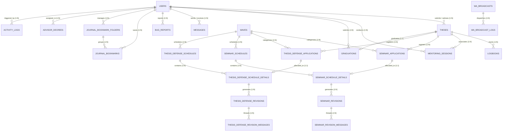

# DOKUMEN RANCANGAN BASIS DATA (DATABASE DESIGN DOCUMENT)
## SISTEM INFORMASI BIMBINGAN TUGAS AKHIR & MANAJEMEN AKADEMIK (SIBIMA)
### FAKULTAS ILMU KOMPUTER — UNIVERSITAS SUBANG (FASILKOM UNSUB)

---

## 1. PENDAHULUAN & ARSITEKTUR BASIS DATA

### 1.1 Ringkasan Arsitektur Basis Data
Basis data **SIBIMA** dirancang menggunakan arsitektur *Relational Database Management System (RDBMS)* berbasis **MySQL / MariaDB Enterprise**. Struktur basis data telah dioptimalkan memenuhi prinsip **Bentuk Normal Ketiga (Third Normal Form / 3NF)** guna mengeliminasi redundansi data, menjaga integritas transaksional (*ACID Compliance*), serta mendukung performa tinggi pada kueri kompleks bimbingan, penjadwalan otomatis, dan pengarsipan akademik.

### 1.2 Standar & Konfigurasi Basis Data
| Parameter Konfigurasi | Spesifikasi Standar SIBIMA |
| :--- | :--- |
| **RDBMS Engine** | **InnoDB** (Mendukung transaksi ACID, row-level locking, dan foreign key constraints) |
| **Karakter Set (Charset)** | **`utf8mb4`** (Mendukung penuh 4-byte UTF-8, emoji, dan karakter khusus simbolis) |
| **Collation** | **`utf8mb4_unicode_ci`** (Pencocokan teks multibahasa akurat dan case-insensitive) |
| **Konvensi Penamaan Tabel** | Format *snake_case* jamak (*plural*), contoh: `theses`, `mentoring_sessions`, `activity_logs` |
| **Konvensi Primary Key** | Menggunakan kolom tunggal berpenamaan `id` bertipe `BIGINT UNSIGNED AUTO_INCREMENT` |
| **Konvensi Foreign Key** | Menggunakan pola `{singular_table_name}_id`, contoh: `user_id`, `thesis_id`, `wave_id` |
| **Pelacakan Waktu (*Timestamps*)** | Standar kolom `created_at` dan `updated_at` bertipe `TIMESTAMP` pada seluruh tabel operasional |

---

## 2. DIAGRAM RELASI ENTITAS (ENTITY-RELATIONSHIP DIAGRAM / ERD)

### 2.1 Diagram ERD Konseptual (Mermaid Visual)

### 2.2 Matriks Relasi Antar-Tabel Utama
| Tabel Asal (*Source*) | Kolom Foreign Key | Tabel Tujuan (*Target*) | Kolom Primary Key | Kardinalitas | Aturan Integritas (*Referential Action*) | Deskripsi Hubungan Bisnis |
| :--- | :--- | :--- | :--- | :---: | :--- | :--- |
| `theses` | `user_id` | `users` | `id` | N : 1 | `ON DELETE CASCADE` | Menghubungkan skripsi dengan mahasiswa penyusun. |
| `theses` | `pembimbing1_id` | `users` | `id` | N : 1 | `ON DELETE SET NULL` | Menugaskan dosen sebagai Pembimbing 1 (Utama). |
| `theses` | `pembimbing2_id` | `users` | `id` | N : 1 | `ON DELETE SET NULL` | Menugaskan dosen sebagai Pembimbing 2 (Pendamping). |
| `mentoring_sessions` | `dosen_id` | `users` | `id` | N : 1 | `ON DELETE CASCADE` | Dosen pembimbing yang membuka agenda bimbingan. |
| `logbooks` | `thesis_id` | `theses` | `id` | N : 1 | `ON DELETE CASCADE` | Catatan harian kemajuan pengerjaan tugas akhir. |
| `seminar_applications` | `thesis_id` | `theses` | `id` | N : 1 | `ON DELETE CASCADE` | Data tugas akhir yang didaftarkan ke Seminar Proposal. |
| `seminar_applications` | `wave_id` | `waves` | `id` | N : 1 | `ON DELETE RESTRICT` | Gelombang pendaftaran seminar proposal aktif. |
| `seminar_schedules` | `wave_id` | `waves` | `id` | N : 1 | `ON DELETE CASCADE` | Sesi jadwal seminar yang masuk pada gelombang tertentu. |
| `seminar_schedule_details` | `seminar_schedule_id` | `seminar_schedules` | `id` | N : 1 | `ON DELETE CASCADE` | Induk sesi pelaksanaan jadwal seminar proposal. |
| `seminar_schedule_details` | `seminar_application_id` | `seminar_applications` | `id` | 1 : 1 | `ON DELETE CASCADE` | Peserta mahasiswa yang dialokasikan pada sesi ujian. |
| `seminar_revisions` | `seminar_schedule_detail_id` | `seminar_schedule_details` | `id` | N : 1 | `ON DELETE CASCADE` | Catatan revisi yang diterbitkan pasca-seminar. |
| `seminar_revisions` | `examiner_id` | `users` | `id` | N : 1 | `ON DELETE CASCADE` | Dosen penguji yang memberikan kewajiban revisi. |
| `seminar_revision_messages` | `seminar_revision_id` | `seminar_revisions` | `id` | N : 1 | `ON DELETE CASCADE` | Thread komunikasi percakapan revisi seminar. |
| `thesis_defense_applications` | `thesis_id` | `theses` | `id` | N : 1 | `ON DELETE CASCADE` | Data tugas akhir yang didaftarkan ke Sidang Skripsi. |
| `thesis_defense_applications` | `wave_id` | `waves` | `id` | N : 1 | `ON DELETE RESTRICT` | Gelombang pendaftaran sidang skripsi aktif. |
| `thesis_defense_schedules` | `wave_id` | `waves` | `id` | N : 1 | `ON DELETE CASCADE` | Sesi jadwal sidang skripsi yang masuk pada gelombang tertentu. |
| `thesis_defense_schedule_details` | `thesis_defense_schedule_id` | `thesis_defense_schedules` | `id` | N : 1 | `ON DELETE CASCADE` | Induk sesi pelaksanaan sidang skripsi. |
| `thesis_defense_schedule_details` | `thesis_defense_application_id` | `thesis_defense_applications` | `id` | 1 : 1 | `ON DELETE CASCADE` | Mahasiswa yang dialokasikan ke dewan penguji sidang. |
| `thesis_defense_revisions` | `thesis_defense_schedule_detail_id` | `thesis_defense_schedule_details` | `id` | N : 1 | `ON DELETE CASCADE` | Catatan revisi yang diterbitkan dewan penguji sidang. |
| `thesis_defense_revisions` | `examiner_id` | `users` | `id` | N : 1 | `ON DELETE CASCADE` | Dosen penguji sidang yang memvalidasi perbaikan. |
| `thesis_defense_revision_messages` | `thesis_defense_revision_id` | `thesis_defense_revisions` | `id` | N : 1 | `ON DELETE CASCADE` | Thread konsultasi revisi sidang skripsi. |
| `graduations` | `user_id` | `users` | `id` | N : 1 | `ON DELETE CASCADE` | Mahasiswa calon wisudawan/yudisium. |
| `graduations` | `thesis_id` | `theses` | `id` | 1 : 1 | `ON DELETE CASCADE` | Tugas akhir yang diselesaikan dan bebas tanggungan. |
| `journal_bookmarks` | `user_id` | `users` | `id` | N : 1 | `ON DELETE CASCADE` | Pengguna pemilik koleksi referensi jurnal. |
| `journal_bookmarks` | `folder_id` | `journal_bookmark_folders` | `id` | N : 1 | `ON DELETE SET NULL` | Pengelompokan artikel jurnal ke dalam folder riset. |
| `wa_broadcast_logs` | `wa_broadcast_id` | `wa_broadcasts` | `id` | N : 1 | `ON DELETE CASCADE` | Riwayat transmisi pesan siaran ke masing-masing nomor. |
| `bug_reports` | `user_id` | `users` | `id` | N : 1 | `ON DELETE CASCADE` | Pelapor kendala bug atau pengusul fitur baru. |

---

## 3. SPESIFIKASI RINCI STRUKTUR TABEL BASIS DATA

Bagian ini memaparkan seluruh struktur fisik 35 tabel operasional SIBIMA. Pada setiap tabel disajikan secara eksplisit informasi **Nama Tabel**, **Primary Key**, **Foreign Key**, **Deskripsi Fungsi**, serta tabel struktur kolom lengkap.

### 3.1 Tabel Rekam Jejak Audit Sistem & Aktivitas Login (`activity_logs`)

> **Nama Tabel**: `activity_logs`  
> **Primary Key**: `id`  
> **Foreign Key**: `user_id` $\rightarrow$ merujuk ke `users.id`  
> **Deskripsi**: Mencatat seluruh rekam jejak mutasi data (create, update, delete) oleh pengguna via trait Auditable serta mencatat riwayat login (IP address, user agent, waktu, status login).

| No | Nama Kolom | Tipe Data | Nullable | Nilai Default | Kunci (*Key*) | Keterangan & Aturan Bisnis |
| :---: | :--- | :--- | :---: | :---: | :---: | :--- |
| 1 | `id` | `bigint(20) unsigned` | NOT NULL | *None* | PRI (auto_increment) | Identitas unik rekaman data (*surrogate primary key*). |
| 2 | `user_id` | `bigint(20) unsigned` | NULL | `NULL` | MUL | ID relasi ke tabel `users` (mahasiswa / pemilik data). |
| 3 | `activity` | `varchar(255)` | NOT NULL | *None* | - | Atribut data operasional activity. |
| 4 | `description` | `text` | NULL | `NULL` | - | Atribut data operasional description. |
| 5 | `module` | `varchar(255)` | NULL | `NULL` | - | Atribut data operasional module. |
| 6 | `subject_type` | `varchar(255)` | NULL | `NULL` | MUL | Atribut data operasional subject type. |
| 7 | `subject_id` | `bigint(20) unsigned` | NULL | `NULL` | - | Atribut data operasional subject id. |
| 8 | `properties` | `longtext` | NULL | `NULL` | - | Atribut data operasional properties. |
| 9 | `ip_address` | `varchar(45)` | NULL | `NULL` | - | Atribut data operasional ip address. |
| 10 | `user_agent` | `text` | NULL | `NULL` | - | Atribut data operasional user agent. |
| 11 | `created_at` | `timestamp` | NULL | `NULL` | - | Waktu rekaman pertama kali dibuat di sistem. |
| 12 | `updated_at` | `timestamp` | NULL | `NULL` | - | Waktu rekaman terakhir kali diperbarui. |

---

### 3.2 Tabel Surat Keputusan (SK) Dosen Pembimbing (`advisor_decrees`)

> **Nama Tabel**: `advisor_decrees`  
> **Primary Key**: `id`  
> **Foreign Key**: `created_by` $\rightarrow$ merujuk ke `users.id` `dosen_id` $\rightarrow$ merujuk ke `users.id` `signer_user_id` $\rightarrow$ merujuk ke `users.id` `wave_id` $\rightarrow$ merujuk ke `waves.id`  
> **Deskripsi**: Menyimpan data arsip penerbitan Surat Keputusan (SK) Dekan dan Surat Tugas Mandiri Dosen Pembimbing Skripsi, memuat nomor surat dinas, masa berlaku, stempel digital, dan token verifikasi publik.

| No | Nama Kolom | Tipe Data | Nullable | Nilai Default | Kunci (*Key*) | Keterangan & Aturan Bisnis |
| :---: | :--- | :--- | :---: | :---: | :---: | :--- |
| 1 | `id` | `bigint(20) unsigned` | NOT NULL | *None* | PRI (auto_increment) | Identitas unik rekaman data (*surrogate primary key*). |
| 2 | `decree_number` | `varchar(255)` | NOT NULL | *None* | MUL | Atribut data operasional decree number. |
| 3 | `title` | `varchar(255)` | NOT NULL | `'Penetapan Dosen Pembimbing Skripsi Mahasiswa'` | - | Atribut data operasional title. |
| 4 | `academic_year` | `varchar(255)` | NOT NULL | `'2025/2026'` | MUL | Atribut data operasional academic year. |
| 5 | `semester` | `varchar(255)` | NOT NULL | `'Ganjil'` | - | Atribut data operasional semester. |
| 6 | `target_type` | `varchar(255)` | NOT NULL | `'collective'` | - | Atribut data operasional target type. |
| 7 | `dosen_id` | `bigint(20) unsigned` | NULL | `NULL` | MUL | Atribut data operasional dosen id. |
| 8 | `wave_id` | `bigint(20) unsigned` | NULL | `NULL` | MUL | ID relasi ke tabel `waves` (gelombang pendaftaran). |
| 9 | `decree_date` | `date` | NOT NULL | *None* | - | Tanggal pelaksanaan atau batas waktu proses bisnis. |
| 10 | `signatory_title` | `varchar(255)` | NOT NULL | `'Dekan Fakultas Ilmu Komputer'` | - | Atribut data operasional signatory title. |
| 11 | `signatory_name` | `varchar(255)` | NOT NULL | *None* | - | Atribut data operasional signatory name. |
| 12 | `signatory_identifier` | `varchar(255)` | NULL | `NULL` | - | Atribut data operasional signatory identifier. |
| 13 | `include_stamp` | `tinyint(1)` | NOT NULL | `1` | - | Atribut data operasional include stamp. |
| 14 | `signer_user_id` | `bigint(20) unsigned` | NULL | `NULL` | MUL | Atribut data operasional signer user id. |
| 15 | `theses_data` | `longtext` | NOT NULL | *None* | - | Atribut data operasional theses data. |
| 16 | `total_students` | `int(10) unsigned` | NOT NULL | `0` | - | Atribut data operasional total students. |
| 17 | `verification_token` | `varchar(64)` | NOT NULL | *None* | UNI | Token acak kriptografis untuk validasi dokumen/keamanan publik. |
| 18 | `created_by` | `bigint(20) unsigned` | NOT NULL | *None* | MUL | Atribut data operasional created by. |
| 19 | `notes` | `text` | NULL | `NULL` | - | Catatan atau pesan deskriptif tambahan dari dosen/admin. |
| 20 | `created_at` | `timestamp` | NULL | `NULL` | - | Waktu rekaman pertama kali dibuat di sistem. |
| 21 | `updated_at` | `timestamp` | NULL | `NULL` | - | Waktu rekaman terakhir kali diperbarui. |

---

### 3.3 Tabel Pengumuman Akademik (`announcements`)

> **Nama Tabel**: `announcements`  
> **Primary Key**: `id`  
> **Foreign Key**: `user_id` $\rightarrow$ merujuk ke `users.id`  
> **Deskripsi**: Menyimpan siaran berita dan pengumuman resmi fakultas yang dipublikasikan oleh Admin/Kaprodi pada halaman utama dashboard pengguna.

| No | Nama Kolom | Tipe Data | Nullable | Nilai Default | Kunci (*Key*) | Keterangan & Aturan Bisnis |
| :---: | :--- | :--- | :---: | :---: | :---: | :--- |
| 1 | `id` | `bigint(20) unsigned` | NOT NULL | *None* | PRI (auto_increment) | Identitas unik rekaman data (*surrogate primary key*). |
| 2 | `title` | `varchar(255)` | NOT NULL | *None* | - | Atribut data operasional title. |
| 3 | `content` | `text` | NOT NULL | *None* | - | Atribut data operasional content. |
| 4 | `type` | `enum('info','warning','important')` | NOT NULL | `'info'` | - | Atribut data operasional type. |
| 5 | `is_active` | `tinyint(1)` | NOT NULL | `1` | - | Penanda status keaktifan record (1 = Aktif, 0 = Non-aktif). |
| 6 | `user_id` | `bigint(20) unsigned` | NOT NULL | *None* | MUL | ID relasi ke tabel `users` (mahasiswa / pemilik data). |
| 7 | `created_at` | `timestamp` | NULL | `NULL` | - | Waktu rekaman pertama kali dibuat di sistem. |
| 8 | `updated_at` | `timestamp` | NULL | `NULL` | - | Waktu rekaman terakhir kali diperbarui. |

---

### 3.4 Tabel Laporan Kendala Sistem & Usulan Fitur Baru (`bug_reports`)

> **Nama Tabel**: `bug_reports`  
> **Primary Key**: `id`  
> **Foreign Key**: `resolved_by` $\rightarrow$ merujuk ke `users.id` `user_id` $\rightarrow$ merujuk ke `users.id`  
> **Deskripsi**: Menyimpan tiket laporan galat teknis (kode BUG-) serta usulan perbaikan/fitur baru (kode REQ-) yang diajukan oleh pengguna melalui widget mengambang di pojok layar.

| No | Nama Kolom | Tipe Data | Nullable | Nilai Default | Kunci (*Key*) | Keterangan & Aturan Bisnis |
| :---: | :--- | :--- | :---: | :---: | :---: | :--- |
| 1 | `id` | `bigint(20) unsigned` | NOT NULL | *None* | PRI (auto_increment) | Identitas unik rekaman data (*surrogate primary key*). |
| 2 | `ticket_number` | `varchar(32)` | NOT NULL | *None* | UNI | Atribut data operasional ticket number. |
| 3 | `user_id` | `bigint(20) unsigned` | NOT NULL | *None* | MUL | ID relasi ke tabel `users` (mahasiswa / pemilik data). |
| 4 | `title` | `varchar(255)` | NOT NULL | *None* | - | Atribut data operasional title. |
| 5 | `category` | `varchar(50)` | NOT NULL | `'functionality'` | - | Atribut data operasional category. |
| 6 | `severity` | `enum('low','medium','high','critical')` | NOT NULL | `'medium'` | MUL | Atribut data operasional severity. |
| 7 | `status` | `enum('open','in_progress','resolved','rejected')` | NOT NULL | `'open'` | MUL | Status alur kerja proses bisnis entitas terkait. |
| 8 | `page_url` | `varchar(500)` | NULL | `NULL` | - | Tautan alamat web / URL eksternal yang terhubung. |
| 9 | `description` | `text` | NOT NULL | *None* | - | Atribut data operasional description. |
| 10 | `steps_to_reproduce` | `text` | NULL | `NULL` | - | Atribut data operasional steps to reproduce. |
| 11 | `device_info` | `text` | NULL | `NULL` | - | Atribut data operasional device info. |
| 12 | `attachment_path` | `varchar(255)` | NULL | `NULL` | - | Path relatif lokasi penyimpanan berkas dokumen pada storage privat. |
| 13 | `admin_notes` | `text` | NULL | `NULL` | - | Catatan atau pesan deskriptif tambahan dari dosen/admin. |
| 14 | `resolved_by` | `bigint(20) unsigned` | NULL | `NULL` | MUL | Atribut data operasional resolved by. |
| 15 | `resolved_at` | `timestamp` | NULL | `NULL` | - | Atribut data operasional resolved at. |
| 16 | `created_at` | `timestamp` | NULL | `NULL` | MUL | Waktu rekaman pertama kali dibuat di sistem. |
| 17 | `updated_at` | `timestamp` | NULL | `NULL` | - | Waktu rekaman terakhir kali diperbarui. |

---

### 3.5 Tabel Pertanyaan Umum (FAQ) (`faqs`)

> **Nama Tabel**: `faqs`  
> **Primary Key**: `id`  
> **Foreign Key**: `created_by` $\rightarrow$ merujuk ke `users.id`  
> **Deskripsi**: Menyimpan daftar tanya-jawab umum seputar prosedur bimbingan, jadwal ujian, dan tata tertib tugas akhir di FASILKOM UNSUB.

| No | Nama Kolom | Tipe Data | Nullable | Nilai Default | Kunci (*Key*) | Keterangan & Aturan Bisnis |
| :---: | :--- | :--- | :---: | :---: | :---: | :--- |
| 1 | `id` | `bigint(20) unsigned` | NOT NULL | *None* | PRI (auto_increment) | Identitas unik rekaman data (*surrogate primary key*). |
| 2 | `question` | `varchar(255)` | NOT NULL | *None* | - | Atribut data operasional question. |
| 3 | `answer` | `text` | NOT NULL | *None* | - | Atribut data operasional answer. |
| 4 | `category` | `varchar(255)` | NOT NULL | `'umum'` | - | Atribut data operasional category. |
| 5 | `target_role` | `varchar(255)` | NOT NULL | `'all'` | - | Atribut data operasional target role. |
| 6 | `order` | `int(11)` | NOT NULL | `0` | - | Atribut data operasional order. |
| 7 | `is_active` | `tinyint(1)` | NOT NULL | `1` | - | Penanda status keaktifan record (1 = Aktif, 0 = Non-aktif). |
| 8 | `created_by` | `bigint(20) unsigned` | NULL | `NULL` | MUL | Atribut data operasional created by. |
| 9 | `created_at` | `timestamp` | NULL | `NULL` | - | Waktu rekaman pertama kali dibuat di sistem. |
| 10 | `updated_at` | `timestamp` | NULL | `NULL` | - | Waktu rekaman terakhir kali diperbarui. |

---

### 3.6 Tabel Indeks Jurnal Ilmiah FASILKOM (Infotronik) (`fasilkom_journals`)

> **Nama Tabel**: `fasilkom_journals`  
> **Primary Key**: `id`  
> **Foreign Key**: Tidak ada (*None*)  
> **Deskripsi**: Menyimpan artikel publikasi dari Open Journal Systems (OJS) internal Fakultas Ilmu Komputer UNSUB (Jurnal Infotronik) hasil sinkronisasi otomatis.

| No | Nama Kolom | Tipe Data | Nullable | Nilai Default | Kunci (*Key*) | Keterangan & Aturan Bisnis |
| :---: | :--- | :--- | :---: | :---: | :---: | :--- |
| 1 | `id` | `bigint(20) unsigned` | NOT NULL | *None* | PRI (auto_increment) | Identitas unik rekaman data (*surrogate primary key*). |
| 2 | `identifier` | `varchar(255)` | NOT NULL | *None* | UNI | Atribut data operasional identifier. |
| 3 | `article_id` | `bigint(20) unsigned` | NULL | `NULL` | MUL | Atribut data operasional article id. |
| 4 | `title` | `text` | NOT NULL | *None* | - | Atribut data operasional title. |
| 5 | `authors` | `longtext` | NULL | `NULL` | - | Atribut data operasional authors. |
| 6 | `authors_string` | `varchar(1000)` | NULL | `NULL` | - | Atribut data operasional authors string. |
| 7 | `abstract` | `longtext` | NULL | `NULL` | - | Atribut data operasional abstract. |
| 8 | `subjects` | `longtext` | NULL | `NULL` | - | Atribut data operasional subjects. |
| 9 | `publication_date` | `varchar(255)` | NULL | `NULL` | - | Tanggal pelaksanaan atau batas waktu proses bisnis. |
| 10 | `year` | `int(11)` | NULL | `NULL` | MUL | Atribut data operasional year. |
| 11 | `volume` | `varchar(255)` | NULL | `NULL` | - | Atribut data operasional volume. |
| 12 | `issue` | `varchar(255)` | NULL | `NULL` | - | Atribut data operasional issue. |
| 13 | `pages` | `varchar(255)` | NULL | `NULL` | - | Atribut data operasional pages. |
| 14 | `landing_page_url` | `varchar(255)` | NOT NULL | *None* | - | Tautan alamat web / URL eksternal yang terhubung. |
| 15 | `pdf_url` | `varchar(255)` | NULL | `NULL` | - | Tautan alamat web / URL eksternal yang terhubung. |
| 16 | `doi` | `varchar(255)` | NULL | `NULL` | - | Atribut data operasional doi. |
| 17 | `publisher` | `varchar(255)` | NULL | `NULL` | - | Atribut data operasional publisher. |
| 18 | `issn` | `varchar(255)` | NULL | `NULL` | - | Atribut data operasional issn. |
| 19 | `created_at` | `timestamp` | NULL | `NULL` | - | Waktu rekaman pertama kali dibuat di sistem. |
| 20 | `updated_at` | `timestamp` | NULL | `NULL` | - | Waktu rekaman terakhir kali diperbarui. |

---

### 3.7 Tabel Yudisium & Bebas Tanggungan Akademik (`graduations`)

> **Nama Tabel**: `graduations`  
> **Primary Key**: `id`  
> **Foreign Key**: `approved_by` $\rightarrow$ merujuk ke `users.id` `student_id` $\rightarrow$ merujuk ke `users.id` `thesis_id` $\rightarrow$ merujuk ke `theses.id`  
> **Deskripsi**: Mencatat pengajuan bebas tanggungan dan kelulusan yudisium mahasiswa. Menyimpan tautan Google Drive / berkas unggahan bukti fisik skripsi, program aplikasi, bebas perpustakaan, nomor SK Yudisium, IPK akhir, serta penerbitan SKL digital ber-QR Code.

| No | Nama Kolom | Tipe Data | Nullable | Nilai Default | Kunci (*Key*) | Keterangan & Aturan Bisnis |
| :---: | :--- | :--- | :---: | :---: | :---: | :--- |
| 1 | `id` | `bigint(20) unsigned` | NOT NULL | *None* | PRI (auto_increment) | Identitas unik rekaman data (*surrogate primary key*). |
| 2 | `thesis_id` | `bigint(20) unsigned` | NOT NULL | *None* | MUL | ID relasi ke tabel `theses` (tugas akhir / skripsi). |
| 3 | `student_id` | `bigint(20) unsigned` | NOT NULL | *None* | MUL | Atribut data operasional student id. |
| 4 | `status` | `enum('pending','approved','rejected')` | NOT NULL | `'pending'` | - | Status alur kerja proses bisnis entitas terkait. |
| 5 | `rejection_reason` | `text` | NULL | `NULL` | - | Atribut data operasional rejection reason. |
| 6 | `final_thesis_file` | `text` | NULL | `NULL` | - | Path relatif lokasi penyimpanan berkas dokumen pada storage privat. |
| 7 | `journal_article_file` | `text` | NULL | `NULL` | - | Path relatif lokasi penyimpanan berkas dokumen pada storage privat. |
| 8 | `publication_link` | `text` | NULL | `NULL` | - | Atribut data operasional publication link. |
| 9 | `plagiarism_file` | `text` | NULL | `NULL` | - | Path relatif lokasi penyimpanan berkas dokumen pada storage privat. |
| 10 | `student_notes` | `text` | NULL | `NULL` | - | Catatan atau pesan deskriptif tambahan dari dosen/admin. |
| 11 | `hardcover_collected` | `tinyint(1)` | NOT NULL | `0` | - | Atribut data operasional hardcover collected. |
| 12 | `hardcover_collected_at` | `timestamp` | NULL | `NULL` | - | Atribut data operasional hardcover collected at. |
| 13 | `library_clearance` | `tinyint(1)` | NOT NULL | `0` | - | Atribut data operasional library clearance. |
| 14 | `library_clearance_at` | `timestamp` | NULL | `NULL` | - | Atribut data operasional library clearance at. |
| 15 | `lab_clearance` | `tinyint(1)` | NOT NULL | `0` | - | Atribut data operasional lab clearance. |
| 16 | `lab_clearance_at` | `timestamp` | NULL | `NULL` | - | Atribut data operasional lab clearance at. |
| 17 | `cd_or_repository_collected` | `tinyint(1)` | NOT NULL | `0` | - | Atribut data operasional cd or repository collected. |
| 18 | `cd_or_repository_collected_at` | `timestamp` | NULL | `NULL` | - | Atribut data operasional cd or repository collected at. |
| 19 | `skl_number` | `varchar(255)` | NULL | `NULL` | - | Atribut data operasional skl number. |
| 20 | `graduation_date` | `date` | NULL | `NULL` | - | Tanggal pelaksanaan atau batas waktu proses bisnis. |
| 21 | `gpa` | `decimal(3,2)` | NULL | `NULL` | - | Atribut data operasional gpa. |
| 22 | `predicate` | `varchar(255)` | NULL | `NULL` | - | Atribut data operasional predicate. |
| 23 | `verification_token` | `varchar(64)` | NULL | `NULL` | UNI | Token acak kriptografis untuk validasi dokumen/keamanan publik. |
| 24 | `approved_by` | `bigint(20) unsigned` | NULL | `NULL` | MUL | Atribut data operasional approved by. |
| 25 | `approved_at` | `timestamp` | NULL | `NULL` | - | Atribut data operasional approved at. |
| 26 | `created_at` | `timestamp` | NULL | `NULL` | - | Waktu rekaman pertama kali dibuat di sistem. |
| 27 | `updated_at` | `timestamp` | NULL | `NULL` | - | Waktu rekaman terakhir kali diperbarui. |

---

### 3.8 Tabel Berkas Panduan & Pedoman Akademik (`guidance_documents`)

> **Nama Tabel**: `guidance_documents`  
> **Primary Key**: `id`  
> **Foreign Key**: `uploaded_by` $\rightarrow$ merujuk ke `users.id`  
> **Deskripsi**: Menyimpan berkas pedoman penulisan skripsi, buku panduan akademik, dan SOP fakultas yang dapat diunduh atau dipratinjau oleh civitas akademika.

| No | Nama Kolom | Tipe Data | Nullable | Nilai Default | Kunci (*Key*) | Keterangan & Aturan Bisnis |
| :---: | :--- | :--- | :---: | :---: | :---: | :--- |
| 1 | `id` | `bigint(20) unsigned` | NOT NULL | *None* | PRI (auto_increment) | Identitas unik rekaman data (*surrogate primary key*). |
| 2 | `title` | `varchar(255)` | NOT NULL | *None* | - | Atribut data operasional title. |
| 3 | `description` | `text` | NULL | `NULL` | - | Atribut data operasional description. |
| 4 | `category` | `varchar(255)` | NOT NULL | `'panduan_skripsi'` | - | Atribut data operasional category. |
| 5 | `file_path` | `varchar(255)` | NOT NULL | *None* | - | Path relatif lokasi penyimpanan berkas dokumen pada storage privat. |
| 6 | `original_name` | `varchar(255)` | NOT NULL | *None* | - | Atribut data operasional original name. |
| 7 | `file_size` | `bigint(20) unsigned` | NULL | `NULL` | - | Path relatif lokasi penyimpanan berkas dokumen pada storage privat. |
| 8 | `file_extension` | `varchar(10)` | NULL | `NULL` | - | Path relatif lokasi penyimpanan berkas dokumen pada storage privat. |
| 9 | `download_count` | `int(10) unsigned` | NOT NULL | `0` | - | Atribut data operasional download count. |
| 10 | `is_active` | `tinyint(1)` | NOT NULL | `1` | - | Penanda status keaktifan record (1 = Aktif, 0 = Non-aktif). |
| 11 | `uploaded_by` | `bigint(20) unsigned` | NULL | `NULL` | MUL | Atribut data operasional uploaded by. |
| 12 | `created_at` | `timestamp` | NULL | `NULL` | - | Waktu rekaman pertama kali dibuat di sistem. |
| 13 | `updated_at` | `timestamp` | NULL | `NULL` | - | Waktu rekaman terakhir kali diperbarui. |

---

### 3.9 Tabel Bookmark Artikel Jurnal & Sitasi (`journal_bookmarks`)

> **Nama Tabel**: `journal_bookmarks`  
> **Primary Key**: `id`  
> **Foreign Key**: `folder_id` $\rightarrow$ merujuk ke `journal_bookmark_folders.id` `user_id` $\rightarrow$ merujuk ke `users.id`  
> **Deskripsi**: Menyimpan artikel jurnal eksternal (GARUDA, DOAJ, Crossref, OpenAlex, Google Books) yang disimpan oleh pengguna ke folder riset, lengkap dengan catatan anotasi dan generator sitasi otomatis.

| No | Nama Kolom | Tipe Data | Nullable | Nilai Default | Kunci (*Key*) | Keterangan & Aturan Bisnis |
| :---: | :--- | :--- | :---: | :---: | :---: | :--- |
| 1 | `id` | `bigint(20) unsigned` | NOT NULL | *None* | PRI (auto_increment) | Identitas unik rekaman data (*surrogate primary key*). |
| 2 | `user_id` | `bigint(20) unsigned` | NOT NULL | *None* | MUL | ID relasi ke tabel `users` (mahasiswa / pemilik data). |
| 3 | `folder_id` | `bigint(20) unsigned` | NULL | `NULL` | MUL | Atribut data operasional folder id. |
| 4 | `journal_identifier` | `varchar(255)` | NOT NULL | *None* | - | Atribut data operasional journal identifier. |
| 5 | `title` | `text` | NOT NULL | *None* | - | Atribut data operasional title. |
| 6 | `authors` | `longtext` | NULL | `NULL` | - | Atribut data operasional authors. |
| 7 | `authors_string` | `text` | NULL | `NULL` | - | Atribut data operasional authors string. |
| 8 | `year` | `smallint(5) unsigned` | NULL | `NULL` | - | Atribut data operasional year. |
| 9 | `venue` | `varchar(255)` | NULL | `NULL` | - | Atribut data operasional venue. |
| 10 | `publisher` | `varchar(255)` | NULL | `NULL` | - | Atribut data operasional publisher. |
| 11 | `doi` | `varchar(255)` | NULL | `NULL` | - | Atribut data operasional doi. |
| 12 | `url` | `text` | NULL | `NULL` | - | Tautan alamat web / URL eksternal yang terhubung. |
| 13 | `pdf_url` | `text` | NULL | `NULL` | - | Tautan alamat web / URL eksternal yang terhubung. |
| 14 | `abstract` | `longtext` | NULL | `NULL` | - | Atribut data operasional abstract. |
| 15 | `source` | `varchar(50)` | NOT NULL | `'unknown'` | - | Atribut data operasional source. |
| 16 | `source_label` | `varchar(100)` | NULL | `NULL` | - | Atribut data operasional source label. |
| 17 | `citations` | `longtext` | NULL | `NULL` | - | Atribut data operasional citations. |
| 18 | `notes` | `text` | NULL | `NULL` | - | Catatan atau pesan deskriptif tambahan dari dosen/admin. |
| 19 | `created_at` | `timestamp` | NULL | `NULL` | - | Waktu rekaman pertama kali dibuat di sistem. |
| 20 | `updated_at` | `timestamp` | NULL | `NULL` | - | Waktu rekaman terakhir kali diperbarui. |

---

### 3.10 Tabel Folder Koleksi Referensi Ilmiah (`journal_bookmark_folders`)

> **Nama Tabel**: `journal_bookmark_folders`  
> **Primary Key**: `id`  
> **Foreign Key**: `user_id` $\rightarrow$ merujuk ke `users.id`  
> **Deskripsi**: Menyimpan folder klasifikasi referensi pribadi yang dibuat oleh dosen atau mahasiswa untuk mengelompokkan artikel jurnal ilmiah berdasarkan topik riset.

| No | Nama Kolom | Tipe Data | Nullable | Nilai Default | Kunci (*Key*) | Keterangan & Aturan Bisnis |
| :---: | :--- | :--- | :---: | :---: | :---: | :--- |
| 1 | `id` | `bigint(20) unsigned` | NOT NULL | *None* | PRI (auto_increment) | Identitas unik rekaman data (*surrogate primary key*). |
| 2 | `user_id` | `bigint(20) unsigned` | NOT NULL | *None* | MUL | ID relasi ke tabel `users` (mahasiswa / pemilik data). |
| 3 | `name` | `varchar(255)` | NOT NULL | *None* | - | Atribut data operasional name. |
| 4 | `color` | `varchar(255)` | NOT NULL | `'orange'` | - | Atribut data operasional color. |
| 5 | `description` | `text` | NULL | `NULL` | - | Atribut data operasional description. |
| 6 | `created_at` | `timestamp` | NULL | `NULL` | - | Waktu rekaman pertama kali dibuat di sistem. |
| 7 | `updated_at` | `timestamp` | NULL | `NULL` | - | Waktu rekaman terakhir kali diperbarui. |

---

### 3.11 Tabel Pengaturan Format Surat Dinas & Kop (`letter_settings`)

> **Nama Tabel**: `letter_settings`  
> **Primary Key**: `id`  
> **Foreign Key**: Tidak ada (*None*)  
> **Deskripsi**: Menyimpan konfigurasi pola penomoran surat otomatis, variabel kode prodi, penandatangan resmi fakultas (Dekan, Kaprodi, Kasubag TU), dan template kop surat dinas FASILKOM UNSUB.

| No | Nama Kolom | Tipe Data | Nullable | Nilai Default | Kunci (*Key*) | Keterangan & Aturan Bisnis |
| :---: | :--- | :--- | :---: | :---: | :---: | :--- |
| 1 | `id` | `bigint(20) unsigned` | NOT NULL | *None* | PRI (auto_increment) | Identitas unik rekaman data (*surrogate primary key*). |
| 2 | `type` | `varchar(255)` | NOT NULL | *None* | UNI | Atribut data operasional type. |
| 3 | `format` | `varchar(255)` | NOT NULL | *None* | - | Atribut data operasional format. |
| 4 | `last_number` | `int(11)` | NOT NULL | `0` | - | Atribut data operasional last number. |
| 5 | `title` | `varchar(255)` | NULL | `NULL` | - | Atribut data operasional title. |
| 6 | `created_at` | `timestamp` | NULL | `NULL` | - | Waktu rekaman pertama kali dibuat di sistem. |
| 7 | `updated_at` | `timestamp` | NULL | `NULL` | - | Waktu rekaman terakhir kali diperbarui. |

---

### 3.12 Tabel Catatan Harian Bimbingan (Logbook) (`logbooks`)

> **Nama Tabel**: `logbooks`  
> **Primary Key**: `id`  
> **Foreign Key**: `thesis_id` $\rightarrow$ merujuk ke `theses.id`  
> **Deskripsi**: Menyimpan rekaman aktivitas kemajuan harian mahasiswa dalam menyusun skripsi. Memuat tanggal bimbingan, bab yang dikerjakan, uraian konsultasi, status validasi dosen pembimbing, serta paraf digital persetujuan.

| No | Nama Kolom | Tipe Data | Nullable | Nilai Default | Kunci (*Key*) | Keterangan & Aturan Bisnis |
| :---: | :--- | :--- | :---: | :---: | :---: | :--- |
| 1 | `id` | `bigint(20) unsigned` | NOT NULL | *None* | PRI (auto_increment) | Identitas unik rekaman data (*surrogate primary key*). |
| 2 | `thesis_id` | `bigint(20) unsigned` | NOT NULL | *None* | MUL | ID relasi ke tabel `theses` (tugas akhir / skripsi). |
| 3 | `date` | `date` | NOT NULL | *None* | - | Tanggal pelaksanaan atau batas waktu proses bisnis. |
| 4 | `progress_notes` | `text` | NOT NULL | *None* | - | Catatan atau pesan deskriptif tambahan dari dosen/admin. |
| 5 | `lecturer_notes` | `text` | NULL | `NULL` | - | Catatan atau pesan deskriptif tambahan dari dosen/admin. |
| 6 | `is_approved` | `tinyint(1)` | NOT NULL | `0` | - | Atribut data operasional is approved. |
| 7 | `created_at` | `timestamp` | NULL | `NULL` | - | Waktu rekaman pertama kali dibuat di sistem. |
| 8 | `updated_at` | `timestamp` | NULL | `NULL` | - | Waktu rekaman terakhir kali diperbarui. |

---

### 3.13 Tabel Sesi Bimbingan Skripsi (`mentoring_sessions`)

> **Nama Tabel**: `mentoring_sessions`  
> **Primary Key**: `id`  
> **Foreign Key**: `dosen_id` $\rightarrow$ merujuk ke `users.id` `thesis_id` $\rightarrow$ merujuk ke `theses.id`  
> **Deskripsi**: Mencatat setiap agenda sesi bimbingan antara dosen pembimbing dan mahasiswa, baik bimbingan mandiri perorangan maupun kelompok. Menyimpan token/QR presensi real-time, waktu dan ruang bimbingan, catatan evaluasi dosen, serta tautan dokumen revisi.

| No | Nama Kolom | Tipe Data | Nullable | Nilai Default | Kunci (*Key*) | Keterangan & Aturan Bisnis |
| :---: | :--- | :--- | :---: | :---: | :---: | :--- |
| 1 | `id` | `bigint(20) unsigned` | NOT NULL | *None* | PRI (auto_increment) | Identitas unik rekaman data (*surrogate primary key*). |
| 2 | `thesis_id` | `bigint(20) unsigned` | NOT NULL | *None* | MUL | ID relasi ke tabel `theses` (tugas akhir / skripsi). |
| 3 | `dosen_id` | `bigint(20) unsigned` | NULL | `NULL` | MUL | Atribut data operasional dosen id. |
| 4 | `scheduled_at` | `datetime` | NOT NULL | *None* | - | Atribut data operasional scheduled at. |
| 5 | `topic` | `varchar(255)` | NOT NULL | *None* | - | Atribut data operasional topic. |
| 6 | `status` | `enum('pending','approved','rejected','completed')` | NOT NULL | `'pending'` | MUL | Status alur kerja proses bisnis entitas terkait. |
| 7 | `student_attendance_status` | `enum('pending','attending','permission')` | NOT NULL | `'pending'` | MUL | Atribut data operasional student attendance status. |
| 8 | `student_attendance_reason` | `text` | NULL | `NULL` | - | Atribut data operasional student attendance reason. |
| 9 | `student_confirmed_at` | `timestamp` | NULL | `NULL` | - | Atribut data operasional student confirmed at. |
| 10 | `is_absent` | `tinyint(1)` | NOT NULL | `0` | - | Atribut data operasional is absent. |
| 11 | `type` | `enum('offline','online')` | NOT NULL | `'offline'` | - | Atribut data operasional type. |
| 12 | `location` | `varchar(255)` | NULL | `NULL` | - | Atribut data operasional location. |
| 13 | `notes` | `text` | NULL | `NULL` | - | Catatan atau pesan deskriptif tambahan dari dosen/admin. |
| 14 | `feedback` | `text` | NULL | `NULL` | - | Atribut data operasional feedback. |
| 15 | `feedback_document_url` | `varchar(1000)` | NULL | `NULL` | - | Tautan alamat web / URL eksternal yang terhubung. |
| 16 | `document_path` | `varchar(255)` | NULL | `NULL` | - | Path relatif lokasi penyimpanan berkas dokumen pada storage privat. |
| 17 | `document_original_name` | `varchar(255)` | NULL | `NULL` | - | Atribut data operasional document original name. |
| 18 | `created_at` | `timestamp` | NULL | `NULL` | - | Waktu rekaman pertama kali dibuat di sistem. |
| 19 | `updated_at` | `timestamp` | NULL | `NULL` | - | Waktu rekaman terakhir kali diperbarui. |

---

### 3.14 Tabel Pesan Obrolan Internal (Chat) (`messages`)

> **Nama Tabel**: `messages`  
> **Primary Key**: `id`  
> **Foreign Key**: `receiver_id` $\rightarrow$ merujuk ke `users.id` `sender_id` $\rightarrow$ merujuk ke `users.id`  
> **Deskripsi**: Menyimpan pesan obrolan langsung antar-pengguna yang telah divalidasi oleh aturan hak akses (Mahasiswa hanya boleh chat dengan Dosen Pembimbing/Penguji dan Admin).

| No | Nama Kolom | Tipe Data | Nullable | Nilai Default | Kunci (*Key*) | Keterangan & Aturan Bisnis |
| :---: | :--- | :--- | :---: | :---: | :---: | :--- |
| 1 | `id` | `bigint(20) unsigned` | NOT NULL | *None* | PRI (auto_increment) | Identitas unik rekaman data (*surrogate primary key*). |
| 2 | `sender_id` | `bigint(20) unsigned` | NOT NULL | *None* | MUL | Atribut data operasional sender id. |
| 3 | `receiver_id` | `bigint(20) unsigned` | NOT NULL | *None* | MUL | Atribut data operasional receiver id. |
| 4 | `message` | `text` | NOT NULL | *None* | - | Atribut data operasional message. |
| 5 | `is_read` | `tinyint(1)` | NOT NULL | `0` | - | Atribut data operasional is read. |
| 6 | `created_at` | `timestamp` | NULL | `NULL` | - | Waktu rekaman pertama kali dibuat di sistem. |
| 7 | `updated_at` | `timestamp` | NULL | `NULL` | - | Waktu rekaman terakhir kali diperbarui. |

---

### 3.15 Tabel Notifikasi Pengguna (In-App) (`notifications`)

> **Nama Tabel**: `notifications`  
> **Primary Key**: `id`  
> **Foreign Key**: Tidak ada (*None*)  
> **Deskripsi**: Tabel standar Laravel untuk notifikasi in-app (polymorphic notification) yang merekam pemberitahuan status tugas akhir, jadwal ujian, dan pengingat revisi.

| No | Nama Kolom | Tipe Data | Nullable | Nilai Default | Kunci (*Key*) | Keterangan & Aturan Bisnis |
| :---: | :--- | :--- | :---: | :---: | :---: | :--- |
| 1 | `id` | `char(36)` | NOT NULL | *None* | PRI | Identitas unik rekaman data (*surrogate primary key*). |
| 2 | `type` | `varchar(255)` | NOT NULL | *None* | - | Atribut data operasional type. |
| 3 | `notifiable_type` | `varchar(255)` | NOT NULL | *None* | MUL | Atribut data operasional notifiable type. |
| 4 | `notifiable_id` | `bigint(20) unsigned` | NOT NULL | *None* | - | Atribut data operasional notifiable id. |
| 5 | `data` | `text` | NOT NULL | *None* | - | Atribut data operasional data. |
| 6 | `read_at` | `timestamp` | NULL | `NULL` | - | Atribut data operasional read at. |
| 7 | `created_at` | `timestamp` | NULL | `NULL` | - | Waktu rekaman pertama kali dibuat di sistem. |
| 8 | `updated_at` | `timestamp` | NULL | `NULL` | - | Waktu rekaman terakhir kali diperbarui. |

---

### 3.16 Tabel Pendaftaran Seminar Proposal (`seminar_applications`)

> **Nama Tabel**: `seminar_applications`  
> **Primary Key**: `id`  
> **Foreign Key**: `thesis_id` $\rightarrow$ merujuk ke `theses.id` `wave_id` $\rightarrow$ merujuk ke `waves.id`  
> **Deskripsi**: Mencatat permohonan mahasiswa untuk mengikuti ujian Seminar Proposal. Menyimpan berkas prasyarat (KRS, bukti pembayaran, draf proposal, sertifikat TOEFL), catatan review admin, dan status validasi kelayakan ujian.

| No | Nama Kolom | Tipe Data | Nullable | Nilai Default | Kunci (*Key*) | Keterangan & Aturan Bisnis |
| :---: | :--- | :--- | :---: | :---: | :---: | :--- |
| 1 | `id` | `bigint(20) unsigned` | NOT NULL | *None* | PRI (auto_increment) | Identitas unik rekaman data (*surrogate primary key*). |
| 2 | `thesis_id` | `bigint(20) unsigned` | NOT NULL | *None* | MUL | ID relasi ke tabel `theses` (tugas akhir / skripsi). |
| 3 | `file_acc_pembimbing` | `varchar(255)` | NOT NULL | *None* | - | Path relatif lokasi penyimpanan berkas dokumen pada storage privat. |
| 4 | `file_pembayaran` | `varchar(255)` | NOT NULL | *None* | - | Path relatif lokasi penyimpanan berkas dokumen pada storage privat. |
| 5 | `file_kartu_bimbingan` | `varchar(255)` | NOT NULL | *None* | - | Path relatif lokasi penyimpanan berkas dokumen pada storage privat. |
| 6 | `file_skripsi` | `varchar(255)` | NOT NULL | *None* | - | Path relatif lokasi penyimpanan berkas dokumen pada storage privat. |
| 7 | `file_formulir` | `varchar(255)` | NULL | `NULL` | - | Path relatif lokasi penyimpanan berkas dokumen pada storage privat. |
| 8 | `status` | `enum('pending','approved','rejected')` | NOT NULL | `'pending'` | - | Status alur kerja proses bisnis entitas terkait. |
| 9 | `admin_feedback` | `text` | NULL | `NULL` | - | Atribut data operasional admin feedback. |
| 10 | `created_at` | `timestamp` | NULL | `NULL` | - | Waktu rekaman pertama kali dibuat di sistem. |
| 11 | `updated_at` | `timestamp` | NULL | `NULL` | - | Waktu rekaman terakhir kali diperbarui. |
| 12 | `wave_id` | `bigint(20) unsigned` | NULL | `NULL` | MUL | ID relasi ke tabel `waves` (gelombang pendaftaran). |
| 13 | `file_reviews` | `longtext` | NULL | `NULL` | - | Path relatif lokasi penyimpanan berkas dokumen pada storage privat. |

---

### 3.17 Tabel Catatan Revisi Seminar Proposal (`seminar_revisions`)

> **Nama Tabel**: `seminar_revisions`  
> **Primary Key**: `id`  
> **Foreign Key**: `examiner_id` $\rightarrow$ merujuk ke `users.id` `seminar_schedule_detail_id` $\rightarrow$ merujuk ke `seminar_schedule_details.id`  
> **Deskripsi**: Menyimpan kewajiban revisi naskah proposal mahasiswa yang diberikan oleh masing-masing dosen penguji pasca-seminar, memuat uraian koreksi, batas waktu pengerjaan (deadline), nilai rubrik ujian, dan status persetujuan penguji.

| No | Nama Kolom | Tipe Data | Nullable | Nilai Default | Kunci (*Key*) | Keterangan & Aturan Bisnis |
| :---: | :--- | :--- | :---: | :---: | :---: | :--- |
| 1 | `id` | `bigint(20) unsigned` | NOT NULL | *None* | PRI (auto_increment) | Identitas unik rekaman data (*surrogate primary key*). |
| 2 | `seminar_schedule_detail_id` | `bigint(20) unsigned` | NOT NULL | *None* | MUL | Atribut data operasional seminar schedule detail id. |
| 3 | `examiner_id` | `bigint(20) unsigned` | NOT NULL | *None* | MUL | Atribut data operasional examiner id. |
| 4 | `revision_notes` | `text` | NULL | `NULL` | - | Catatan atau pesan deskriptif tambahan dari dosen/admin. |
| 5 | `revision_file` | `varchar(255)` | NULL | `NULL` | - | Path relatif lokasi penyimpanan berkas dokumen pada storage privat. |
| 6 | `student_notes` | `text` | NULL | `NULL` | - | Catatan atau pesan deskriptif tambahan dari dosen/admin. |
| 7 | `student_file` | `varchar(255)` | NULL | `NULL` | - | Path relatif lokasi penyimpanan berkas dokumen pada storage privat. |
| 8 | `resubmitted_at` | `timestamp` | NULL | `NULL` | - | Atribut data operasional resubmitted at. |
| 9 | `status` | `varchar(255)` | NOT NULL | `'pending'` | - | Status alur kerja proses bisnis entitas terkait. |
| 10 | `score_presentation` | `int(11)` | NULL | `NULL` | - | Atribut data operasional score presentation. |
| 11 | `score_explanation` | `int(11)` | NULL | `NULL` | - | Atribut data operasional score explanation. |
| 12 | `score_writing` | `int(11)` | NULL | `NULL` | - | Atribut data operasional score writing. |
| 13 | `created_at` | `timestamp` | NULL | `NULL` | - | Waktu rekaman pertama kali dibuat di sistem. |
| 14 | `updated_at` | `timestamp` | NULL | `NULL` | - | Waktu rekaman terakhir kali diperbarui. |

---

### 3.18 Tabel Pesan Thread Revisi Seminar (`seminar_revision_messages`)

> **Nama Tabel**: `seminar_revision_messages`  
> **Primary Key**: `id`  
> **Foreign Key**: `seminar_revision_id` $\rightarrow$ merujuk ke `seminar_revisions.id` `sender_id` $\rightarrow$ merujuk ke `users.id`  
> **Deskripsi**: Mencatat riwayat percakapan konsultasi dua arah antara mahasiswa dan dosen penguji selama masa perbaikan revisi seminar proposal beserta lampiran dokumen revisi.

| No | Nama Kolom | Tipe Data | Nullable | Nilai Default | Kunci (*Key*) | Keterangan & Aturan Bisnis |
| :---: | :--- | :--- | :---: | :---: | :---: | :--- |
| 1 | `id` | `bigint(20) unsigned` | NOT NULL | *None* | PRI (auto_increment) | Identitas unik rekaman data (*surrogate primary key*). |
| 2 | `seminar_revision_id` | `bigint(20) unsigned` | NOT NULL | *None* | MUL | Atribut data operasional seminar revision id. |
| 3 | `sender_id` | `bigint(20) unsigned` | NOT NULL | *None* | MUL | Atribut data operasional sender id. |
| 4 | `message` | `text` | NOT NULL | *None* | - | Atribut data operasional message. |
| 5 | `file_path` | `varchar(255)` | NULL | `NULL` | - | Path relatif lokasi penyimpanan berkas dokumen pada storage privat. |
| 6 | `read_at` | `timestamp` | NULL | `NULL` | - | Atribut data operasional read at. |
| 7 | `created_at` | `timestamp` | NULL | `NULL` | - | Waktu rekaman pertama kali dibuat di sistem. |
| 8 | `updated_at` | `timestamp` | NULL | `NULL` | - | Waktu rekaman terakhir kali diperbarui. |

---

### 3.19 Tabel Master Jadwal Seminar Proposal (`seminar_schedules`)

> **Nama Tabel**: `seminar_schedules`  
> **Primary Key**: `id`  
> **Foreign Key**: `chairman_id` $\rightarrow$ merujuk ke `users.id` `created_by` $\rightarrow$ merujuk ke `users.id` `moderator_id` $\rightarrow$ merujuk ke `users.id` `wave_id` $\rightarrow$ merujuk ke `waves.id`  
> **Deskripsi**: Menyimpan sesi pelaksanaan jadwal seminar proposal per gelombang, mencakup tanggal pelaksanaan, ruangan ujian, tautan konferensi daring (jika daring), serta pejabat penandatangan surat tugas.

| No | Nama Kolom | Tipe Data | Nullable | Nilai Default | Kunci (*Key*) | Keterangan & Aturan Bisnis |
| :---: | :--- | :--- | :---: | :---: | :---: | :--- |
| 1 | `id` | `bigint(20) unsigned` | NOT NULL | *None* | PRI (auto_increment) | Identitas unik rekaman data (*surrogate primary key*). |
| 2 | `title` | `varchar(255)` | NOT NULL | *None* | - | Atribut data operasional title. |
| 3 | `date` | `date` | NOT NULL | *None* | - | Tanggal pelaksanaan atau batas waktu proses bisnis. |
| 4 | `chairman_id` | `bigint(20) unsigned` | NULL | `NULL` | MUL | Atribut data operasional chairman id. |
| 5 | `moderator_id` | `bigint(20) unsigned` | NULL | `NULL` | MUL | Atribut data operasional moderator id. |
| 6 | `location` | `varchar(255)` | NULL | `NULL` | - | Atribut data operasional location. |
| 7 | `created_by` | `bigint(20) unsigned` | NOT NULL | *None* | MUL | Atribut data operasional created by. |
| 8 | `created_at` | `timestamp` | NULL | `NULL` | - | Waktu rekaman pertama kali dibuat di sistem. |
| 9 | `updated_at` | `timestamp` | NULL | `NULL` | - | Waktu rekaman terakhir kali diperbarui. |
| 10 | `wave_id` | `bigint(20) unsigned` | NULL | `NULL` | MUL | ID relasi ke tabel `waves` (gelombang pendaftaran). |
| 11 | `meeting_link` | `varchar(255)` | NULL | `NULL` | - | Atribut data operasional meeting link. |

---

### 3.20 Tabel Rincian Alokasi Peserta & Penguji Seminar (`seminar_schedule_details`)

> **Nama Tabel**: `seminar_schedule_details`  
> **Primary Key**: `id`  
> **Foreign Key**: `examiner1_id` $\rightarrow$ merujuk ke `users.id` `examiner2_id` $\rightarrow$ merujuk ke `users.id` `seminar_schedule_id` $\rightarrow$ merujuk ke `seminar_schedules.id` `thesis_id` $\rightarrow$ merujuk ke `theses.id`  
> **Deskripsi**: Menghubungkan jadwal seminar dengan mahasiswa peserta dan dewan penguji (Ketua Penguji, Penguji 1, Penguji 2, Penguji 3). Menyimpan jam ujian, token verifikasi dokumen, dan Berita Acara resmi.

| No | Nama Kolom | Tipe Data | Nullable | Nilai Default | Kunci (*Key*) | Keterangan & Aturan Bisnis |
| :---: | :--- | :--- | :---: | :---: | :---: | :--- |
| 1 | `id` | `bigint(20) unsigned` | NOT NULL | *None* | PRI (auto_increment) | Identitas unik rekaman data (*surrogate primary key*). |
| 2 | `verification_token` | `varchar(255)` | NULL | `NULL` | UNI | Token acak kriptografis untuk validasi dokumen/keamanan publik. |
| 3 | `seminar_schedule_id` | `bigint(20) unsigned` | NOT NULL | *None* | MUL | Atribut data operasional seminar schedule id. |
| 4 | `thesis_id` | `bigint(20) unsigned` | NULL | `NULL` | MUL | ID relasi ke tabel `theses` (tugas akhir / skripsi). |
| 5 | `activity_name` | `varchar(255)` | NULL | `NULL` | - | Atribut data operasional activity name. |
| 6 | `start_time` | `time` | NOT NULL | *None* | - | Atribut data operasional start time. |
| 7 | `end_time` | `time` | NOT NULL | *None* | - | Atribut data operasional end time. |
| 8 | `examiner1_id` | `bigint(20) unsigned` | NULL | `NULL` | MUL | Atribut data operasional examiner1 id. |
| 9 | `examiner2_id` | `bigint(20) unsigned` | NULL | `NULL` | MUL | Atribut data operasional examiner2 id. |
| 10 | `order` | `int(11)` | NOT NULL | `0` | - | Atribut data operasional order. |
| 11 | `created_at` | `timestamp` | NULL | `NULL` | - | Waktu rekaman pertama kali dibuat di sistem. |
| 12 | `updated_at` | `timestamp` | NULL | `NULL` | - | Waktu rekaman terakhir kali diperbarui. |

---

### 3.21 Tabel Template Dokumen Seminar Proposal (`seminar_templates`)

> **Nama Tabel**: `seminar_templates`  
> **Primary Key**: `id`  
> **Foreign Key**: Tidak ada (*None*)  
> **Deskripsi**: Menyimpan berkas template dokumen resmi terkait seminar proposal (seperti format cover, draf naskah, formulir persetujuan) yang dapat diunduh oleh mahasiswa.

| No | Nama Kolom | Tipe Data | Nullable | Nilai Default | Kunci (*Key*) | Keterangan & Aturan Bisnis |
| :---: | :--- | :--- | :---: | :---: | :---: | :--- |
| 1 | `id` | `bigint(20) unsigned` | NOT NULL | *None* | PRI (auto_increment) | Identitas unik rekaman data (*surrogate primary key*). |
| 2 | `title` | `varchar(255)` | NOT NULL | *None* | - | Atribut data operasional title. |
| 3 | `file_path` | `varchar(255)` | NOT NULL | *None* | - | Path relatif lokasi penyimpanan berkas dokumen pada storage privat. |
| 4 | `original_name` | `varchar(255)` | NOT NULL | *None* | - | Atribut data operasional original name. |
| 5 | `is_active` | `tinyint(1)` | NOT NULL | `1` | - | Penanda status keaktifan record (1 = Aktif, 0 = Non-aktif). |
| 6 | `created_at` | `timestamp` | NULL | `NULL` | - | Waktu rekaman pertama kali dibuat di sistem. |
| 7 | `updated_at` | `timestamp` | NULL | `NULL` | - | Waktu rekaman terakhir kali diperbarui. |

---

### 3.22 Tabel Konfigurasi Sistem Global (`settings`)

> **Nama Tabel**: `settings`  
> **Primary Key**: `id`  
> **Foreign Key**: Tidak ada (*None*)  
> **Deskripsi**: Menyimpan pasangan kunci-nilai (key-value) untuk pengaturan global aplikasi SIBIMA, seperti nama instansi, masa aktif bimbingan, batas minimal bimbingan untuk daftar ujian, kuota default dosen, dan konfigurasi API eksternal.

| No | Nama Kolom | Tipe Data | Nullable | Nilai Default | Kunci (*Key*) | Keterangan & Aturan Bisnis |
| :---: | :--- | :--- | :---: | :---: | :---: | :--- |
| 1 | `id` | `bigint(20) unsigned` | NOT NULL | *None* | PRI (auto_increment) | Identitas unik rekaman data (*surrogate primary key*). |
| 2 | `key` | `varchar(255)` | NOT NULL | *None* | UNI | Atribut data operasional key. |
| 3 | `value` | `text` | NULL | `NULL` | - | Atribut data operasional value. |
| 4 | `type` | `varchar(255)` | NOT NULL | `'string'` | - | Atribut data operasional type. |
| 5 | `created_at` | `timestamp` | NULL | `NULL` | - | Waktu rekaman pertama kali dibuat di sistem. |
| 6 | `updated_at` | `timestamp` | NULL | `NULL` | - | Waktu rekaman terakhir kali diperbarui. |

---

### 3.23 Tabel Tugas Akhir / Skripsi Mahasiswa (`theses`)

> **Nama Tabel**: `theses`  
> **Primary Key**: `id`  
> **Foreign Key**: `pembimbing1_id` $\rightarrow$ merujuk ke `users.id` `pembimbing2_id` $\rightarrow$ merujuk ke `users.id` `requested_pembimbing1_id` $\rightarrow$ merujuk ke `users.id` `requested_pembimbing2_id` $\rightarrow$ merujuk ke `users.id` `student_id` $\rightarrow$ merujuk ke `users.id`  
> **Deskripsi**: Entitas inti manajemen skripsi yang merekam seluruh siklus tugas akhir mahasiswa mulai dari judul pengajuan awal, judul final pasca-revisi, bidang kajian/topik, abstrak, penunjukan dosen pembimbing 1 dan 2, status persetujuan ujian (ACC Sempro & ACC Sidang), serta status kelulusan akhir.

| No | Nama Kolom | Tipe Data | Nullable | Nilai Default | Kunci (*Key*) | Keterangan & Aturan Bisnis |
| :---: | :--- | :--- | :---: | :---: | :---: | :--- |
| 1 | `id` | `bigint(20) unsigned` | NOT NULL | *None* | PRI (auto_increment) | Identitas unik rekaman data (*surrogate primary key*). |
| 2 | `student_id` | `bigint(20) unsigned` | NOT NULL | *None* | MUL | Atribut data operasional student id. |
| 3 | `pembimbing1_id` | `bigint(20) unsigned` | NULL | `NULL` | MUL | Atribut data operasional pembimbing1 id. |
| 4 | `pembimbing2_id` | `bigint(20) unsigned` | NULL | `NULL` | MUL | Atribut data operasional pembimbing2 id. |
| 5 | `requested_pembimbing1_id` | `bigint(20) unsigned` | NULL | `NULL` | MUL | Atribut data operasional requested pembimbing1 id. |
| 6 | `requested_pembimbing2_id` | `bigint(20) unsigned` | NULL | `NULL` | MUL | Atribut data operasional requested pembimbing2 id. |
| 7 | `title` | `varchar(255)` | NOT NULL | *None* | - | Atribut data operasional title. |
| 8 | `final_title` | `varchar(255)` | NULL | `NULL` | - | Atribut data operasional final title. |
| 9 | `abstract` | `text` | NULL | `NULL` | - | Atribut data operasional abstract. |
| 10 | `topic` | `varchar(255)` | NULL | `NULL` | - | Atribut data operasional topic. |
| 11 | `is_migrated` | `tinyint(1)` | NOT NULL | `0` | - | Atribut data operasional is migrated. |
| 12 | `status` | `enum('pending','active','completed','rejected')` | NOT NULL | `'pending'` | MUL | Status alur kerja proses bisnis entitas terkait. |
| 13 | `acc_up_p1` | `tinyint(1)` | NOT NULL | `0` | - | Atribut data operasional acc up p1. |
| 14 | `acc_up_p2` | `tinyint(1)` | NOT NULL | `0` | - | Atribut data operasional acc up p2. |
| 15 | `acc_sidang_p1` | `tinyint(1)` | NOT NULL | `0` | - | Atribut data operasional acc sidang p1. |
| 16 | `acc_sidang_p2` | `tinyint(1)` | NOT NULL | `0` | - | Atribut data operasional acc sidang p2. |
| 17 | `created_at` | `timestamp` | NULL | `NULL` | - | Waktu rekaman pertama kali dibuat di sistem. |
| 18 | `updated_at` | `timestamp` | NULL | `NULL` | - | Waktu rekaman terakhir kali diperbarui. |

---

### 3.24 Tabel Pendaftaran Sidang Skripsi (`thesis_defense_applications`)

> **Nama Tabel**: `thesis_defense_applications`  
> **Primary Key**: `id`  
> **Foreign Key**: `thesis_id` $\rightarrow$ merujuk ke `theses.id` `wave_id` $\rightarrow$ merujuk ke `waves.id`  
> **Deskripsi**: Mencatat permohonan mahasiswa untuk menempuh ujian akhir Sidang Skripsi. Menyimpan seluruh berkas persyaratan akademik lengkap (transkrip nilai, bebas tanggungan sempro, bukti bayar sidang, sertifikat kompetensi, draf skripsi lengkap) dan status verifikasi.

| No | Nama Kolom | Tipe Data | Nullable | Nilai Default | Kunci (*Key*) | Keterangan & Aturan Bisnis |
| :---: | :--- | :--- | :---: | :---: | :---: | :--- |
| 1 | `id` | `bigint(20) unsigned` | NOT NULL | *None* | PRI (auto_increment) | Identitas unik rekaman data (*surrogate primary key*). |
| 2 | `thesis_id` | `bigint(20) unsigned` | NOT NULL | *None* | MUL | ID relasi ke tabel `theses` (tugas akhir / skripsi). |
| 3 | `file_formulir` | `varchar(255)` | NOT NULL | *None* | - | Path relatif lokasi penyimpanan berkas dokumen pada storage privat. |
| 4 | `file_transkrip` | `varchar(255)` | NOT NULL | *None* | - | Path relatif lokasi penyimpanan berkas dokumen pada storage privat. |
| 5 | `file_acc_pembimbing` | `varchar(255)` | NOT NULL | *None* | - | Path relatif lokasi penyimpanan berkas dokumen pada storage privat. |
| 6 | `file_logbook` | `varchar(255)` | NOT NULL | *None* | - | Path relatif lokasi penyimpanan berkas dokumen pada storage privat. |
| 7 | `file_pembayaran` | `varchar(255)` | NOT NULL | *None* | - | Path relatif lokasi penyimpanan berkas dokumen pada storage privat. |
| 8 | `file_skripsi` | `varchar(255)` | NOT NULL | *None* | - | Path relatif lokasi penyimpanan berkas dokumen pada storage privat. |
| 9 | `file_ktm` | `varchar(255)` | NOT NULL | *None* | - | Path relatif lokasi penyimpanan berkas dokumen pada storage privat. |
| 10 | `file_pkkmb_univ` | `varchar(255)` | NOT NULL | *None* | - | Path relatif lokasi penyimpanan berkas dokumen pada storage privat. |
| 11 | `file_pkkmb_fak` | `varchar(255)` | NOT NULL | *None* | - | Path relatif lokasi penyimpanan berkas dokumen pada storage privat. |
| 12 | `file_makrab` | `varchar(255)` | NOT NULL | *None* | - | Path relatif lokasi penyimpanan berkas dokumen pada storage privat. |
| 13 | `file_cisco` | `varchar(255)` | NOT NULL | *None* | - | Path relatif lokasi penyimpanan berkas dokumen pada storage privat. |
| 14 | `file_workshop` | `varchar(255)` | NOT NULL | *None* | - | Path relatif lokasi penyimpanan berkas dokumen pada storage privat. |
| 15 | `file_organisasi` | `varchar(255)` | NOT NULL | *None* | - | Path relatif lokasi penyimpanan berkas dokumen pada storage privat. |
| 16 | `file_toefl` | `varchar(255)` | NOT NULL | *None* | - | Path relatif lokasi penyimpanan berkas dokumen pada storage privat. |
| 17 | `file_kewirausahaan` | `varchar(255)` | NOT NULL | *None* | - | Path relatif lokasi penyimpanan berkas dokumen pada storage privat. |
| 18 | `file_tahsin` | `varchar(255)` | NOT NULL | *None* | - | Path relatif lokasi penyimpanan berkas dokumen pada storage privat. |
| 19 | `file_komputer` | `varchar(255)` | NOT NULL | *None* | - | Path relatif lokasi penyimpanan berkas dokumen pada storage privat. |
| 20 | `file_perpus_pinjam` | `varchar(255)` | NOT NULL | *None* | - | Path relatif lokasi penyimpanan berkas dokumen pada storage privat. |
| 21 | `file_perpus_sumbang` | `varchar(255)` | NOT NULL | *None* | - | Path relatif lokasi penyimpanan berkas dokumen pada storage privat. |
| 22 | `file_ijazah` | `varchar(255)` | NOT NULL | *None* | - | Path relatif lokasi penyimpanan berkas dokumen pada storage privat. |
| 23 | `status` | `varchar(255)` | NOT NULL | `'pending'` | - | Status alur kerja proses bisnis entitas terkait. |
| 24 | `admin_feedback` | `text` | NULL | `NULL` | - | Atribut data operasional admin feedback. |
| 25 | `created_at` | `timestamp` | NULL | `NULL` | - | Waktu rekaman pertama kali dibuat di sistem. |
| 26 | `updated_at` | `timestamp` | NULL | `NULL` | - | Waktu rekaman terakhir kali diperbarui. |
| 27 | `wave_id` | `bigint(20) unsigned` | NULL | `NULL` | MUL | ID relasi ke tabel `waves` (gelombang pendaftaran). |
| 28 | `file_reviews` | `longtext` | NULL | `NULL` | - | Path relatif lokasi penyimpanan berkas dokumen pada storage privat. |

---

### 3.25 Tabel Catatan Revisi Sidang Skripsi (`thesis_defense_revisions`)

> **Nama Tabel**: `thesis_defense_revisions`  
> **Primary Key**: `id`  
> **Foreign Key**: `thesis_defense_schedule_detail_id` $\rightarrow$ merujuk ke `thesis_defense_schedule_details.id` `examiner_id` $\rightarrow$ merujuk ke `users.id`  
> **Deskripsi**: Menyimpan poin perbaikan naskah skripsi yang diwajibkan oleh dosen penguji sidang, batas akhir waktu revisi (14 hari), nilai rubrik akhir, dan status pengesahan revisi.

| No | Nama Kolom | Tipe Data | Nullable | Nilai Default | Kunci (*Key*) | Keterangan & Aturan Bisnis |
| :---: | :--- | :--- | :---: | :---: | :---: | :--- |
| 1 | `id` | `bigint(20) unsigned` | NOT NULL | *None* | PRI (auto_increment) | Identitas unik rekaman data (*surrogate primary key*). |
| 2 | `thesis_defense_schedule_detail_id` | `bigint(20) unsigned` | NOT NULL | *None* | MUL | Atribut data operasional thesis defense schedule detail id. |
| 3 | `examiner_id` | `bigint(20) unsigned` | NOT NULL | *None* | MUL | Atribut data operasional examiner id. |
| 4 | `revision_notes` | `text` | NULL | `NULL` | - | Catatan atau pesan deskriptif tambahan dari dosen/admin. |
| 5 | `revision_file` | `varchar(255)` | NULL | `NULL` | - | Path relatif lokasi penyimpanan berkas dokumen pada storage privat. |
| 6 | `student_notes` | `text` | NULL | `NULL` | - | Catatan atau pesan deskriptif tambahan dari dosen/admin. |
| 7 | `student_file` | `varchar(255)` | NULL | `NULL` | - | Path relatif lokasi penyimpanan berkas dokumen pada storage privat. |
| 8 | `resubmitted_at` | `timestamp` | NULL | `NULL` | - | Atribut data operasional resubmitted at. |
| 9 | `status` | `varchar(255)` | NOT NULL | `'pending'` | - | Status alur kerja proses bisnis entitas terkait. |
| 10 | `score_presentation` | `int(11)` | NULL | `NULL` | - | Atribut data operasional score presentation. |
| 11 | `score_explanation` | `int(11)` | NULL | `NULL` | - | Atribut data operasional score explanation. |
| 12 | `score_writing` | `int(11)` | NULL | `NULL` | - | Atribut data operasional score writing. |
| 13 | `created_at` | `timestamp` | NULL | `NULL` | - | Waktu rekaman pertama kali dibuat di sistem. |
| 14 | `updated_at` | `timestamp` | NULL | `NULL` | - | Waktu rekaman terakhir kali diperbarui. |

---

### 3.26 Tabel Pesan Thread Revisi Sidang Skripsi (`thesis_defense_revision_messages`)

> **Nama Tabel**: `thesis_defense_revision_messages`  
> **Primary Key**: `id`  
> **Foreign Key**: `thesis_defense_revision_id` $\rightarrow$ merujuk ke `thesis_defense_revisions.id` `sender_id` $\rightarrow$ merujuk ke `users.id`  
> **Deskripsi**: Mencatat komunikasi tanya jawab dua arah antara mahasiswa dan dewan penguji selama proses perbaikan naskah skripsi pasca-sidang.

| No | Nama Kolom | Tipe Data | Nullable | Nilai Default | Kunci (*Key*) | Keterangan & Aturan Bisnis |
| :---: | :--- | :--- | :---: | :---: | :---: | :--- |
| 1 | `id` | `bigint(20) unsigned` | NOT NULL | *None* | PRI (auto_increment) | Identitas unik rekaman data (*surrogate primary key*). |
| 2 | `thesis_defense_revision_id` | `bigint(20) unsigned` | NOT NULL | *None* | MUL | Atribut data operasional thesis defense revision id. |
| 3 | `sender_id` | `bigint(20) unsigned` | NOT NULL | *None* | MUL | Atribut data operasional sender id. |
| 4 | `message` | `text` | NOT NULL | *None* | - | Atribut data operasional message. |
| 5 | `file_path` | `varchar(255)` | NULL | `NULL` | - | Path relatif lokasi penyimpanan berkas dokumen pada storage privat. |
| 6 | `read_at` | `timestamp` | NULL | `NULL` | - | Atribut data operasional read at. |
| 7 | `created_at` | `timestamp` | NULL | `NULL` | - | Waktu rekaman pertama kali dibuat di sistem. |
| 8 | `updated_at` | `timestamp` | NULL | `NULL` | - | Waktu rekaman terakhir kali diperbarui. |

---

### 3.27 Tabel Master Jadwal Sidang Skripsi (`thesis_defense_schedules`)

> **Nama Tabel**: `thesis_defense_schedules`  
> **Primary Key**: `id`  
> **Foreign Key**: `chairman_id` $\rightarrow$ merujuk ke `users.id` `created_by` $\rightarrow$ merujuk ke `users.id` `moderator_id` $\rightarrow$ merujuk ke `users.id` `wave_id` $\rightarrow$ merujuk ke `waves.id`  
> **Deskripsi**: Menyimpan jadwal kolektif sidang skripsi per gelombang, ruang ujian, tanggal sidang, serta tautan telekonferensi.

| No | Nama Kolom | Tipe Data | Nullable | Nilai Default | Kunci (*Key*) | Keterangan & Aturan Bisnis |
| :---: | :--- | :--- | :---: | :---: | :---: | :--- |
| 1 | `id` | `bigint(20) unsigned` | NOT NULL | *None* | PRI (auto_increment) | Identitas unik rekaman data (*surrogate primary key*). |
| 2 | `title` | `varchar(255)` | NOT NULL | *None* | - | Atribut data operasional title. |
| 3 | `date` | `date` | NOT NULL | *None* | - | Tanggal pelaksanaan atau batas waktu proses bisnis. |
| 4 | `chairman_id` | `bigint(20) unsigned` | NULL | `NULL` | MUL | Atribut data operasional chairman id. |
| 5 | `moderator_id` | `bigint(20) unsigned` | NULL | `NULL` | MUL | Atribut data operasional moderator id. |
| 6 | `location` | `varchar(255)` | NULL | `NULL` | - | Atribut data operasional location. |
| 7 | `created_by` | `bigint(20) unsigned` | NOT NULL | *None* | MUL | Atribut data operasional created by. |
| 8 | `created_at` | `timestamp` | NULL | `NULL` | - | Waktu rekaman pertama kali dibuat di sistem. |
| 9 | `updated_at` | `timestamp` | NULL | `NULL` | - | Waktu rekaman terakhir kali diperbarui. |
| 10 | `wave_id` | `bigint(20) unsigned` | NULL | `NULL` | MUL | ID relasi ke tabel `waves` (gelombang pendaftaran). |
| 11 | `meeting_link` | `varchar(255)` | NULL | `NULL` | - | Atribut data operasional meeting link. |

---

### 3.28 Tabel Rincian Peserta & Dewan Penguji Sidang Skripsi (`thesis_defense_schedule_details`)

> **Nama Tabel**: `thesis_defense_schedule_details`  
> **Primary Key**: `id`  
> **Foreign Key**: `thesis_defense_schedule_id` $\rightarrow$ merujuk ke `thesis_defense_schedules.id` `examiner1_id` $\rightarrow$ merujuk ke `users.id` `examiner2_id` $\rightarrow$ merujuk ke `users.id` `thesis_id` $\rightarrow$ merujuk ke `theses.id`  
> **Deskripsi**: Mengalokasikan mahasiswa pendaftar ke slot waktu, ruang sidang, dan dewan penguji sidang skripsi (Ketua Penguji, Sekretaris, Penguji Utama). Menyimpan token verifikasi dokumen dan status kelulusan akhir.

| No | Nama Kolom | Tipe Data | Nullable | Nilai Default | Kunci (*Key*) | Keterangan & Aturan Bisnis |
| :---: | :--- | :--- | :---: | :---: | :---: | :--- |
| 1 | `id` | `bigint(20) unsigned` | NOT NULL | *None* | PRI (auto_increment) | Identitas unik rekaman data (*surrogate primary key*). |
| 2 | `verification_token` | `varchar(255)` | NULL | `NULL` | UNI | Token acak kriptografis untuk validasi dokumen/keamanan publik. |
| 3 | `thesis_defense_schedule_id` | `bigint(20) unsigned` | NOT NULL | *None* | MUL | Atribut data operasional thesis defense schedule id. |
| 4 | `thesis_id` | `bigint(20) unsigned` | NULL | `NULL` | MUL | ID relasi ke tabel `theses` (tugas akhir / skripsi). |
| 5 | `activity_name` | `varchar(255)` | NULL | `NULL` | - | Atribut data operasional activity name. |
| 6 | `start_time` | `time` | NOT NULL | *None* | - | Atribut data operasional start time. |
| 7 | `end_time` | `time` | NOT NULL | *None* | - | Atribut data operasional end time. |
| 8 | `examiner1_id` | `bigint(20) unsigned` | NULL | `NULL` | MUL | Atribut data operasional examiner1 id. |
| 9 | `examiner2_id` | `bigint(20) unsigned` | NULL | `NULL` | MUL | Atribut data operasional examiner2 id. |
| 10 | `order` | `int(11)` | NOT NULL | `0` | - | Atribut data operasional order. |
| 11 | `created_at` | `timestamp` | NULL | `NULL` | - | Waktu rekaman pertama kali dibuat di sistem. |
| 12 | `updated_at` | `timestamp` | NULL | `NULL` | - | Waktu rekaman terakhir kali diperbarui. |

---

### 3.29 Tabel Template Dokumen Sidang Skripsi (`thesis_defense_templates`)

> **Nama Tabel**: `thesis_defense_templates`  
> **Primary Key**: `id`  
> **Foreign Key**: Tidak ada (*None*)  
> **Deskripsi**: Menyimpan berkas template resmi pedoman dan format kelengkapan berkas sidang skripsi yang disediakan oleh fakultas.

| No | Nama Kolom | Tipe Data | Nullable | Nilai Default | Kunci (*Key*) | Keterangan & Aturan Bisnis |
| :---: | :--- | :--- | :---: | :---: | :---: | :--- |
| 1 | `id` | `bigint(20) unsigned` | NOT NULL | *None* | PRI (auto_increment) | Identitas unik rekaman data (*surrogate primary key*). |
| 2 | `title` | `varchar(255)` | NOT NULL | *None* | - | Atribut data operasional title. |
| 3 | `file_path` | `varchar(255)` | NOT NULL | *None* | - | Path relatif lokasi penyimpanan berkas dokumen pada storage privat. |
| 4 | `original_name` | `varchar(255)` | NOT NULL | *None* | - | Atribut data operasional original name. |
| 5 | `is_active` | `tinyint(1)` | NOT NULL | `1` | - | Penanda status keaktifan record (1 = Aktif, 0 = Non-aktif). |
| 6 | `created_at` | `timestamp` | NULL | `NULL` | - | Waktu rekaman pertama kali dibuat di sistem. |
| 7 | `updated_at` | `timestamp` | NULL | `NULL` | - | Waktu rekaman terakhir kali diperbarui. |

---

### 3.30 Tabel Repositori Skripsi Alumni FASILKOM (`thesis_repositories`)

> **Nama Tabel**: `thesis_repositories`  
> **Primary Key**: `id`  
> **Foreign Key**: Tidak ada (*None*)  
> **Deskripsi**: Katalog repositori digital karya ilmiah skripsi alumni Fakultas Ilmu Komputer Universitas Subang. Menyimpan metadata judul, abstrak, penulis, pembimbing, tahun angkatan, serta pemisahan berkas Bab 1 hingga Bab 6 untuk perlindungan hak cipta.

| No | Nama Kolom | Tipe Data | Nullable | Nilai Default | Kunci (*Key*) | Keterangan & Aturan Bisnis |
| :---: | :--- | :--- | :---: | :---: | :---: | :--- |
| 1 | `id` | `bigint(20) unsigned` | NOT NULL | *None* | PRI (auto_increment) | Identitas unik rekaman data (*surrogate primary key*). |
| 2 | `identifier` | `varchar(255)` | NULL | `NULL` | - | Atribut data operasional identifier. |
| 3 | `name` | `varchar(255)` | NOT NULL | *None* | - | Atribut data operasional name. |
| 4 | `year` | `int(11)` | NOT NULL | *None* | - | Atribut data operasional year. |
| 5 | `title` | `varchar(255)` | NOT NULL | *None* | - | Atribut data operasional title. |
| 6 | `abstract` | `text` | NULL | `NULL` | - | Atribut data operasional abstract. |
| 7 | `pembimbing1` | `varchar(255)` | NULL | `NULL` | - | Atribut data operasional pembimbing1. |
| 8 | `pembimbing2` | `varchar(255)` | NULL | `NULL` | - | Atribut data operasional pembimbing2. |
| 9 | `file_path` | `varchar(255)` | NULL | `NULL` | - | Path relatif lokasi penyimpanan berkas dokumen pada storage privat. |
| 10 | `file_path_bab2` | `varchar(255)` | NULL | `NULL` | - | Path relatif lokasi penyimpanan berkas dokumen pada storage privat. |
| 11 | `file_path_bab3` | `varchar(255)` | NULL | `NULL` | - | Path relatif lokasi penyimpanan berkas dokumen pada storage privat. |
| 12 | `file_path_bab4` | `varchar(255)` | NULL | `NULL` | - | Path relatif lokasi penyimpanan berkas dokumen pada storage privat. |
| 13 | `file_path_bab5` | `varchar(255)` | NULL | `NULL` | - | Path relatif lokasi penyimpanan berkas dokumen pada storage privat. |
| 14 | `file_path_bab6` | `varchar(1000)` | NULL | `NULL` | - | Path relatif lokasi penyimpanan berkas dokumen pada storage privat. |
| 15 | `created_at` | `timestamp` | NULL | `NULL` | - | Waktu rekaman pertama kali dibuat di sistem. |
| 16 | `updated_at` | `timestamp` | NULL | `NULL` | - | Waktu rekaman terakhir kali diperbarui. |

---

### 3.31 Tabel Pengguna & Kredensial Akun (`users`)

> **Nama Tabel**: `users`  
> **Primary Key**: `id`  
> **Foreign Key**: Tidak ada (*None*)  
> **Deskripsi**: Menyimpan seluruh entitas pengguna sistem SIBIMA lintas peran (Admin, Kaprodi, Dosen, dan Mahasiswa). Tabel ini menyimpan data identitas akademik (NPM/NIDN), kredensial login terenkripsi, status keaktifan, spesimen tanda tangan digital ber-token, kuota bimbingan dosen, serta preferensi bidang minat riset.

| No | Nama Kolom | Tipe Data | Nullable | Nilai Default | Kunci (*Key*) | Keterangan & Aturan Bisnis |
| :---: | :--- | :--- | :---: | :---: | :---: | :--- |
| 1 | `id` | `bigint(20) unsigned` | NOT NULL | *None* | PRI (auto_increment) | Identitas unik rekaman data (*surrogate primary key*). |
| 2 | `name` | `varchar(255)` | NOT NULL | *None* | - | Atribut data operasional name. |
| 3 | `email` | `varchar(255)` | NOT NULL | *None* | UNI | Atribut data operasional email. |
| 4 | `username` | `varchar(255)` | NULL | `NULL` | UNI | Atribut data operasional username. |
| 5 | `phone_number` | `varchar(255)` | NULL | `NULL` | - | Atribut data operasional phone number. |
| 6 | `signature` | `longtext` | NULL | `NULL` | - | Atribut data operasional signature. |
| 7 | `signature_token` | `varchar(255)` | NULL | `NULL` | - | Token acak kriptografis untuk validasi dokumen/keamanan publik. |
| 8 | `role` | `enum('admin','kaprodi','dosen','mahasiswa')` | NOT NULL | `'mahasiswa'` | - | Atribut data operasional role. |
| 9 | `is_active` | `tinyint(1)` | NOT NULL | `0` | - | Penanda status keaktifan record (1 = Aktif, 0 = Non-aktif). |
| 10 | `identifier` | `varchar(255)` | NULL | `NULL` | - | Atribut data operasional identifier. |
| 11 | `research_interests` | `text` | NULL | `NULL` | - | Atribut data operasional research interests. |
| 12 | `max_quota` | `int(11)` | NOT NULL | `8` | - | Atribut data operasional max quota. |
| 13 | `entry_year` | `int(11)` | NULL | `NULL` | - | Atribut data operasional entry year. |
| 14 | `birth_date` | `date` | NULL | `NULL` | MUL | Tanggal pelaksanaan atau batas waktu proses bisnis. |
| 15 | `last_birthday_wished_year` | `smallint(6)` | NULL | `NULL` | - | Atribut data operasional last birthday wished year. |
| 16 | `avatar` | `longtext` | NULL | `NULL` | - | Atribut data operasional avatar. |
| 17 | `email_verified_at` | `timestamp` | NULL | `NULL` | - | Atribut data operasional email verified at. |
| 18 | `password` | `varchar(255)` | NOT NULL | *None* | - | Atribut data operasional password. |
| 19 | `remember_token` | `varchar(100)` | NULL | `NULL` | - | Token acak kriptografis untuk validasi dokumen/keamanan publik. |
| 20 | `last_login_at` | `timestamp` | NULL | `NULL` | - | Atribut data operasional last login at. |
| 21 | `created_at` | `timestamp` | NULL | `NULL` | - | Waktu rekaman pertama kali dibuat di sistem. |
| 22 | `updated_at` | `timestamp` | NULL | `NULL` | - | Waktu rekaman terakhir kali diperbarui. |

---

### 3.32 Tabel Gelombang Pendaftaran Ujian (`waves`)

> **Nama Tabel**: `waves`  
> **Primary Key**: `id`  
> **Foreign Key**: Tidak ada (*None*)  
> **Deskripsi**: Mengatur periode pembukaan dan penutupan gelombang pendaftaran Seminar Proposal dan Sidang Skripsi oleh Ketua Program Studi (Kaprodi), termasuk kuota peserta dan rentang tanggal pelaksanaan ujian.

| No | Nama Kolom | Tipe Data | Nullable | Nilai Default | Kunci (*Key*) | Keterangan & Aturan Bisnis |
| :---: | :--- | :--- | :---: | :---: | :---: | :--- |
| 1 | `id` | `bigint(20) unsigned` | NOT NULL | *None* | PRI (auto_increment) | Identitas unik rekaman data (*surrogate primary key*). |
| 2 | `name` | `varchar(255)` | NOT NULL | *None* | - | Atribut data operasional name. |
| 3 | `is_active` | `tinyint(1)` | NOT NULL | `0` | - | Penanda status keaktifan record (1 = Aktif, 0 = Non-aktif). |
| 4 | `description` | `text` | NULL | `NULL` | - | Atribut data operasional description. |
| 5 | `created_at` | `timestamp` | NULL | `NULL` | - | Waktu rekaman pertama kali dibuat di sistem. |
| 6 | `updated_at` | `timestamp` | NULL | `NULL` | - | Waktu rekaman terakhir kali diperbarui. |
| 7 | `start_date` | `date` | NULL | `NULL` | - | Tanggal pelaksanaan atau batas waktu proses bisnis. |
| 8 | `end_date` | `date` | NULL | `NULL` | - | Tanggal pelaksanaan atau batas waktu proses bisnis. |

---

### 3.33 Tabel Siaran Pesan WhatsApp Massal (`wa_broadcasts`)

> **Nama Tabel**: `wa_broadcasts`  
> **Primary Key**: `id`  
> **Foreign Key**: `sender_id` $\rightarrow$ merujuk ke `users.id`  
> **Deskripsi**: Menyimpan kampanye siaran pesan WhatsApp massal yang disusun oleh Admin/Kaprodi berdasarkan filter kriteria target audiens tertentu.

| No | Nama Kolom | Tipe Data | Nullable | Nilai Default | Kunci (*Key*) | Keterangan & Aturan Bisnis |
| :---: | :--- | :--- | :---: | :---: | :---: | :--- |
| 1 | `id` | `bigint(20) unsigned` | NOT NULL | *None* | PRI (auto_increment) | Identitas unik rekaman data (*surrogate primary key*). |
| 2 | `sender_id` | `bigint(20) unsigned` | NOT NULL | *None* | MUL | Atribut data operasional sender id. |
| 3 | `title` | `varchar(255)` | NOT NULL | *None* | - | Atribut data operasional title. |
| 4 | `target_type` | `varchar(255)` | NOT NULL | *None* | - | Atribut data operasional target type. |
| 5 | `target_filter` | `longtext` | NULL | `NULL` | - | Atribut data operasional target filter. |
| 6 | `message_template` | `text` | NOT NULL | *None* | - | Atribut data operasional message template. |
| 7 | `delay_seconds` | `int(11)` | NOT NULL | `4` | - | Atribut data operasional delay seconds. |
| 8 | `total_recipients` | `int(11)` | NOT NULL | `0` | - | Atribut data operasional total recipients. |
| 9 | `successful_count` | `int(11)` | NOT NULL | `0` | - | Atribut data operasional successful count. |
| 10 | `failed_count` | `int(11)` | NOT NULL | `0` | - | Atribut data operasional failed count. |
| 11 | `status` | `varchar(255)` | NOT NULL | `'completed'` | - | Status alur kerja proses bisnis entitas terkait. |
| 12 | `sent_at` | `timestamp` | NULL | `NULL` | - | Atribut data operasional sent at. |
| 13 | `created_at` | `timestamp` | NULL | `NULL` | - | Waktu rekaman pertama kali dibuat di sistem. |
| 14 | `updated_at` | `timestamp` | NULL | `NULL` | - | Waktu rekaman terakhir kali diperbarui. |

---

### 3.34 Tabel Log Pengiriman Siaran WhatsApp (`wa_broadcast_logs`)

> **Nama Tabel**: `wa_broadcast_logs`  
> **Primary Key**: `id`  
> **Foreign Key**: `recipient_id` $\rightarrow$ merujuk ke `users.id` `wa_broadcast_id` $\rightarrow$ merujuk ke `wa_broadcasts.id`  
> **Deskripsi**: Mencatat status pengiriman rincian per nomor penerima pesan broadcast (status terkirim, gagal, atau ditangguhkan oleh circuit breaker).

| No | Nama Kolom | Tipe Data | Nullable | Nilai Default | Kunci (*Key*) | Keterangan & Aturan Bisnis |
| :---: | :--- | :--- | :---: | :---: | :---: | :--- |
| 1 | `id` | `bigint(20) unsigned` | NOT NULL | *None* | PRI (auto_increment) | Identitas unik rekaman data (*surrogate primary key*). |
| 2 | `wa_broadcast_id` | `bigint(20) unsigned` | NOT NULL | *None* | MUL | Atribut data operasional wa broadcast id. |
| 3 | `recipient_id` | `bigint(20) unsigned` | NULL | `NULL` | MUL | Atribut data operasional recipient id. |
| 4 | `recipient_name` | `varchar(255)` | NOT NULL | *None* | - | Atribut data operasional recipient name. |
| 5 | `recipient_identifier` | `varchar(255)` | NULL | `NULL` | - | Atribut data operasional recipient identifier. |
| 6 | `recipient_phone` | `varchar(255)` | NULL | `NULL` | - | Atribut data operasional recipient phone. |
| 7 | `message_content` | `text` | NOT NULL | *None* | - | Atribut data operasional message content. |
| 8 | `status` | `varchar(255)` | NOT NULL | `'pending'` | - | Status alur kerja proses bisnis entitas terkait. |
| 9 | `error_message` | `text` | NULL | `NULL` | - | Atribut data operasional error message. |
| 10 | `sent_at` | `timestamp` | NULL | `NULL` | - | Atribut data operasional sent at. |
| 11 | `created_at` | `timestamp` | NULL | `NULL` | - | Waktu rekaman pertama kali dibuat di sistem. |
| 12 | `updated_at` | `timestamp` | NULL | `NULL` | - | Waktu rekaman terakhir kali diperbarui. |

---

### 3.35 Tabel Template Notifikasi WhatsApp Gateway (`wa_templates`)

> **Nama Tabel**: `wa_templates`  
> **Primary Key**: `id`  
> **Foreign Key**: Tidak ada (*None*)  
> **Deskripsi**: Menyimpan template pesan WhatsApp dengan dukungan sintaks Spintax dinamis dan interpolasi variabel (nama mahasiswa, judul, tanggal, dosen) untuk berbagai event sistem.

| No | Nama Kolom | Tipe Data | Nullable | Nilai Default | Kunci (*Key*) | Keterangan & Aturan Bisnis |
| :---: | :--- | :--- | :---: | :---: | :---: | :--- |
| 1 | `id` | `bigint(20) unsigned` | NOT NULL | *None* | PRI (auto_increment) | Identitas unik rekaman data (*surrogate primary key*). |
| 2 | `code` | `varchar(255)` | NOT NULL | *None* | UNI | Atribut data operasional code. |
| 3 | `name` | `varchar(255)` | NOT NULL | *None* | - | Atribut data operasional name. |
| 4 | `category` | `varchar(255)` | NOT NULL | *None* | - | Atribut data operasional category. |
| 5 | `content` | `text` | NOT NULL | *None* | - | Atribut data operasional content. |
| 6 | `available_variables` | `longtext` | NULL | `NULL` | - | Atribut data operasional available variables. |
| 7 | `is_customized` | `tinyint(1)` | NOT NULL | `0` | - | Atribut data operasional is customized. |
| 8 | `is_active` | `tinyint(1)` | NOT NULL | `1` | - | Penanda status keaktifan record (1 = Aktif, 0 = Non-aktif). |
| 9 | `created_at` | `timestamp` | NULL | `NULL` | - | Waktu rekaman pertama kali dibuat di sistem. |
| 10 | `updated_at` | `timestamp` | NULL | `NULL` | - | Waktu rekaman terakhir kali diperbarui. |

---

## 4. PENGINDEKSAN BASIS DATA & OPTIMASI PERFORMA (*INDEXING & OPTIMIZATION*)

Untuk menjaga kinerja kueri tetap optimal pada saat beban puncak, SIBIMA menerapkan strategi pengindeksan komposit (*Composite Indexes*) dan indeks pencarian teks:

| Nama Tabel | Nama Indeks | Kolom yang Diindeks | Jenis Indeks | Manfaat Performa Kueri |
| :--- | :--- | :--- | :--- | :--- |
| `users` | `users_role_is_active_idx` | `(role, is_active)` | B-Tree Composite | Mempercepat penyaringan daftar dosen pembimbing dan mahasiswa aktif. |
| `users` | `users_identifier_unique` | `(identifier)` | Unique Index | Validasi instan keunikan NPM/NIDN saat proses registrasi dan login. |
| `theses` | `theses_status_user_idx` | `(status, user_id)` | B-Tree Composite | Optimasi dashboard mahasiswa dan pemantauan status skripsi oleh Kaprodi. |
| `theses` | `theses_pembimbing1_idx` | `(pembimbing1_id)` | Single Column | Akses cepat daftar mahasiswa bimbingan dosen pembimbing utama. |
| `theses` | `theses_pembimbing2_idx` | `(pembimbing2_id)` | Single Column | Akses cepat daftar mahasiswa bimbingan dosen pembimbing pendamping. |
| `mentoring_sessions` | `mentoring_dosen_date_idx` | `(dosen_id, date)` | B-Tree Composite | Pengecekan konflik bentrok jadwal bimbingan dan tampilan kalender. |
| `logbooks` | `logbooks_thesis_status_idx` | `(thesis_id, status)` | B-Tree Composite | Menghitung akumulasi bimbingan tervalidasi ($\ge 8$ sesi) untuk syarat ujian. |
| `seminar_schedule_details` | `sem_sched_det_lookup_idx` | `(seminar_schedule_id, seminar_application_id)` | B-Tree Composite | Pengambilan data Berita Acara dan alokasi dewan penguji seminar. |
| `thesis_defense_schedule_details` | `def_sched_det_lookup_idx` | `(thesis_defense_schedule_id, thesis_defense_application_id)` | B-Tree Composite | Pengambilan data Berita Acara dan alokasi dewan penguji sidang skripsi. |
| `activity_logs` | `activity_logs_created_at_idx` | `(created_at)` | B-Tree Single | Paginasi cepat log aktivitas sistem dan audit forensik keamanan. |
| `bug_reports` | `bug_reports_status_type_idx` | `(status, category)` | B-Tree Composite | Penyaringan cepat laporan bug dan usulan fitur baru pada panel admin. |

---

## 5. KEAMANAN, INTEGRITAS DATA & STRATEGI PENCADANGAN

### 5.1 Integritas Referensial & Transaksi ACID
1. **Foreign Key Constraints**: Seluruh relasi induk-anak dilindungi oleh *Foreign Key Constraints* pada engine InnoDB. Operasi penghapusan data induk yang bersifat esensial dicegah melalui aturan `ON DELETE RESTRICT` (misal gelombang yang telah memuat peserta), sementara relasi data privat anak dibersihkan secara bersih via `ON DELETE CASCADE` (misal berkas logbook skripsi).
2. **Database Transactions (`DB::transaction`)**: Seluruh proses multi-tabel (pendaftaran ujian, alokasi penguji otomatis, perubahan status sidang, restore cadangan) diwajibkan menggunakan transaksi basis data untuk menjamin tidak ada data yatim (*orphan records*) jika terjadi gangguan jaringan di tengah proses.

### 5.2 Strategi Pencadangan & Sanitasi SQL (*Database Backup & Restore*)
1. **Pencadangan Mandiri**: Sistem menyediakan modul pencadangan basis data yang mengekspor seluruh skema dan rekaman data ke dalam format SQL dump terkompresi.
2. **Sanitasi Kueri Pemulihan (*Query Barrier*)**: Modul `BackupService` menyaring setiap berkas SQL cadangan sebelum dipulihkan ke server produksi guna memblokir instruksi berbahaya (`INTO OUTFILE`, `LOAD_FILE`, `GRANT`, `DROP USER`) serta melindungi integritas akun administrator dari ancaman penguncian hak akses.

---

## 6. KESIMPULAN

Dokumen Rancangan Basis Data SIBIMA ini menyajikan rincian menyeluruh atas **35 tabel operasional**, **relasi entitas (ERD)**, **kardinalitas**, **spesifikasi kolom**, dan **strategi pengindeksan performa**. Struktur ini menjamin platform SIBIMA memiliki pondasi data yang kokoh, konsisten, aman, dan siap diskalakan untuk mendukung tata kelola tugas akhir di lingkungan Fakultas Ilmu Komputer Universitas Subang secara andal.
