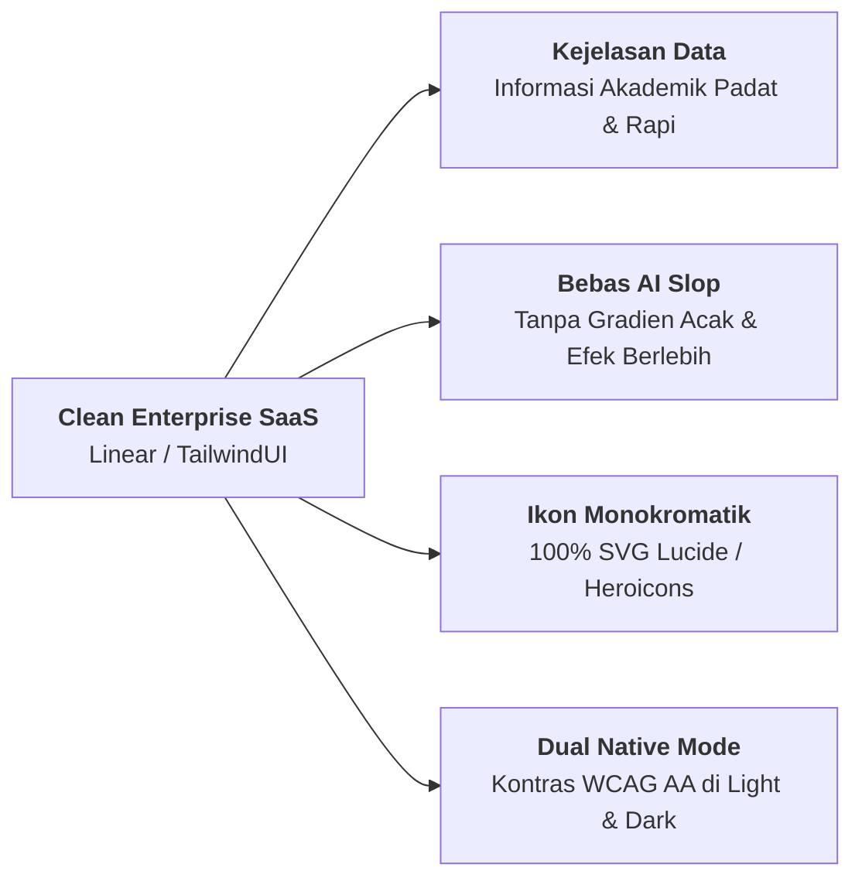
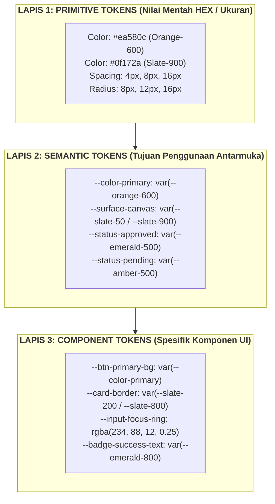
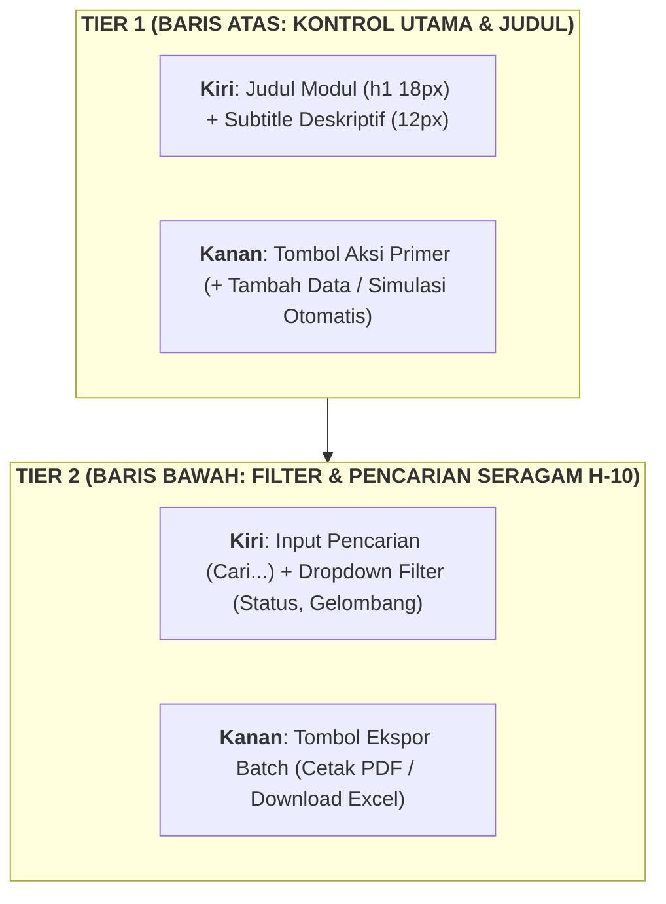
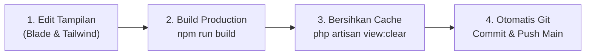

# PANDUAN SISTEM DESAIN UI/UX (DESIGN SYSTEM GUIDELINES)
## SISTEM INFORMASI BIMBINGAN TUGAS AKHIR (SIBIMA)
### FAKULTAS ILMU KOMPUTER — UNIVERSITAS SUBANG

| Informasi Dokumen | Spesifikasi Teknis & Standar Desain |
| :--- | :--- |
| **Nama Sistem** | SIBIMA (Sistem Informasi Bimbingan Tugas Akhir Mahasiswa) |
| **Institusi Pemilik** | Fakultas Ilmu Komputer, Universitas Subang (FASILKOM UNSUB) |
| **Filosofi Desain** | **Clean Enterprise SaaS** (Linear / TailwindUI Inspiration) |
| **Versi Design System** | v2.0 (Three-Layer Tokens, Dual Light/Dark Mode Native) |
| **Framework CSS** | Tailwind CSS v3.4+ dengan Ekstensi `@tailwindcss/forms` |
| **Framework Template** | Laravel Blade Engine & Alpine.js v3.x |
| **Koleksi Ikonografi** | 100% SVG Monokromatik (Heroicons / Lucide Icons) |
| **Standar Aksesibilitas** | **WCAG 2.1 Level AA** (Rasio Kontras Minimum 4.5:1) |
| **Klasifikasi Dokumen** | **Dokumen Standar Rekayasa Antarmuka (*UI/UX Design Specification*)** |
| **Tanggal Pembaruan** | 29 Oktober 2026 |

---

## 1. FILOSOFI & PRINSIP DESAIN SIBIMA

Sistem Informasi Bimbingan Tugas Akhir (SIBIMA) adalah platform akademik perguruan tinggi yang melayani berbagai pemangku kepentingan: Administrator, Ketua Program Studi (Kaprodi), Dosen Pembimbing & Penguji, serta Mahasiswa tingkat akhir. Oleh karena itu, antarmuka dirancang berorientasi pada **fungsionalitas tinggi, keterbacaan data akademik (*data clarity*), kerapian visual, dan efisiensi kerja pengguna**.



### 1.1 Empat Pilar Prinsip Desain
1. **Kejelasan di Atas Ornamen (*Clarity over Ornamentation*)**:
   - Setiap elemen visual harus memiliki tujuan fungsional. Antarmuka mengutamakan status alur bimbingan, verifikasi prasyarat, nilai rubrik, dan jadwal ujian tanpa distraksi visual yang tidak perlu.
2. **Larangan Tegas "AI Slop" (*Zero AI Slop Rule*)**:
   - Dilarang keras menggunakan gradien warna-warni acak (seperti ungu ke pink neon), bayangan berlebihan (*drop shadow* pekat), efek kartu kaca (*heavy glassmorphism*) yang mengorbankan keterbacaan, atau animasi yang memperlambat interaksi pengguna.
3. **Standarisasi Ikonografi SVG Monokrom**:
   - Seluruh ikon antarmuka wajib menggunakan format **SVG monokromatik (Heroicons atau Lucide)**. Dilarang menggunakan emoji Unicode sebagai ikon fungsional tombol, tabel, atau navigasi.
4. **Jaminan Kontras WCAG 2.1 AA & Dukungan Penuh Dark Mode**:
   - Seluruh pasangan warna teks dan latar belakang wajib memenuhi rasio kontras minimal **4.5:1** untuk teks normal dan **3.0:1** untuk teks tebal/besar pada kedua mode (Light Mode maupun Dark Mode).

---

## 2. ARSITEKTUR TOKEN DESAIN TIGA LAPIS (THREE-LAYER TOKEN ARCHITECTURE)

SIBIMA mengadopsi struktur token desain tiga lapis (*Primitive* $\rightarrow$ *Semantic* $\rightarrow$ *Component*) guna menjamin skalabilitas, konsistensi tema, dan kemudahan pemeliharaan kode:



### 2.1 Tabel Hierarki Token Desain

| Kategori Token | Lapis 1: Primitive Token | Lapis 2: Semantic Token | Lapis 3: Component Token | Kelas Tailwind SIBIMA |
| :--- | :--- | :--- | :--- | :--- |
| **Brand Action** | `#ea580c` (Orange-600) | `--color-primary` | `--btn-primary-bg` | `bg-orange-600 hover:bg-orange-700` |
| **Brand Action Focus** | `rgba(249, 115, 22, 0.25)` | `--ring-brand-focus` | `--input-focus-glow` | `focus:ring-4 focus:ring-orange-500/20` |
| **Kanvas Halaman (Light)** | `#f8fafc` (Slate-50) | `--surface-background` | `--app-layout-bg` | `bg-slate-50 text-slate-800` |
| **Kanvas Halaman (Dark)** | `#0f172a` (Slate-900) | `--surface-background-dark` | `--app-layout-bg-dark` | `dark:bg-slate-900 dark:text-slate-100` |
| **Permukaan Kartu (Light)**| `#ffffff` (White) | `--surface-card` | `--card-container-bg` | `bg-white border-slate-200` |
| **Permukaan Kartu (Dark)** | `#0f172a` (Slate-900) | `--surface-card-dark` | `--card-container-bg-dark`| `dark:bg-slate-900 dark:border-slate-800`|
| **Sub-Permukaan / Well** | `#f8fafc` / `#1e293b` | `--surface-subtle` | `--table-header-bg` | `bg-slate-50/60 dark:bg-slate-800/40` |
| **Status Sukses / ACC** | `#059669` (Emerald-600) | `--status-success` | `--badge-approved-border` | `bg-emerald-50 text-emerald-800 border-emerald-200` |
| **Status Menunggu / Revisi** | `#d97706` (Amber-600) | `--status-warning` | `--badge-pending-border` | `bg-amber-50 text-amber-800 border-amber-200` |
| **Status Informasi / Terkirim**| `#2563eb` (Blue-600) | `--status-info` | `--badge-info-border` | `bg-blue-50 text-blue-800 border-blue-200` |
| **Status Ditolak / Bahaya**| `#e11d48` (Rose-600) | `--status-danger` | `--badge-danger-border` | `bg-rose-50 text-rose-800 border-rose-200` |

---

## 3. PALET WARNA SEMANTIK SIBIMA & RASIO KONTRAS WCAG AA

Seluruh elemen visual wajib menggunakan token warna semantik yang konsisten guna menjamin kenyamanan mata civitas akademika selama penggunaan harian.

### 3.1 Palet Utama (Brand Primary — SIBIMA Orange)
Warna oranye merupakan identitas utama institusi FASILKOM UNSUB yang melambangkan inovasi, energi akademik, dan ketegasan aksi:

| Token Warna | Nilai HEX | Penggunaan Utama | Kontras terhadap Latar |
| :--- | :---: | :--- | :---: |
| `orange-50` | `#fff7ed` | Latar badge oranye terang, highlight baris terpilih | 16.5:1 (dengan teks orange-900) |
| `orange-100` | `#ffedd5` | Border aksen kartu oranye, pill chip | 14.1:1 |
| `orange-500` | `#f97316` | Border fokus input, indikator aktif tab | 3.2:1 (UI Component) |
| **`orange-600`** | **`#ea580c`** | **Tombol Aksi Utama (Primary Button), Ikon Sorotan** | **4.6:1 (Teks Putih — Lulus WCAG AA)** |
| `orange-700` | `#c2410c` | Hover state tombol aksi utama, sub-judul aksen | 6.8:1 (Teks Putih) |
| `orange-800` | `#9a3412` | Teks judul aksen pada latar terang | 8.9:1 |

### 3.2 Palet Netral & Permukaan (Neutral Slate Palette)
Menggunakan keluarga warna `Slate` yang memiliki rona biru dingin mikro (*cool blue undertone*) untuk kesan modern enterprise:

| Token Warna | Nilai HEX | Implementasi Light Mode | Implementasi Dark Mode |
| :--- | :---: | :--- | :--- |
| `slate-50` | `#f8fafc` | Latar belakang halaman (*page background*) | Teks kontras tertinggi (*headings*) |
| `slate-100` | `#f1f5f9` | Latar toolbar, hover baris tabel | Latar chip/badge sekunder |
| `slate-200` | `#e2e8f0` | Border kartu, garis batas tabel data | - |
| `slate-300` | `#cbd5e1` | Border input form keadaan default | - |
| `slate-400` | `#94a3b8` | Ikon sekunder, teks *placeholder* | Teks muted/sekunder pada dark mode |
| `slate-500` | `#64748b` | Teks sekunder, label atribut tabel | Ikon sekunder pada dark mode |
| `slate-600` | `#475569` | Teks body sekunder | Border kontrol pada dark mode |
| `slate-700` | `#334155` | Teks body reguler | Border kartu modal dark mode |
| `slate-800` | `#1e293b` | Header tabel data (`<th>`), teks judul | Permukaan well/sub-surface dark |
| `slate-900` | `#0f172a` | Teks judul utama (*h1/h2*) | Permukaan kartu (*card surface*) & canvas |

### 3.3 Status Semantik (Semantic Feedback Palette)
Digunakan secara konsisten untuk badge status pendaftaran, persetujuan bimbingan, kelulusan, dan format dokumen:

| Kategori Status | Contoh Kasus Bisnis | Kelas Tailwind (Light Mode) | Kelas Tailwind (Dark Mode) |
| :--- | :--- | :--- | :--- |
| **Approved / Selesai** | ACC Bimbingan, Lulus Sidang, Terverifikasi | `bg-emerald-50 text-emerald-800 border-emerald-200` | `dark:bg-emerald-950/40 dark:text-emerald-300 dark:border-emerald-800/60` |
| **Pending / Perhatian** | Menunggu Review, Revisi Ujian, Simulasi | `bg-amber-50 text-amber-800 border-amber-200` | `dark:bg-amber-950/40 dark:text-amber-300 dark:border-amber-800/60` |
| **Info / Terkirim** | Pesan Broadcast WA, Dokumen Word, Berita | `bg-blue-50 text-blue-800 border-blue-200` | `dark:bg-blue-950/40 dark:text-blue-300 dark:border-blue-800/60` |
| **Bahaya / Ditolak** | Berkas Ditolak, Dokumen PDF, Galat Sistem | `bg-rose-50 text-rose-800 border-rose-200` | `dark:bg-rose-950/40 dark:text-rose-300 dark:border-rose-800/60` |
| **Akademik / Yudisium** | SK Dekan, Penetapan Dosen Pembimbing | `bg-purple-50 text-purple-800 border-purple-200` | `dark:bg-purple-950/40 dark:text-purple-300 dark:border-purple-800/60` |

---

## 4. TIPOGRAFI, SKALA SPASI & SUDUT LENGKUNG

### 4.1 Keluarga Font (*Font Families*)
1. **Primary Interface Font**: `Plus Jakarta Sans` / `Figtree` (Sans-Serif)
   - Digunakan untuk seluruh elemen teks antarmuka, label form, judul modul, dan navigasi.
   - `font-family: 'Plus Jakarta Sans', system-ui, -apple-system, sans-serif;`
2. **Monospace / Code Font**: `JetBrains Mono` / `ui-monospace`
   - Digunakan khusus untuk Nomor Induk (NPM/NIDN), token tanda tangan QR, kode tiket bug (`BUG-xxxx`), format waktu, dan nilai tipe data basis data.
   - `font-family: 'JetBrains Mono', monospace;`

### 4.2 Skala Ukuran Teks (*Typography Scale*)

| Tingkat Tipografi | Ukuran (px / rem) | Berat (*Weight*) | Tinggi Baris (*Line Height*) | Penerapan Antarmuka |
| :--- | :---: | :---: | :---: | :--- |
| **Display / H1** | 24px / 1.50rem | 800 (ExtraBold) | 1.25 | Judul utama halaman dashboard & modul |
| **Heading 2 / H2** | 18px / 1.125rem | 700 (Bold) | 1.30 | Judul kartu data (*card header*), modal title |
| **Heading 3 / H3** | 15px / 0.9375rem | 700 (Bold) | 1.35 | Sub-bagian panel, judul seksi formulir |
| **Body Regular** | 13.5px / 0.84rem | 400 (Regular) | 1.60 | Paragraf penjelasan, uraian catatan revisi |
| **Body Medium** | 13.5px / 0.84rem | 500 (Medium) | 1.50 | Teks isi tabel data, opsi dropdown |
| **Caption / Small** | 11.5px / 0.72rem | 600 (SemiBold) | 1.40 | Label form, header tabel kolom (`<th>`), tanggal |
| **Micro Badge** | 10px / 0.625rem | 700 (Bold) | 1.20 | Badge status pil, tag peran pengguna, counter chip |

### 4.3 Skala Spasi (4px Grid Spacing Scale)
Seluruh margin, padding, dan layout container wajib menggunakan kelipatan grid **4px**:
- `p-1` (4px) | `p-2` (8px) | `p-3` (12px) | `p-4` (16px) | `p-5` (20px) | `p-6` (24px) | `p-8` (32px) | `p-10` (40px)

### 4.4 Sudut Lengkung (*Border Radius*)
- **`rounded-lg` (8px)**: Elemen internal kecil, baris tabel terpilih, thumbnail avatar mini.
- **`rounded-xl` (12px)**: Standar untuk seluruh **Tombol (Button)**, **Input Form**, **Dropdown Select**, dan **Badge Box**.
- **`rounded-2xl` (16px - 20px)**: Standar untuk **Container Kartu (Card)**, **Jendela Modal Dialog**, dan **Canvas Container**.
- **`rounded-full` (9999px)**: **Status Pill Badge**, **Avatar Lingkaran**, dan **Floating Action Button**.

---

## 5. SPESIFIKASI & KATALOG KOMPONEN INTI UI

### 5.1 Tombol (*Button System*)
Semua tombol memiliki tinggi seragam `h-10` (40px) pada toolbar atau `h-9` (36px) pada tabel:

```html
<!-- 1. Primary Action Button -->
<button class="inline-flex items-center gap-2 px-4 h-10 bg-orange-600 hover:bg-orange-700 active:bg-orange-800 text-white text-xs font-bold rounded-xl shadow-sm transition-all focus:outline-none focus:ring-4 focus:ring-orange-500/20">
    <svg class="w-4 h-4" fill="none" stroke="currentColor" viewBox="0 0 24 24"><path stroke-linecap="round" stroke-linejoin="round" stroke-width="2" d="M12 4v16m8-8H4"/></svg>
    <span>Tambah Jadwal Baru</span>
</button>

<!-- 2. Secondary Neutral Button -->
<button class="inline-flex items-center gap-2 px-4 h-10 bg-white hover:bg-slate-50 text-slate-700 dark:bg-slate-900 dark:hover:bg-slate-800 dark:text-slate-200 border border-slate-200 dark:border-slate-700 text-xs font-bold rounded-xl shadow-sm transition-all">
    <svg class="w-4 h-4 text-slate-500" fill="none" stroke="currentColor" viewBox="0 0 24 24"><path stroke-linecap="round" stroke-linejoin="round" stroke-width="2" d="M4 16v1a3 3 0 003 3h10a3 3 0 003-3v-1m-4-4l-4 4m0 0l-4-4m4 4V4"/></svg>
    <span>Cetak Berita Acara</span>
</button>
```

### 5.2 Kontrol Form (*Form Inputs & Dropdowns*)
- **Tinggi Seragam**: `h-10` (40px) dengan `box-sizing: border-box`.
- **Fokus Interaktif**: Wajib menampilkan cincin aksen oranye SIBIMA (`border-orange-500 focus:ring-4 focus:ring-orange-500/20`).

```html
<div class="space-y-1.5">
    <label class="block text-xs font-bold uppercase tracking-wider text-slate-600 dark:text-slate-400">
        Nama Lengkap Mahasiswa <span class="text-rose-500">*</span>
    </label>
    <input type="text" 
           class="w-full h-10 px-3.5 bg-white dark:bg-slate-900 border border-slate-300 dark:border-slate-700 rounded-xl text-slate-800 dark:text-slate-100 text-xs focus:border-orange-500 focus:ring-4 focus:ring-orange-500/20 outline-none transition-all" 
           placeholder="Masukkan nama lengkap dan gelar..." />
</div>
```

### 5.3 Pola Tata Letak Toolbar & Tabel (2-Tier Header Pattern)
Pola wajib untuk halaman manajemen berkas, jadwal seminar, sidang, dan repositori:



### 5.4 Kartu Data & Statistik (*Metric Stat Card*)
```html
<div class="p-5 bg-white dark:bg-slate-900 border border-slate-200 dark:border-slate-800 rounded-2xl shadow-sm hover:shadow-md transition-shadow">
    <div class="flex items-center justify-between">
        <span class="text-[11px] font-bold uppercase tracking-wider text-slate-500 dark:text-slate-400">Total Skripsi Aktif</span>
        <div class="p-2 bg-orange-50 dark:bg-orange-950/40 text-orange-600 rounded-xl">
            <svg class="w-5 h-5" fill="none" stroke="currentColor" viewBox="0 0 24 24"><path stroke-linecap="round" stroke-linejoin="round" stroke-width="2" d="M12 6.253v13m0-13C10.832 5.477 9.246 5 7.5 5S4.168 5.477 3 6.253v13C4.168 18.477 5.754 18 7.5 18s3.332.477 4.5 1.253m0-13C13.168 5.477 14.754 5 16.5 5c1.747 0 3.332.477 4.5 1.253v13C19.832 18.477 18.247 18 16.5 18c-1.746 0-3.332.477-4.5 1.253"/></svg>
        </div>
    </div>
    <div class="mt-3 flex items-baseline gap-2">
        <span class="text-2xl font-black text-slate-900 dark:text-slate-100">142</span>
        <span class="inline-flex items-center text-[10.5px] font-bold text-emerald-600 bg-emerald-50 dark:bg-emerald-950/40 px-1.5 py-0.5 rounded-md">+12% semester ini</span>
    </div>
</div>
```

---

## 6. STANDAR INTERAKSI, RESPONSIF & AKSESIBILITAS (WCAG 2.1 AA)

1. **Target Sentuh Minimum (*Touch Targets*)**:
   - Seluruh elemen yang dapat diklik memiliki area sentuh minimal **40px $\times$ 40px** untuk mencegah salah klik pada perangkat tablet dan seluler.
2. **Indikator Fokus Terlihat (*Visible Focus Rings*)**:
   - Seluruh elemen tombol, link, dan input wajib memiliki fokus visual yang jelas: `focus-visible:ring-4 focus-visible:ring-orange-500/20 focus-visible:outline-none`.
3. **Penyusunan DOM Semantik**:
   - Menggunakan tag HTML5 semantik (`<header>`, `<nav>`, `<main>`, `<section>`, `<article>`, `<footer>`) dengan atribut `aria-label` pada tombol yang hanya menampilkan ikon tanpa teks (*icon-only buttons*).
4. **Breakpoint Responsif**:
   - Mobile: `< 640px` (`sm`) $\rightarrow$ Layout satu kolom vertikal, menu navigasi lipat (*drawer*).
   - Tablet: `640px - 1024px` (`md/lg`) $\rightarrow$ Grid dua kolom, toolbar responsif fleksibel.
   - Desktop: `> 1024px` (`xl/2xl`) $\rightarrow$ Lebar maksimal container `max-w-7xl` (1280px).

---

## 7. PANDUAN PENERAPAN DEVELOPER (HANDOFF WORKFLOW)

Setiap pengembang (*developer* atau AI agent) yang melakukan penambahan fitur atau pengubahan antarmuka wajib mematuhi alur kerja berikut:



1. **Gunakan Token Resmi**: Jangan sekali-kali menuliskan warna HEX acak pada file Blade. Selalu gunakan utilitas warna semantik SIBIMA (`orange-600`, `slate-800`, `emerald-50`, dll).
2. **Kompilasi Aset Produksi**: Jalankan `npm run build` untuk memproses seluruh class Tailwind baru ke file bundle `public/build/`.
3. **Bersihkan Cache Template**: Eksekusi `php artisan view:clear` agar view hasil kompilasi Blade tidak menampilkan cache usang.
4. **Git Commit & Push Otomatis**: Lakukan `git add`, `git commit -m "feat/ui: ..."` dan `git push origin main` agar pembaruan antarmuka langsung tersinkronisasi ke server produksi.

---

## 8. KESIMPULAN

Dokumen Panduan Sistem Desain SIBIMA ini merupakan acuan tunggal (*Single Source of Truth*) bagi seluruh rancang bangun antarmuka pengguna pada sistem SIBIMA. Dengan mematuhi filosofi **Clean Enterprise SaaS**, arsitektur token tiga lapis, dan standar aksesibilitas WCAG 2.1 AA, platform SIBIMA dapat memberikan pengalaman akademik yang modern, terpercaya, dan bermartabat bagi seluruh civitas akademika Fakultas Ilmu Komputer Universitas Subang.